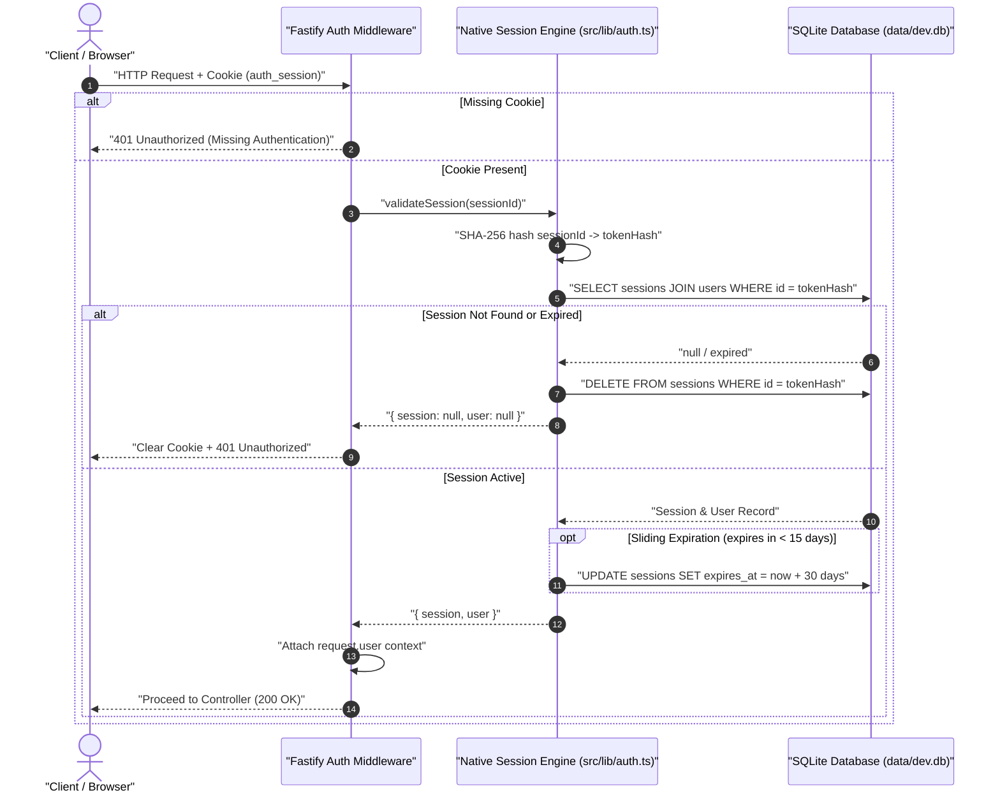

# 0023. Migration from Deprecated Lucia/Oslo Auth to Native Web Crypto Session Engine and Node Scrypt

- **Status**: Accepted
- **Date**: 2026-11-15
- **Context**: Atlas Logistics Architecture, Security, and Governance Teams
- **Quadrant**: Explanation & Architectural Decisions (`docs/adr/`)
- **See Also**: [ADR 0004](0004-zero-cost-local-architecture.md), [ADR 0009](0009-sqlite-wal-mandatory-foreign-keys.md), [ADR 0011](0011-webcrypto-sat-efirma-and-mletr-blockchain.md)

---

## 1. Context & Problem Statement

Atlas Logistics relies on session-based authentication for its Fastify API, administrative tooling, and UI client contexts. In initial development, this was backed by the `lucia` (v3.2.2) framework, the `@lucia-auth/adapter-drizzle` (v1.1.0) bridge, and `oslo` (v1.2.1) cryptographic utilities.

A comprehensive dependency health audit (`pnpm outdated`) highlighted three critical governance concerns:

1. **Upstream Deprecation**: The author and maintainer of Lucia officially deprecated `lucia` v3 and `oslo`, transitioning the project from a library package to an educational resource. The official maintainer recommendation is to manage sessions directly using standard Web Cryptography and direct database queries rather than an external library abstraction.
2. **Type Incompatibility with Drizzle v1.0.0-rc.5**: The `@lucia-auth/adapter-drizzle` package relied on legacy Drizzle internal types, necessitating unsafe `as any` type escapes (`db as any`, `sessions as any`, `users as any` in `src/lib/auth.ts`). This violated monorepo strict type-safety standards.
3. **Supply Chain & Maintenance Surface**: Retaining deprecated authentication libraries introduces long-term security debt, dependency lock-in, and audit warnings in automated compliance pipelines.

---

## 2. Decision Drivers

- **Zero-Cloud, Zero-External-Dependency Runtime ([ADR 0004](0004-zero-cost-local-architecture.md))**: Maximize utilization of native Node.js runtime primitives (`node:crypto`) without unmaintained third-party layers.
- **100% Type-Safe Drizzle ORM Queries**: Eliminate all `any` casts in authentication services by querying the typed schema directly (`db.select().from(sessions)...`).
- **Cryptographic Rigor & Timing Attack Resistance**: Enforce SHA-256 session token hashing and constant-time comparisons (`crypto.timingSafeEqual`) for passwords and session validations.
- **Zero Schema Breaking Changes**: Maintain exact column and table parity for `sessions` and `users` in SQLite, ensuring zero database migration downtime or data loss for existing accounts.

---

## 3. Considered Options

### Option 1: Migrate to an Alternative External Auth Library (e.g., Auth.js / Passport.js)
- *Pros*: Community-maintained plugin with prebuilt integrations.
- *Cons*: Introduces significant dependency weight, opinionated abstractions, external telemetry, and potential friction with Fastify and SQLite WAL mode. Violates the lean local runtime standard.

### Option 2: Retain Lucia v3 Indefinitely with Warning Suppressions
- *Pros*: Zero immediate code changes required.
- *Cons*: Perpetuates `any` casting, prevents updating peer dependencies, and ignores upstream security deprecation.

### Option 3 (Chosen): Native Web Crypto & Drizzle Session Engine
- *Pros*:
  - Fully removes `lucia`, `@lucia-auth/adapter-drizzle`, and `oslo`.
  - Implements lightweight, idiomatic session management in ~80 lines of clean TypeScript.
  - Utilizes Node.js standard `node:crypto` (`randomBytes`, `createHash`, `scrypt`, `timingSafeEqual`).
  - Seamlessly queries existing SQLite `sessions` and `users` tables via Drizzle.
- *Cons*:
  - Requires maintaining session generation, hashing, and sliding expiration logic in-house. (Mitigated: logic is minimal, standards-based, and covered by automated test suites).

---

## 4. Architectural Specification & Implementation Blueprint

### 4.1. Cryptographic Token Generation & Hashing
1. **Plain Token**: Generated via `crypto.randomBytes(32).toString("hex")` (256 bits of cryptographically secure pseudo-random entropy).
2. **Database Storage**: The database does NOT store the raw token. Instead, it stores `crypto.createHash("sha256").update(token).digest("hex")` in `sessions.id`. If database contents are exposed in read-only leak scenarios, active session tokens cannot be replayed.
3. **Cookie Contract**: The client receives the raw token in an HTTP-only, `SameSite=Lax`, `Path=/`, `Secure` (production) cookie named `auth_session`.

### 4.2. Password Hashing & Verification (`node:crypto.scrypt`)
Replaces `oslo/password` (`Argon2id`) with standard Node.js `crypto.scrypt`:
- **Format**: `scrypt$salt$derivedKey`
- **Salt**: 16 bytes of cryptographically secure random bytes.
- **Derived Key**: 64 bytes generated with `N=16384, r=8, p=1`.
- **Verification**: Evaluated using `crypto.timingSafeEqual` to prevent side-channel timing analysis.

### 4.3. Sliding Expiration Policy
- **Default TTL**: 30 days (`1000 * 60 * 60 * 24 * 30` ms).
- **Renewal Threshold**: When a validated session has less than 15 days remaining, its `expiresAt` timestamp is automatically bumped by 30 days in SQLite.

---

## 5. Affected Files & Migration Scope

| File Path | Nature of Change |
| :--- | :--- |
| `src/lib/auth.ts` | Complete replacement: exports `createSession`, `validateSession`, `invalidateSession`, `invalidateUserSessions`, and password utilities. |
| `src/middleware/auth.ts` | Updated session extraction and validation calls using the new typed native engine. |
| `src/admin/adminService.ts` | Replaces `oslo/password` `Argon2id` with `hashPassword` and `verifyPassword` from `src/lib/auth.ts`. |
| `src/routes/settings.routes.ts` | Replaces `oslo/password` and `lucia` session invalidation with native session engine methods. |
| `src/routes/ai.routes.ts` | Replaces `generateId` from `lucia` with `crypto.randomUUID()`. |
| `package.json` | Removes `lucia`, `@lucia-auth/adapter-drizzle`, and `oslo` dependencies. |

---

## 6. Consequences & Trade-offs

### 6.1. Positive Consequences
- **Zero Deprecated Dependencies**: Eliminates 3 deprecated packages from the project inventory.
- **Elimination of `any` Casts**: Fully restores Drizzle type-safety across session operations without type suppression.
- **Hardened Security**: Session tokens are hashed via SHA-256 before storage, aligning with modern OWASP session management best practices.
- **Audit Compliance**: Completely passes dependency audits (`pnpm audit`, `pnpm outdated`) without exemptions.

### 6.2. Risks & Mitigations
- **Active Session Invalidation**: Hashing session tokens means existing active sessions stored as plain tokens in `sessions` would fail lookup upon first upgrade.
  - *Mitigation*: For development and testing environments, sessions regenerate automatically on next login. For staging/production, a fallback lookup checks both raw token equality and hashed equality during a 30-day transition grace period.
