# 0024. GitHub Pages SPA Continuous Deployment and Pull Request Previews

- **Status**: Accepted
- **Date**: 2026-11-15
- **Context**: Atlas Logistics DevOps, Infrastructure, and Frontend Architecture Teams
- **Quadrant**: Explanation & Architectural Decisions (`docs/adr/`)
- **See Also**: [ADR 0004](0004-zero-cost-local-architecture.md), [ADR 0015](0015-production-release-v1.0.0-ci-cd-governance.md), [ADR 0020](0020-frontend-modular-decomposition-and-file-size-guardrails.md)

---

## 1. Context & Problem Statement

Atlas Logistics operates as an enterprise Single Page Application (SPA) with a Vite/React frontend and a Fastify backend. Production builds are hosted statically on GitHub Pages under the repository path (`https://xpallares1987-ai.github.io/Atlas-Logistics/`).

Previously, static deployment was handled by an unpinned, ad-hoc workflow (`jekyll-gh-pages.yml`). A comprehensive DevOps and pipeline audit identified several critical architectural and governance limitations:

1. **Misleading Nomenclature & Tooling Drift**: The legacy workflow was named after GitHub's default Jekyll template despite building an enterprise Vite/React SPA. It specified `pnpm@10` (diverging from the repository standard `pnpm@11.5.1`) and utilized unpinned `ubuntu-latest` runners.
2. **Ungated Deployment Concurrency**: The deployment job triggered on `push: branches: [main]` concurrently with the main CI/CD test suite (`ci.yml`). If unit tests, security audits, or type-checks failed, the broken build was nonetheless packaged and published to production.
3. **Absence of Ephemeral Pull Request Previews**: Contributors and reviewers had no mechanism to test UI features, responsive layouts, or Web Worker behavior in isolated cloud environments prior to merging PRs into `main`.
4. **Client-Side Deep Link Routing Failures (404s)**: Navigating directly or refreshing deep links (e.g. `/Atlas-Logistics/fueleu-maritime`) caused GitHub Pages to return standard 404 HTTP errors due to missing path-specific `index.html` files.
5. **Backend API URL Duplication**: Frontend components configuring `VITE_API_URL` risked path duplication (e.g., `https://domain.com/api/api/endpoint`) depending on whether environment variables included the `/api` prefix.

---

## 2. Decision Drivers

- **Zero-Cost Production Hosting ([ADR 0004](0004-zero-cost-local-architecture.md))**: Leverage native GitHub Pages infrastructure without external SaaS dependencies or hosting fees.
- **Strict Gating on CI/CD Success ([ADR 0015](0015-production-release-v1.0.0-ci-cd-governance.md))**: Production deployments must only execute after `CI/CD Pipeline` completes with exit code 0 across all lint, test, build, and security gates.
- **Isolated PR Previews**: Ephemeral preview deployments for every open pull request under dedicated subdirectories (`/pr-preview/pr-X/`), automatically updated on pushes and cleaned up on merge/close.
- **Seamless Deep-Link Client Routing**: Guarantee 100% route restoration on deep links across both production and PR preview subdirectories.
- **Defensive API URL Resolution**: Standardize all API queries and fetch calls to resolve base endpoints idempotently.

---

## 3. Considered Options

### Option 1: Migrate to Third-Party Static Cloud Hosting (e.g., Cloudflare Pages, Vercel, Netlify)
- *Pros*: Built-in PR preview environments out of the box.
- *Cons*: Introduces external platform dependencies, account management overhead, third-party vendor tokens, and violates the zero-external-cost architectural baseline.

### Option 2: Deploy Only Production from Artifacts without PR Previews
- *Pros*: Simplest configuration using `actions/upload-pages-artifact` alone.
- *Cons*: Reviewers cannot visually test PR changes before merging, leading to higher regression rates in frontend components.

### Option 3 (Chosen): Dual-Hosting Architecture on `gh-pages` Branch & Actions Artifacts
- *Pros*:
  - **Gated Production Deployment**: `.github/workflows/pages-deploy.yml` triggers via `workflow_run` exclusively after successful completion of `CI/CD Pipeline` on `main`.
  - **Coexistence via Directory Partitioning**: The root `/` of `gh-pages` hosts production, while `/pr-preview/pr-X/` hosts active PR previews. Deployments preserve existing subdirectories via `keep_files: true`.
  - **Automated Lifecycle Management**: `.github/workflows/pr-preview.yml` builds previews using `rossjrw/pr-preview-action@v1`, comments live URLs on PRs, and automatically purges preview directories upon PR closure.
  - **Client-Side SPA Routing Fallback**: `packages/frontend/public/404.html` dynamically detects the URL path segment depth and restores client-side history state before React Router mounts.
  - **Global API Normalization**: `resolveApiUrl()` in `useApiQuery.ts` and `main.tsx` guarantees transparent routing to remote or local backends.

---

## 4. Architectural Specification & Implementation Blueprint

```mermaid
flowchart TD
    subgraph "Main Branch Pipeline"
        PushMain["Push to main"] --> CI["CI/CD Pipeline (ci.yml)"]
        CI -- "Success (Exit 0)" --> TriggerPages["workflow_run Trigger"]
        TriggerPages --> DeployProd["pages-deploy.yml"]
        DeployProd --> BuildProd["Build Production SPA<br/>VITE_BASE_PATH='/Atlas-Logistics/'"]
        BuildProd --> PushGhPages["Deploy to gh-pages root<br/>(peaceiris/actions-gh-pages, keep_files: true)"]
        BuildProd --> UploadPagesArtifact["Upload Artifact & Deploy Pages<br/>(actions/deploy-pages@v4)"]
    end

    subgraph "Pull Request Pipeline"
        PR["PR opened / synchronized"] --> PRWorkflow["pr-preview.yml"]
        PRWorkflow --> BuildPR["Build PR Preview SPA<br/>VITE_BASE_PATH='/Atlas-Logistics/pr-preview/pr-X/'"]
        BuildPR --> DeployPRSubdir["Deploy to gh-pages (/pr-preview/pr-X/)<br/>(rossjrw/pr-preview-action@v1)"]
        DeployPRSubdir --> BotComment["Post/Update PR Comment with Live Link"]
        
        PRClose["PR closed / merged"] --> PRCloseWorkflow["pr-preview.yml (action: remove)"]
        PRCloseWorkflow --> PurgeSubdir["Purge /pr-preview/pr-X/ from gh-pages"]
    end

    subgraph "Client Routing & API Gateway"
        DeepLink["Browser visits /Atlas-Logistics/fueleu-maritime<br/>or /pr-preview/pr-42/..."] --> Fallback404["404.html Redirect Handler"]
        Fallback404 --> RestoreHistory["index.html History Restoration"]
        RestoreHistory --> ReactRouter["React Router (BrowserRouter basename)"]
        ReactRouter --> GlobalFetch["Global Fetch Interceptor (main.tsx)"]
        GlobalFetch --> ResolveAPI["resolveApiUrl() (Backend Gateway)"]
    end
```

---

## 5. Technical Specifications

### 5.1 Gated Production Workflow (`.github/workflows/pages-deploy.yml`)
- **Trigger**: `workflow_run` on `CI/CD Pipeline` completion on `main`, guarded by `if: ${{ github.event_name == 'workflow_dispatch' || github.event.workflow_run.conclusion == 'success' }}`.
- **Runner**: Pinned to `ubuntu-24.04`.
- **Package Manager**: `pnpm/action-setup@v4` enforcing repository package manager version.
- **Build Flags**: `VITE_BASE_PATH: "/Atlas-Logistics/"`, `VITE_API_URL: "${{ secrets.VITE_API_URL || 'https://atlas-backend-100198375762.europe-west1.run.app/api' }}"`.
- **Publishing**: Deploys to `gh-pages` branch with `keep_files: true` and publishes pages artifact.

### 5.2 PR Preview Workflow (`.github/workflows/pr-preview.yml`)
- **Trigger**: `pull_request` types `[opened, synchronize, reopened, closed]`.
- **Concurrency**: `group: pr-preview-${{ github.event.number }}`, `cancel-in-progress: true`.
- **Deployment**: `rossjrw/pr-preview-action@v1` targeting branch `gh-pages` and umbrella directory `pr-preview`.
- **Cleanup**: Automatically deletes preview directory upon PR closure.

### 5.3 Single Page Application 404 Routing Fallback (`packages/frontend/public/404.html`)
- Inspects `window.location.pathname`. If path contains `/pr-preview/pr-`, sets `pathSegmentsToKeep = 3`; otherwise defaults to `1` (`/Atlas-Logistics/`).
- Encodes path and query parameters into a query string (`/?/...`) and redirects to the appropriate sub-base.
- `packages/frontend/index.html` parses query parameter on load, decodes the original URI, and invokes `window.history.replaceState()` prior to React Router initialization.

---

## 6. Consequences & Verification

- **Security & Integrity**: Broken code on `main` will never reach production; deployment is strictly blocked unless CI passes 100%.
- **Reviewer Experience**: Every PR receives an isolated, interactive preview URL directly in the PR discussion.
- **Backward Compatibility**: Fully compatible with existing API endpoints and local development.
