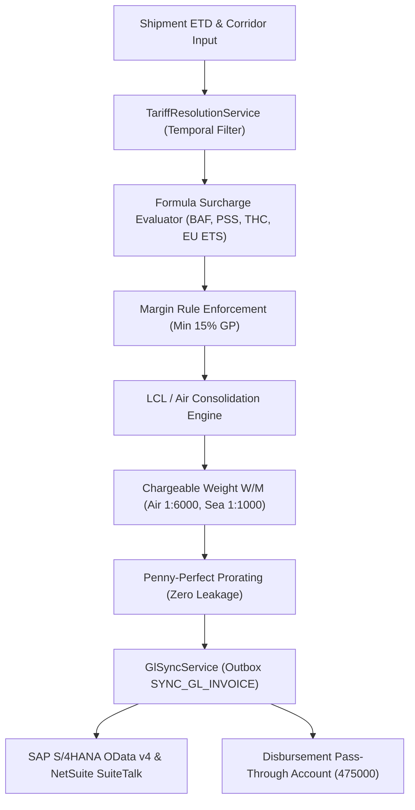

# ADR 0025: Commercial Pricing, Dynamic Tariff Engine, Consolidation Math, and General Ledger Synchronization

- **Status**: Accepted
- **Deciders**: Architecture Team, Financial Controlling, SCM Operations
- **Date**: 2026-11-18

## Context and Problem Statement

Freight forwarding operations require deterministic calculation of multimodal freight costs, dynamic formula-based carrier surcharges (e.g., BAF fuel price indexing, seasonal surges, EU ETS maritime carbon fees), strict profit margin validation, penny-perfect MBL-to-HBL cost prorating across LCL/Air consolidations without financial leakage, and immutable General Ledger (GL) synchronization with enterprise ERPs (SAP S/4HANA and Oracle NetSuite) while preventing customs disbursement taxes ("Suplidos") from inflating operational gross margin.

## Decision Drivers

- **Rate Temporality & Append-Only Rates**: Rates must be evaluated strictly against shipment estimated time of departure (ETD) without allowing retroactive rating or destructive record deletion.
- **Dynamic Surcharge Precedence**: Formula-based surcharges must evaluate deterministically: Base Freight (`FREIGHT`) -> Origin/Destination Port Local Charges (`ORIGIN_LOCAL`, `DESTINATION_LOCAL`) -> Customs & Compliance (`CUSTOMS`, `ADMIN`).
- **Penny-Perfect Cost Allocation**: Master consolidation costs must be distributed proportionally across House Bills of Lading (HBLs) with exact penny rounding ($\sum \text{allocated} \equiv \text{master cost}$), assigning fractional remainder cents to the largest HBL.
- **Disbursement Segregation & Asynchronous GL Sync**: Customs duties and import VAT must be classified into pass-through liability sub-accounts (`475000`) rather than operational freight revenue, and posted to enterprise ERPs asynchronously via the Transactional Outbox pattern (`scmOutboxMessages`).

## Decision Outcome

Adopted a tripartite architecture combining:

1. **Chargeable Weight (CW) W/M Engine (`@atlas/shared/logistics/consolidation-math`)**:
   - Compares gross weight against volumetric weight using industry divisors (Air: 166.667 kg/m³, Ocean LCL: 1,000 kg/m³, Road: 333.333 kg/m³).
   - Enforces zero-leakage cost prorating distributing remaining pennies to the largest HBL.
   - Computes dynamic consolidation Gross Margin and yield per CBM/KG.

2. **Commercial Tariff Engine (`@atlas/shared/logistics/tariff-engine` & `src/services/pricing/tariff-resolution.service.ts`)**:
   - Enforces temporal validity (`effectiveDate <= ETD && expirationDate >= ETD`).
   - Implements append-only rate retirement (`invalidateRateEarly` setting `validTo = now()`).
   - Evaluates formula-based surcharges (`BAF_FUEL_INDEX`, `PEAK_SEASON_SURGE`, `EU_ETS_MARITIME`).
   - Enforces corporate profit margin thresholds before quote finalization.

3. **Asynchronous GL Synchronization (`src/services/accounting/gl-sync.service.ts`)**:
   - Enqueues `accounting.SYNC_GL_INVOICE` tasks into `scmOutboxMessages`.
   - Generates SAP S/4HANA `ServiceEntrySheet` and NetSuite SuiteTalk REST payloads.
   - Segregates disbursements ("Suplidos" / customs duties) into balance sheet liability accounts, preserving true operational gross margin.

### Consequences

- **Good**: Zero rounding drift on consolidated transport, automated compliance with maritime ETS carbon accounting, audit-ready ERP integration, and elimination of margin distortion caused by pass-through customs taxes.
- **Bad**: Requires maintaining currency exchange rate feeds and updating bunker baseline indices periodically.
