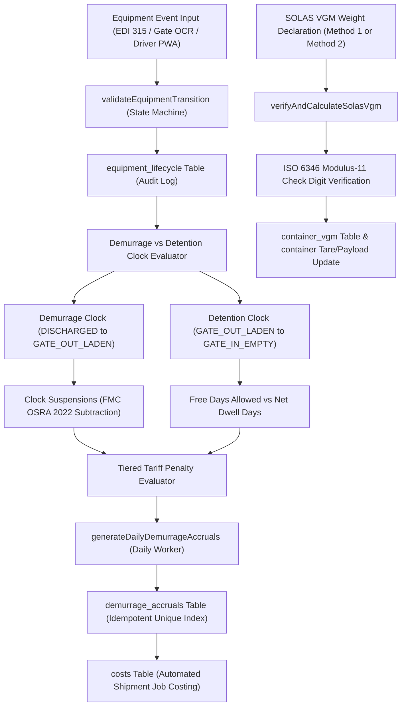

# ADR 0026: Equipment Control, Demurrage & Detention (D&D) Clock Engine, and SOLAS VGM Compliance

- **Status**: Accepted
- **Deciders**: Architecture Team, Equipment Control, Ocean Freight Operations, Legal & Regulatory Compliance
- **Date**: 2026-11-18

## Context and Problem Statement

International intermodal freight logistics requires rigorous tracking of physical equipment (shipping containers) whose lifecycle is decoupled from commercial shipment records. Terminal port dwell (Demurrage) and outside-terminal customer dwell (Detention) must be calculated separately with strict legal clock anchors, free time allowances, and regulatory clock suspensions under US FMC 46 CFR Part 541 / OSRA 2022 and European / Spanish port standards. Furthermore, automated daily penalty accruals must be injected into job costing tables idempotently to prevent duplicate financial exposure, and SOLAS Chapter VI Regulation 2 Verified Gross Mass (VGM) declarations must be certified under Method 1 or Method 2 with mandatory ISO 6346 check digit validation.

## Decision Drivers

- **Decoupled Equipment State Machine**: Container milestones (`GATE_OUT_EMPTY` -> `GATE_IN_LADEN` -> `DISCHARGED` -> `GATE_OUT_LADEN` -> `GATE_IN_EMPTY`) must progress through an independent physical state machine with strict transition validation, supporting both export dispatch and import discharge workflows.
- **Demurrage vs. Detention Clock Separation**: Demurrage clocks must anchor strictly between `DISCHARGED` and `GATE_OUT_LADEN` (inside terminal), while Detention clocks anchor between `GATE_OUT_LADEN` and `GATE_IN_EMPTY` (outside terminal in customer custody).
- **FMC OSRA 2022 Clock Suspensions**: Terminal gate closures, appointment unavailability, government customs holds (VACIS/physical exams), port strikes, or chassis shortages must subtract calendar dwell days from gross dwell time.
- **Automated Daily Accrual Idempotency**: Daily background workers evaluating overdue containers must record accruals keyed by `(containerNumber, chargeType, accrualDate)`, automatically posting cost lines into `costs` while guaranteeing that repeated executions on the same day never produce duplicate charges.
- **SOLAS VGM & ISO 6346 Verification**: Scale weight (Method 1) or package/tare summation (Method 2) must be legally validated, verified against maximum permissible gross mass (ISO 668 CSC safety plate rating), signed by an authorized representative, and rejected if container identifiers fail ISO 6346 modulus-11 check digit verification.

## Decision Outcome

Adopted a multi-tiered architecture combining domain algorithms in `@atlas/shared`, relational persistence in SQLite via Drizzle ORM, and operational Fastify endpoints:

1. **Domain Engine (`@atlas/shared/logistics/equipment-control`)**:
   - `validateEquipmentTransition`: Enforces legal lifecycle sequences and starting points (`GATE_OUT_EMPTY`, `GATE_IN_LADEN`, `DISCHARGED`), preventing out-of-order state jumps.
   - `evaluateDemurrageAndDetention`: Evaluates gross calendar dwell, subtracts approved clock suspensions, and applies tiered penalty rates (e.g., Days 1–4 at $150/day, Days 5+ at $250/day).
   - `verifyAndCalculateSolasVgm`: Validates Method 1 (certified weighbridge) and Method 2 (package + dunnage + tare), verifying CSC maximum gross limits (30,480 kg), authorized signatory name, and ISO 6346 check digits via `@atlas/shared/iso6346`.

2. **Database Schema & Multi-Tenant Isolation (`src/db/schema/containers.ts`)**:
   - `containers`: Physical equipment master entity with `tenantId`, `shipmentId`, `containerNumber`, `isoSizeType`, `tareWeightKg`, `maxPayloadKg`, and `isShipperOwned`.
   - `equipmentLifecycle`: Append-only event history tracking `eventType`, `eventTimestamp`, `locationId`, and `reportedBy`.
   - `demurrageAccruals`: Daily penalty ledger enforcing a composite unique index on `(containerNumber, chargeType, accrualDate)` for zero-leakage idempotency.
   - `containerVgm`: Legal SOLAS weight certificate repository storing `vgmWeightKg`, `weighingMethod`, `authorizedPerson`, `signatureDate`, and blob URLs.

3. **Demurrage Engine Service (`src/services/equipment/demurrage-engine.service.ts`)**:
   - `recordEquipmentEvent`: Manages container resolution, transition checks, and milestone insertion.
   - `calculateEquipmentDAndD`: Queries chronological container history and returns full D&D dwell status.
   - `generateDailyDemurrageAccruals`: Scans active containers exceeding free days, writes to `demurrage_accruals`, and injects cost records directly into `costs`.
   - `certifySolasVgm`: Validates declarations and updates tare/payload limits on physical container records.

4. **Operational Endpoints (`src/routes/operations/demurrage.routes.ts`)**:
   - `POST /api/operations/demurrage/events` (Milestone registration)
   - `GET /api/operations/demurrage/containers/:containerNumber/lifecycle` (Audit history)
   - `POST /api/operations/demurrage/calculate` (Real-time clock evaluation)
   - `POST /api/operations/demurrage/run-accruals` (Daily worker trigger)
   - `POST /api/operations/demurrage/vgm-certify` (SOLAS VGM certification)

### Consequences

- **Good**: Full regulatory alignment with US FMC OSRA 2022 and European port conventions, clear separation between carrier demurrage and client detention, 100% idempotent daily accruals preventing duplicate financial postings, and maritime safety compliance through verified container gross mass certifications.
- **Bad**: Requires terminal gate EDI feeds (`EDI 315` / API) to record physical gate events in real time; otherwise dwell clocks rely on manual operator entries or driver mobile scans.
