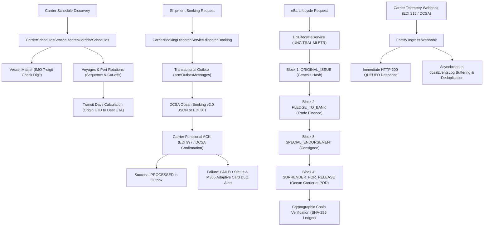

# ADR 0027: Carrier Integrations, Ocean Schedules & eBL Lifecycle Architecture

- **Status**: Accepted
- **Deciders**: Architecture Team, Ocean Freight Operations, Trade Finance, Legal Compliance, Carrier Gateways
- **Date**: 2026-11-19

## Context and Problem Statement

Global maritime shipping requires forwarders to interface with ocean liner networks across three critical operational pillars:
1. **Master Vessel Schedules & Port Rotations**: Forwarding operations must discover transit corridors, port call sequences, and cut-off deadlines (CY Gate-in, VGM, and Shipping Instructions) across carrier service loops independently from operational customer bookings.
2. **Electronic Booking Dispatch (EDI 301 & DCSA v2.0)**: Booking requests submitted to ocean carriers must be standardized, decoupled from database transactions via the Transactional Outbox pattern (`scmOutboxMessages`), and protected by Dead-Letter Queue (DLQ) alerts formatted as Microsoft 365 Adaptive Cards when carrier limits or syntax rejections occur.
3. **Electronic Bill of Lading (eBL) Lifecycle under UNCITRAL MLETR**: Negotiable bills of lading require an immutable, cryptographic state machine (`ISSUED` -> `ENDORSED` -> `SURRENDERED` -> `CANCELLED`) with SHA-256 block hashing that tracks title transfers between Shippers, Trade Finance Banks, Consignees, and Carriers, guaranteeing zero tampering and auditability.
4. **Asynchronous Track & Trace Ingestion**: Inbound carrier telemetry (EDI 315 / DCSA events) must immediately receive HTTP 200 acknowledgments to prevent third-party timeouts and duplicate dispatches, buffering payloads into dedicated event ledgers.

## Decision Drivers

- **Separation of Concerns (`atlas-schema-carrier-schedules`)**: Master vessel schedules, voyage loops, and port rotations must reside in independent master data tables (`carrier_services`, `vessels`, `voyages`, `port_calls`), never duplicating customer booking state in FMS Execution.
- **IMO Number Integrity**: Ocean vessel identifiers must be validated against the official International Maritime Organization (IMO) 7-digit modulus-10 check digit algorithm ($\sum_{i=1}^6 d_i \times (8 - i) \pmod{10} = d_7$).
- **Multi-Port Corridor Routing & Cut-off Rules**: Sequential port call validation must enforce that destination port sequence is strictly greater than origin port sequence ($seq_{orig} < seq_{dest}$), calculating transit days dynamically while asserting that terminal cut-offs precede departure ($T_{cutoff} \le ETD$).
- **Asynchronous B2B Outbox Gateway (`atlas-b2b-edi-gateway`)**: Outbound booking dispatches speak DCSA Ocean Booking v2.0 JSON or ANSI X12 EDI 301, writing to the transactional outbox (`scmOutboxMessages`) to ensure retries without duplicate carrier bookings.
- **UNCITRAL MLETR Cryptographic Security**: Every title transfer must mine an append-only block in `mletr_endorsements_ledger` linked to the genesis hash, verifying chain integrity and preventing title transfers on surrendered records.
- **Immediate Telemetry Acknowledgment**: Dedicated Fastify webhook endpoints must immediately return HTTP 200 with `{ status: "QUEUED" }` and buffer events into `dcsa_events_log`.

## Decision Outcome

Adopted a unified Carrier Integration architecture spanning shared logistics primitives (`@atlas/shared`), Drizzle ORM schema models, dedicated domain services, and Fastify routes:

### 1. Domain Math & Data Contracts (`@atlas/shared/logistics/carrier-integration`)
- `validateImoNumber`: Verifies 7-digit IMO ship identifiers using weighted modulus-10 checksum validation.
- `buildDcsaOceanBookingPayload`: Constructs DCSA Ocean Booking v2.0 JSON structures with commodity, container, voyage, and party details.
- `buildEdi301Payload` & `parseEdi997Acknowledgment`: Generates standard ANSI X12 EDI 301 Ocean Booking messages and evaluates functional acknowledgments.
- `buildM365DeadLetterAdaptiveCard`: Builds Microsoft 365 Adaptive Card v1.5 JSON alert cards for dead-letter booking failures.

### 2. Database Schema (`src/db/schema/carrier_schedules.ts`)
- `carrierServices`: Defines carrier loops, SCAC links, and trade lanes (e.g. `ASIA_NORTH_EUROPE`).
- `vessels`: Master fleet catalog storing unique 7-digit IMO numbers, vessel names, capacity TEU, and flags.
- `voyages`: Rotation instances enforcing unique constraints on `(vesselId, voyageNumber)`.
- `portCalls`: Ordered stops per voyage with sequence index, ETD/ETA timestamps, and CY/VGM/SI cut-off dates.

### 3. Application Services
- `CarrierSchedulesService` (`src/services/carrier/carrier-schedules.service.ts`):
  - Registers vessels with verified IMO check digits.
  - Manages voyage schedules and validates sequential port call ordering.
  - Searches corridors across port rotation CTEs, calculating transit times and cut-offs.
- `CarrierBookingDispatchService` (`src/services/carrier/carrier-booking-dispatch.service.ts`):
  - Dispatches bookings asynchronously via `scmOutboxMessages`.
  - Handles carrier confirmations (`EDI 997` / DCSA confirmation) and publishes DLQ alert cards on failure.
- `EblLifecycleService` (`src/services/carrier/ebl-lifecycle.service.ts`):
  - Manages UNCITRAL MLETR negotiable electronic bills of lading (`ISSUED` -> `ENDORSED` -> `SURRENDERED` -> `CANCELLED`).
  - Verifies SHA-256 cryptographic hash chaining across `mletr_endorsements_ledger`.

### 4. Fastify Endpoints (`src/routes/carrier/carrier-integrations.routes.ts`)
- Mounted under prefix `/api/carrier`:
  - `POST /api/carrier/vessels` & `GET /api/carrier/vessels`
  - `POST /api/carrier/services` & `GET /api/carrier/services`
  - `POST /api/carrier/voyages` & `GET /api/carrier/schedules/search`
  - `POST /api/carrier/bookings/dispatch` & `POST /api/carrier/bookings/confirm`
  - `POST /api/carrier/ebl/issue`, `POST /api/carrier/ebl/:id/endorse`, `POST /api/carrier/ebl/:id/surrender`, `GET /api/carrier/ebl/:id/verify`
  - `POST /api/carrier/webhooks/track-and-trace`: Immediate HTTP 200 response with asynchronous ledger buffering.

## Consequences

### Positive
- **Supply-Chain Integrity**: 100% cryptographic traceability for electronic bills of lading compliant with UNCITRAL MLETR Model Law.
- **Zero Third-Party Timeouts**: Ingress telemetry webhooks respond immediately with HTTP 200, decoupling external carrier dispatchers from backend database writes.
- **Resilient Outbox Dispatch**: Bookings are never lost during API downtime; failed transmissions produce actionable M365 Adaptive Cards for rapid operational triage.
- **Accurate Logistics Discovery**: Corridor searches dynamically resolve vessel rotations, transit days, and terminal cut-offs.

### Negative / Trade-offs
- Forwarding operations require automated monitoring of `scmOutboxMessages` to ensure background workers process queued bookings with exponential backoff.
