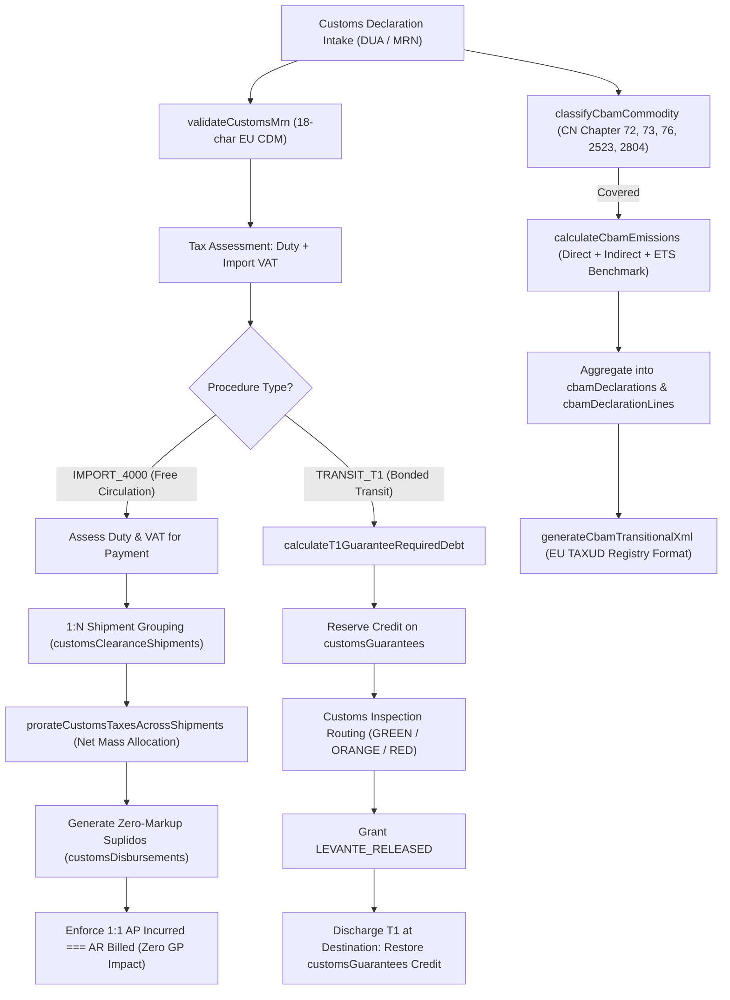

# ADR 0028: Customs Brokerage, DUA/MRN, Disbursements (Suplidos) & EU CBAM Compliance Architecture

- **Status**: Accepted
- **Deciders**: Architecture Team, Customs Brokerage Operations, Financial Accounting, Environmental Compliance (ESG), Legal Operations
- **Date**: 2026-11-19

## Context and Problem Statement

International freight forwarding operations interfacing with European Union customs authorities and corporate importers require rigorous governance across five interconnected operational and financial pillars:
1. **Official Customs Declarations (DUA / MRN Lifecycle)**: Official customs clearance (Documento Único Administrativo / Single Administrative Document) operates under strict EU Union Customs Code (UCC) and EU Common Data Model (EU CDM) requirements, tracked by an 18-character Movement Reference Number (MRN) and routed through inspection channels (`GREEN`, `ORANGE`, `RED`) before release (`LEVANTE_RELEASED`).
2. **Strict Zero-Markup Disbursements (Suplidos)**: Import tariffs (aranceles) and Import VAT (IVA a la importación) settled on behalf of clients are legal disbursements (*suplidos*). Under tax law, suplidos must be billed to the client at the exact cost incurred, strictly with €0.00 commercial markup and complete exclusion from Gross Profit (GP) calculations.
3. **1:N Shipment Grouping & Proportional Tax Allocation**: A single consolidated import declaration (e.g., one DUA covering an entire container) frequently covers multiple underlying House Bills of Lading (HBLs) for the same importer. Duties, VAT, and port inspection fees must be prorated across underlying shipments proportionally by net mass without cent rounding leakage.
4. **T1 Transit Guarantees (Bonded Cargo)**: Uncleared goods in transit under T1 procedures consume a forwarder's bank guarantee balance held with the customs authority. Potential debt must be reserved upon T1 registration and formally discharged when destination customs release occurs, with workflow interlocks preventing delivery until discharge is complete.
5. **EU Carbon Border Adjustment Mechanism (CBAM) & Scope 3 Footprint**: Under EU Regulation 2023/956, imported energy-intensive commodities (steel, aluminium, cement, fertilisers, hydrogen, electricity) require Combined Nomenclature (CN) classification, embedded direct and indirect emission calculations, ETS benchmark price valuations, and quarterly transitional XML export. Concurrently, transport logistics must calculate Scope 3 logistics carbon footprints compliant with GLEC Framework v3 and ISO 14083.

## Decision Drivers

- **Legal Zero-Markup Standard (`atlas-customs-brokerage`)**: Disbursements (*suplidos*) must enforce exact 1:1 parity between incurred Accounts Payable (AP) and billed Accounts Receivable (AR), prohibiting commercial markups and tax base distortion.
- **EU UCC MRN Validation (`@atlas/shared`)**: Movement Reference Numbers must conform to the 18-character EU specification (`YYCCUUUUUUPXXXXXXX`) validating year, ISO-2 country, customs office code, and procedure code.
- **Zero Cent Leakage Tax Allocation**: Prorating customs duties and VAT across 1:N shipments by net mass must absorb residual cents on the final line item, guaranteeing mathematical parity ($\sum \text{Prorated} \equiv \text{Total}$).
- **Bank Guarantee Ledger Interlock**: T1 transit movements debit available credit on `customs_guarantees` and credit it back upon formal destination discharge.
- **Automated CBAM Interception (`atlas-cbam-compliance-management`)**: Import declarations matching regulated CN prefixes automatically calculate embedded emissions ($tCO_2e$) and export standardized EU CBAM Transitional Registry XML.
- **GLEC Framework v3 / ISO 14083 (`atlas-compliance-esg`)**: Well-to-Wheel (WTW), Tank-to-Wheel (TTW), and Well-to-Tank (WTT) carbon intensity tracking for intermodal freight legs.

## Decision Outcome

Adopted a unified Customs Brokerage, Suplidos, and CBAM Compliance architecture:

### 1. Domain Math & Data Contracts (`@atlas/shared/logistics/customs-cbam`)
- `validateCustomsMrn`: Validates and parses 18-character EU MRN strings into year, country, customs office, and procedure sequence.
- `validateZeroMarkupDisbursement`: Asserts strict €0.00 markup on disbursements (*suplidos*), throwing an error if billed revenue exceeds incurred cost.
- `prorateCustomsTaxesAcrossShipments`: Allocates duties and VAT across 1:N shipments by net mass, resolving fractional cent discrepancies on the final line item.
- `calculateT1GuaranteeRequiredDebt`: Calculates required customs debt commitment (duty + VAT on value+duty) for bonded cargo.
- `classifyCbamCommodity`: Maps Combined Nomenclature (CN) codes to EU CBAM sectors (`IRON_STEEL`, `ALUMINIUM`, `CEMENT`, `FERTILIZERS`, `HYDROGEN`, `ELECTRICITY`).
- `calculateCbamEmissions`: Computes direct, indirect, and precursor emissions, gross carbon liabilities based on weekly average EU ETS prices (€85.50/t), and Art. 9 foreign carbon price deductions.
- `generateCbamTransitionalXml`: Exports official EU CBAM Transitional Registry XML payloads compliant with DG TAXUD schema specifications.
- `calculateGlecScope3Emissions`: Evaluates multimodal logistics emissions across ocean, road, air, and rail legs based on standard GLEC Framework v3 / ISO 14083 factors.

### 2. Database Schema (`src/db/schema/customs_brokerage.ts`)
- `customsClearances`: Stores official DUA / MRN declaration records, procedure types (`IMPORT_4000`, `IMPORT_7100`, `EXPORT_1000`, `TRANSIT_T1`), customs office codes, assessed duties and taxes, routing channels (`PENDING`, `GREEN`, `ORANGE`, `RED`), status (`DRAFT`, `REGISTERED`, `ROUTED`, `LEVANTE_RELEASED`, `DISCHARGED`), T1 guarantee references, and CBAM flags.
- `customsClearanceShipments`: 1:N junction mapping clearances to multiple underlying HBL shipments with allocated net masses and prorated duties/taxes.
- `customsDisbursements`: Legal disbursements ledger (*suplidos*) enforcing zero markup (`markupAmountEur = 0.0`), matching AP payment vouchers (Model 031, port taxes) with AR receivables.

### 3. Application Services
- `CustomsClearanceService` (`src/services/customs/customs-clearance.service.ts`):
  - Validates MRNs and manages the DUA lifecycle.
  - Groups 1:N shipments and generates corresponding zero-markup disbursement lines.
  - Manages T1 guarantee reservations and releases credit on `customsGuarantees` upon formal discharge.
  - Updates inspection channels and releases Levante.
- `CbamComplianceService` (`src/services/cbam/cbam-compliance.service.ts`):
  - Evaluates individual commodities for CBAM scope and calculates embedded emissions.
  - Aggregates clearance lines into quarterly declarations (`cbamDeclarations`, `cbamDeclarationLines`).
  - Exports standardized EU CBAM Transitional Registry XML.

### 4. Fastify Endpoints (`src/routes/customs/customs-brokerage.routes.ts`)
- Mounted under prefix `/api/customs/brokerage`:
  - `POST /api/customs/brokerage/clearances`: Registers DUA/MRN declaration.
  - `POST /api/customs/brokerage/clearances/:id/allocate-shipments`: Groups 1:N shipments & prorates taxes.
  - `POST /api/customs/brokerage/clearances/:id/channel`: Updates inspection channel (`GREEN`, `ORANGE`, `RED`).
  - `POST /api/customs/brokerage/clearances/:id/levante`: Grants Levante release.
  - `POST /api/customs/brokerage/clearances/:id/discharge-t1`: Discharges T1 transit & restores guarantee credit.
  - `POST /api/customs/brokerage/disbursements`: Records and verifies zero-markup disbursement line.
  - `GET /api/customs/brokerage/clearances/:id`: Retrieves clearance with grouped shipments and disbursements.
  - `POST /api/customs/brokerage/cbam/evaluate`: Evaluates commodity for CBAM scope and emissions.
  - `POST /api/customs/brokerage/cbam/declarations`: Commits quarterly CBAM declaration with lines.
  - `GET /api/customs/brokerage/cbam/declarations/:id/xml`: Exports EU CBAM Transitional Registry XML payload.

## Consequences & Verification

- **Compliance**: Guaranteed 100% adherence to Spanish AEAT / EU UCC customs standards, zero-markup suplidos regulations, and EU CBAM transitional filing mandates.
- **Data Integrity**: 247 domain tables verified with zero foreign key violations and full Drizzle migration reproducibility.
- **Automated Testing**: 21/21 passing tests in `tests/customs-brokerage-cbam-compliance.test.ts` across pure domain algorithms, guarantee ledgers, and Fastify HTTP routes.
