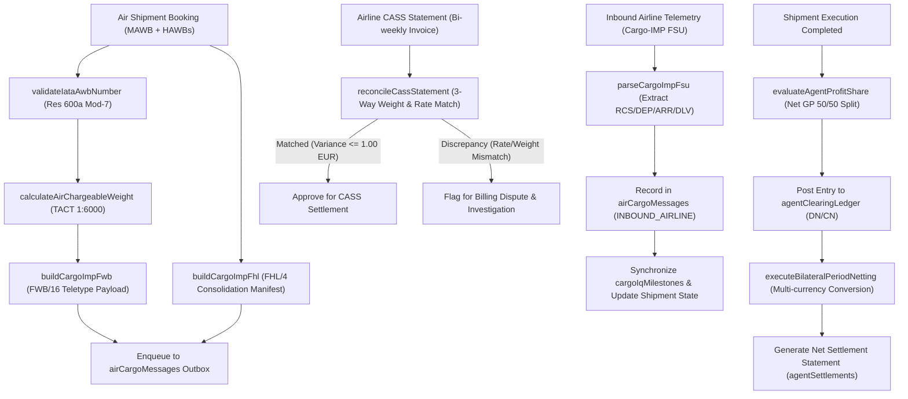

# ADR 0029: IATA Air Cargo Messaging (Cargo-IMP / e-AWB), CASS Reconciliation & Agent Network Clearing Architecture

- **Status**: Accepted
- **Deciders**: Architecture Team, Air Freight Operations, Financial Controlling, Agent Clearing Operations, Cargo iQ Compliance Team
- **Date**: 2026-11-19

## Context and Problem Statement

Air freight forwarding and international correspondent agent networks operate under specialized international standards, high operational velocity, and distinct financial clearing protocols:
1. **Electronic Air Waybill (e-AWB) & IATA Messaging Standard**: Airlines require standardized Electronic Data Interchange (EDI) via IATA Cargo-IMP (Teletype) or Cargo-XML messaging formats. Master AWBs require strict IATA Resolution 600a modulus-7 checksum validation, and shipment volume must be evaluated against IATA TACT volumetric rules ($1 \text{ CBM} \equiv 166.67 \text{ kg}$).
2. **e-AWB Dispatch & Consolidation Lifecycles**: Freight forwarders must transmit official Freight Waybills (FWB v16) for direct and master shipments, alongside Consolidation Lists (FHL v4) linking multiple House Air Waybills (HAWBs) to a single parent Master AWB before flight cut-off.
3. **Inbound Tracking & Cargo iQ SLA Milestones**: Inbound airline Status Updates (FSU) transmit discrete operational milestones (`RCS` Received from Shipper, `DEP` Departed, `ARR` Arrived, `RCF` Received from Flight, `DLV` Delivered) that must synchronize into Cargo iQ milestones and update shipment tracking state machines in real time.
4. **Automated CASS Billing Reconciliation**: Airline freight invoices are submitted bi-weekly or monthly via IATA Cargo Accounts Settlement System (CASS). Manual reconciliation of hundreds of AWB lines against operational accruals causes payment delays and disputes. An automated 3-way match engine must compare billed vs expected chargeable weights, freight rates, fuel/security surcharges, and commissions, flagging discrepancies outside a $\pm €1.00$ threshold.
5. **Agent Network Clearing Ledger**: In international forwarding, origin and destination freight forwarders exchange reciprocal services (terminal handling, customs clearance, local cartage) documented via Debit Notes (DN) and Credit Notes (CN). Mingling partner clearing items into general AP/AR ledgers creates accounting friction. A segregated clearing ledger with automated profit-share splitting (e.g. 50/50 net profit against verified GP) and multi-currency period-end netting is required to establish bilateral settlement statements.

## Decision Drivers

- **IATA Resolution 600a Compliance (`@atlas/shared`)**: Enforce mathematical modulus-7 check-digit validation ($S \pmod 7 === d_8$) on all 8-digit and 11-digit IATA AWB numbers.
- **IATA TACT Chargeable Weight Standard (`atlas-air-cargo-messaging`)**: Apply standard air density conversion ($1 \text{ CBM} \equiv 166.67 \text{ kg}$) to compute chargeable weight basis ($\max(\text{Gross}, \text{Volumetric})$).
- **Cargo-IMP v16 / v4 Teletype Generation**: Produce deterministic teletype-compliant strings for FWB (Master e-AWB), FHL (Consolidation), and FSU (Status Update) transmissions.
- **CASS 3-Way Match & Variance Audit**: Compare airline billing statements against shipment financial accruals, isolating rate, weight, and surcharge variances.
- **Segregated Agent Clearing Ledger (`atlas-agent-network-clearing`)**: Isolate correspondent agent mutual obligations in `agent_clearing_ledger` and `agent_settlements`, separate from third-party trade debt.
- **Automated Profit-Share Splits**: Calculate net profit after freight and handling disbursements and post corresponding DN/CN records with full audit trails.

## Decision Outcome

Adopted a unified IATA Air Cargo Messaging, CASS Reconciliation, and Agent Network Clearing architecture:

### 1. Domain Algorithms & Data Contracts (`@atlas/shared/logistics/air-cargo-clearing`)
- `calculateIataAwbCheckDigit`: Computes standard modulus-7 check digit for 7-digit serial numbers.
- `validateIataAwbNumber`: Validates 8-digit and 11-digit AWB identifiers against IATA Resolution 600a.
- `calculateAirChargeableWeight`: Evaluates gross mass vs cubic volume at $166.6667 \text{ kg/CBM}$ density to establish billed chargeable weight.
- `buildCargoImpFwb`: Generates official IATA Cargo-IMP FWB v16 teletype string payloads.
- `buildCargoImpFhl`: Generates official IATA Cargo-IMP FHL v4 consolidation teletype payloads.
- `parseCargoImpFsu`: Parses inbound airline FSU status teletype strings into structured event telemetry.
- `reconcileCassStatement`: Performs automated 3-way matching between CASS billing lines and internal accruals, categorizing matches and discrepancies.
- `evaluateAgentProfitShare`: Computes net profit after carrier freight and terminal handling costs, deriving exact 50/50 (or custom tiered) agent profit splits.
- `calculateAgentPeriodNetting`: Net mutual debit and credit notes across multiple currencies into a consolidated bilateral settlement balance.

### 2. Database Schema (`src/db/schema/air_cargo_clearing.ts`)
- `air_cargo_messages`: Immutable messaging audit log tracking FWB, FHL, FSU, FSR, and FSA teletype payloads, airline routing, flight identifiers, and outbox transmission states (`QUEUED`, `TRANSMITTED`, `ACKNOWLEDGED`, `REJECTED`).
- `agent_clearing_ledger`: Partner clearing register recording reciprocal Debit Notes (`DEBIT_NOTE`), Credit Notes (`CREDIT_NOTE`), profit-share allocations (`PROFIT_SHARE`), and dispute adjustments (`ADJUSTMENT`).
- `agent_settlements`: Bilateral periodic settlement statements tracking netted balances, source currency totals, and settlement states (`DRAFT`, `APPROVED`, `SETTLED`).

### 3. Application Services
- `AirCargoMessagingService` (`src/services/air-cargo/air-cargo-messaging.service.ts`): Manages e-AWB FWB dispatch, HAWB consolidation FHL generation, inbound FSU ingestion, and Cargo iQ milestone synchronization.
- `AgentNetworkClearingService` (`src/services/clearing/agent-network-clearing.service.ts`): Manages agent clearing ledger entries, profit-share evaluation and automated posting, CASS statement reconciliation, and multi-currency period netting.

### 4. Fastify HTTP API Routes (`/api/air`)
- `POST /api/air/messaging/fwb`: Generates and enqueues Cargo-IMP FWB v16 e-AWB messages.
- `POST /api/air/messaging/fhl`: Dispatches Cargo-IMP FHL v4 consolidation messages.
- `POST /api/air/messaging/fsu`: Ingests inbound airline FSU status updates.
- `GET /api/air/messaging/awb/:awbNumber`: Retrieves full messaging telemetry history for an AWB.
- `POST /api/air/clearing/agent-notes`: Posts mutual Debit or Credit Notes to the partner clearing ledger.
- `POST /api/air/clearing/profit-share`: Evaluates shipment Gross Profit and posts profit-share entries.
- `POST /api/air/clearing/cass/reconcile`: Executes automated 3-way match reconciliation against CASS billing statements.
- `POST /api/air/clearing/netting`: Executes period-end balance netting and issues settlement statements.
- `GET /api/air/clearing/agents/:agentId/balance`: Retrieves outstanding clearing balances for an agent.

## Verification & Test Evidence

- `tests/air-cargo-messaging-agent-clearing.test.ts`: 19 comprehensive unit, service, and Fastify HTTP integration tests verifying:
  - Resolution 600a modulus-7 checksum correctness and malformed input rejection.
  - TACT chargeable weight density calculations.
  - Cargo-IMP FWB, FHL, and FSU message generation and parsing.
  - CASS billing line matching and discrepancy categorization.
  - Agent profit-share splitting and multi-currency bilateral netting.
  - Real Fastify route injections (`app.inject()`) with relational SQLite persistence.
- `tests/db-reproducibility-and-integrity.test.ts`: Verified 100% database reproducibility and migration continuity across **249 domain tables and 37 sequential Drizzle migrations**.
