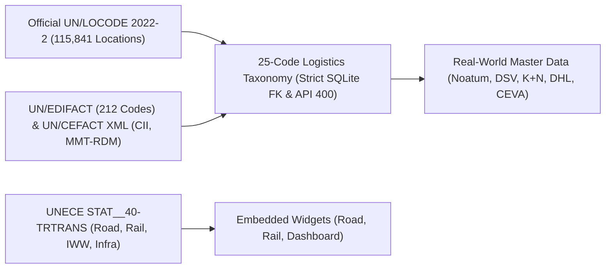

# ADR 0030: Strict 25-Code Logistics Entity Taxonomy, Real-World Master Data & UNECE / UN/CEFACT Standards Integration

- **Status**: Accepted
- **Date**: 2026-11-19
- **Bounded Context**: Master Data Governance, EDI / UN/CEFACT Interoperability, External Open Data Analytics
- **Related ADRs**: [ADR 0010](0010-zero-mock-live-persistence-standard.md), [ADR 0020](0020-frontend-modular-decomposition-and-file-size-guardrails.md), [ADR 0021](0021-external-data-governance-and-licensing.md), [ADR 0022](0022-enterprise-freight-forwarding-organization-schema-and-governance.md)

---

## 1. Context

Atlas-Logistics previously stored operational trading partners using broad legacy `address_type` codes (`CAR`, `CB`, `AG`, `FW`, `TRM`, `WH`, `HAU`, `CUS`, `CAA`), seeded only 24 hardcoded UN/LOCODE records in SQLite, included mock `"Atlas ..."` company/address records in database seeds, and lacked authoritative SQLite catalogs for official UN/EDIFACT message types, UN/CEFACT XML Schemas, and UNECE macro transport statistics.

To align Atlas-Logistics with real-world international freight forwarding operations and UNECE / UN/CEFACT open trade standards at **$0.00 infrastructure cost**, we standardized four foundational pillars.

---

## 2. Decision

### 2.1 Strict 25-Code Unique Logistics Taxonomy & Zero-Atlas-Mock Policy
1. **`address_types` Strictly Enforces 25 Unique 3-Letter Codes**:
   - `MCC` (Main Customer Company), `OCA` (Ocean Carrier), `ACA` (Airline Carrier), `RCA` (Rail Carrier), `CLA` (Carrier Line Agency), `CBA` (Customs Broker Agency), `OAG` / `DAG` (Origin / Destination Representative Agent), `FFC` (Freight Forwarding Company), `SPT` (Seaport Terminal), `RST` (Railway Station Terminal), `OIC` / `DIC` (Origin / Destination Inland Container Terminal), `OEW` / `DEW` (Origin / Destination External Warehouse), `OWO` / `DWO` (Origin / Destination Owned Warehouse), `OHA` / `DHA` (Origin / Destination Haulier), `INS` (Marine Cargo Insurer), `PLL` (Place of Loading Location), `PDL` (Place of Delivery Location), `POL` (Port of Loading), `POD` (Port of Discharge), and `TSP` (Transhipment Port).
   - Legacy rows (`AG`, `CAA`, `CAR`, `CB`, `CUS`, `FW`, `HAU`, `PAT`, `SUP`, `TRM`, `WH`) are migrated and purged from `address_types` so SQLite's foreign key constraint blocks non-canonical codes at the storage layer.
2. **Strict API Writes + Lenient Category Reads**:
   - `POST`/`PATCH /api/addresses` rejects legacy or unknown `addressType` tokens with HTTP `400 Bad Request`, preventing silent misclassifications.
   - `POL`, `POD`, and `TSP` records require a valid 5-character UN/LOCODE verified against `unlocode_locations`.
   - Shared canonical Role Groups and directional sorting (`packages/shared/src/logistics/address-taxonomy.ts`) power backend services and 2-tier grouped UI controls (`AddressModal` `<optgroup>` and `AddressesHubModule` category tabs + sub-code chips).
3. **Zero `"Atlas"` Mock Companies or Addresses**:
   - `"Atlas-Logistics"` is strictly the software platform name. Database `companies` and `addresses` use real-world top-tier logistics operators (Noatum Logistics for tenant `c-1`, global branches, and owned hubs; DSV, Kuehne+Nagel, DHL Global Forwarding, CEVA Logistics, Maersk, MSC, Lufthansa Cargo, IAG Cargo, Renfe Mercancías, DB Cargo, BASF, SEAT, Bosch, and major port authorities across all 25 codes).

### 2.2 Full Official UNECE UN/LOCODE 2022-2 Catalog (`unlocode_locations`)
- Extracted all **115,841 official UN/LOCODE 2022-2 locations**, **249 ISO 3166-1 countries/territories**, and **4,676 ISO 3166-2 subdivisions** from the official UNECE distribution into compressed reproducible catalogs (`data/catalogs/unlocode-2022-2.ndjson.gz`).
- Bulk-imported into SQLite `unlocode_locations` via `scripts/import-unlocode-catalog.mjs` and wired directly into `/api/addresses/unlocode-lookup`, `/api/external-governance/unlocode/lookup`, and `/api/external-governance/unlocode/countries`.

### 2.3 Official UN/EDIFACT (212 Codes) & UN/CEFACT XML Schemas + Live Generators
- Created `edifact_message_types` storing **212 official 6-character UN/EDIFACT codes** (including `CONTRL`, normalized ASCII tokens `JAPRES`, `ORDERS`, `PRPAID`, `QUOTES`, `RECORD`, `RELIST`, `UTILTS`) cross-mapped to the 25-code entity taxonomy.
- Created `uncefact_xml_schemas` registering official UN/CEFACT XML Schemas (`CII`, `MMT_CONSIGNMENT`, `MMT_EBL`, `MMT_ECMR`, `CIDA`, `CIO`, `CIQ`, `CIR`, `DGD`, `CUSDEC_XML`) and implemented live SQLite-backed XML export generators for **Cross Industry Invoice (`CII D23B`)** and **MMT-RDM Multimodal Consignment** exposed in `EdiIntegrationModule` (`components/edi/Tab/Catalog.tsx`).

### 2.4 UNECE Transport Statistics (`STAT__40-TRTRANS`)
- Created `unece_transport_statistics` seeded from a real verified snapshot fetched from the live zero-cost UNECE PX-Web REST API (`https://w3.unece.org/PXWeb2015/api/v1/en/STAT/40-TRTRANS`) across Road, Rail, Inland Waterway tonne-km and Transport Infrastructure datasets, paired with live on-demand sync (`POST /api/analytics/unece-transport/sync`).
- Embedded reusable benchmark widgets (`components/Analytics/UneceTransportBenchmarkWidget.tsx`) directly into `RoadFreightModule`, `RailFreightModule`, and `DashboardModule` while maintaining ADR 0020 page-size compliance (`< 1,000` lines).

---

## 3. Consequences

- **Positive**: 100% referential integrity on strictly 25 unique logistics codes, full global UN/LOCODE coverage (115,841 entries), standards-compliant UN/EDIFACT & UN/CEFACT XML interoperability, real macro freight benchmarks at $0.00 cost, and complete elimination of mock `"Atlas"` companies/addresses.
- **Trade-offs**: External callers posting legacy codes (`CAR`, `WH`, `TRM`) receive HTTP 400 and must specify the exact canonical 3-letter code; the repository stores ~3.3 MB of compressed gzipped UNECE open catalogs under `data/catalogs/`.
