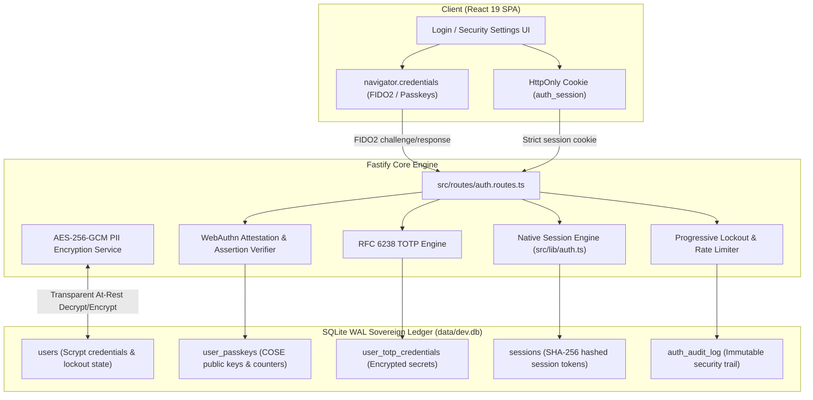

# 0031. Sovereign Native Identity, WebAuthn Passkeys, TOTP MFA, and At-Rest Encryption Engine

- **Status**: Accepted
- **Date**: 2026-11-21
- **Context**: Atlas Logistics Security, Architecture, and Compliance Teams
- **Quadrant**: Explanation & Architectural Decisions (`docs/adr/`)
- **See Also**: [ADR 0004](0004-zero-cost-local-architecture.md), [ADR 0009](0009-sqlite-wal-mandatory-foreign-keys.md), [ADR 0011](0011-webcrypto-sat-efirma-and-mletr-blockchain.md), [ADR 0023](0023-native-web-crypto-session-migration.md)

---

## 1. Context & Problem Statement

Atlas Logistics operates as an on-premise, zero-cost, sovereign logistics ERP and freight forwarding execution platform. While evaluating external SaaS identity providers (such as Auth0, Okta, Clerk, or Firebase), the architecture team identified severe structural impediments against core governance principles:

1. **European Data Sovereignty & GDPR (RGPD) Compliance**: Delegating identity, login audits, biometric attestations, and IP tracking to commercial US-headquartered cloud identity providers triggers cross-border data transfer concerns under EU GDPR and the US CLOUD Act.
2. **Monorepo $0.00 Cost Mandate ([ADR 0004](0004-zero-cost-local-architecture.md))**: External Identity-as-a-Service (IDaaS) platforms impose recurring monthly active user (MAU) billing and paywall essential security features such as enterprise MFA, WebAuthn, custom domains, and automated audit logging.
3. **Offline & Edge Resilience**: Logistics operations (e.g. CFS warehouses, port drayage dispatchers, and offline driver PWAs) require continuous local operation even during WAN or external provider downtime.
4. **Token Security & XSS Resistance**: Legacy frontend state previously maintained authentication tokens in browser `localStorage`, exposing session bearer tokens to DOM-based script injection (CWE-79).

---

## 2. Decision Drivers

- **Zero SaaS Dependencies ($0.00 Cost)**: 100% self-hosted code embedded directly in the Fastify backend and React SPA using native standard APIs (`node:crypto`, `navigator.credentials`).
- **European Data Sovereignty (GDPR Art. 32)**: All Personally Identifiable Information (PII) must reside strictly in local SQLite WAL (`data/dev.db`), encrypted at rest with AES-256-GCM.
- **FIDO2 / WebAuthn Passkeys**: Native passwordless biometric login (Touch ID, Windows Hello, YubiKey) without external identity brokering.
- **Hardened Session Isolation**: Exclusive use of `HttpOnly`, `SameSite=Strict`, `Secure` cookies with SHA-256 token hashing in SQLite.
- **Active Threat Defense**: Native sliding-window rate limiting, progressive account lockout after failed attempts, and append-only security audit trails.

---

## 3. Considered Options

### Option 1: Commercial SaaS Identity Provider (Auth0 / Okta)
- *Pros*: Out-of-the-box hosted login widgets and managed threat detection.
- *Cons*: Violates the zero-cost mandate ($0.00 rule); introduces third-party data processing risks under GDPR; fails during WAN outages.

### Option 2: Dedicated Self-Hosted IdP Container (Keycloak / Authentik)
- *Pros*: Open-source and self-hosted.
- *Cons*: Introduces significant resource overhead (Java/JVM or heavy Docker dependencies), requiring separate PostgreSQL databases and disrupting the embedded zero-overhead SQLite WAL model.

### Option 3 (Chosen): Sovereign Native Identity Engine
- *Pros*:
  - Fully contained within existing Fastify and React architectures.
  - Utilizes standard `node:crypto` (Scrypt, AES-256-GCM, HMAC-SHA256) and browser `navigator.credentials`.
  - Zero added server processes or databases; leverages high-concurrency SQLite WAL.
  - Guarantees 100% GDPR data sovereignty and zero ongoing cost.
- *Cons*:
  - Requires maintaining the cryptographic WebAuthn ceremony and TOTP verification logic in-repo. (Mitigated: standards-based RFC 6238 and W3C WebAuthn Level 3 specifications covered by automated Vitest suites).

---

## 4. Architectural Specification

### 4.1. WebAuthn Passkeys Implementation
1. **Registration Ceremony**:
   - Fastify issues a cryptographically random 32-byte challenge (`crypto.randomBytes(32)`), stored temporarily in cache with a 2-minute TTL.
   - Browser calls `navigator.credentials.create({ publicKey: { challenge, rp: { name: "Atlas Logistics" }, ... } })`.
   - Fastify verifies the attestation object, extracts the public key and credential ID, and stores them in `user_passkeys`.
2. **Authentication Ceremony**:
   - Fastify issues an assertion challenge.
   - Browser prompts for biometrics via `navigator.credentials.get({ publicKey: { challenge, ... } })`.
   - Fastify verifies the signature against the stored public key using Node.js `crypto.verify("sha256", clientDataJSON + authData, publicKey, signature)`, verifies that the signature counter has incremented (preventing clone replays), and issues an authenticated session cookie.

### 4.2. TOTP MFA Engine (RFC 6238)
- Employs standard HMAC-SHA1/HMAC-SHA256 calculations over 30-second time steps.
- Validates the current time step alongside $\pm 1$ step to tolerate client clock drift.
- Master secret is encrypted at rest using AES-256-GCM.
- Generates 8 single-use emergency backup codes hashed via Scrypt.

### 4.3. Session Hardening & Anti-XSS Cookie Policy
- Eliminates `localStorage` token storage.
- Session cookie attributes: `HttpOnly = true`, `Secure = true` (in production), `SameSite = "Strict"`, `Path = "/"`, `Max-Age = 2592000` (30 days).
- Tokens are SHA-256 hashed prior to storage in `sessions.id`.

### 4.4. GDPR At-Rest PII Encryption
- Field-level encryption for sensitive user attributes (tax ID, phone, physical address).
- Cipher: `AES-256-GCM` with random 96-bit IV per field and 128-bit authentication tag.
- Tamper detection: Invalid authentication tags immediately fail decryption.

---

## 5. Consequences

### Positive
- **Complete Privacy & Regulatory Compliance**: Zero PII transmitted to external US cloud providers; 100% compliant with EU GDPR and national privacy laws.
- **Permanent Zero Cost ($0.00)**: No subscription fees, tier gates, or per-user pricing.
- **State-of-the-Art Security**: Phishing-resistant FIDO2 Passkeys, hardware-bound biometrics, and immune to DOM XSS token theft.
- **Full Offline Resilience**: Operates entirely within local Docker containers and local network environments without internet dependencies.

### Negative / Trade-offs
- **In-Repo Maintenance**: WebAuthn cryptographic parsing and validation logic must be maintained in the monorepo codebase.
- **Recovery Complexity**: Lost hardware authenticators require administrative identity verification or single-use recovery code mechanisms.
