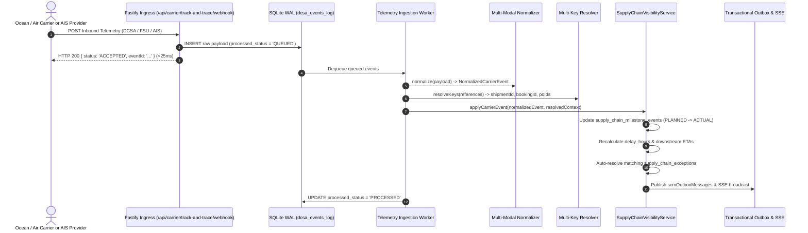

# 0034. Multi-Modal Carrier Track & Trace Async Ingestion and Predictive Resolution Engine

- **Status**: Accepted
- **Date**: 2026-11-22
- **Context**: Atlas Logistics Architecture, SCM, Visibility & Freight Execution Teams
- **Quadrant**: Explanation & Architectural Decisions (`docs/adr/`)
- **See Also**: [ADR 0005](0005-fastify-websockets-for-realtime.md), [ADR 0008](0008-scm-sqlite-cqrs-workflow-engine.md), [ADR 0009](0009-sqlite-wal-mandatory-foreign-keys.md), [ADR 0010](0010-zero-mock-live-persistence-standard.md), [ADR 0016](0016-b2b-edi-dcsa-ebl-iata-one-record.md), [ADR 0027](0027-carrier-integrations-ocean-schedules-ebl-lifecycle.md), [ADR 0029](0029-air-cargo-messaging-cass-and-agent-network-clearing.md), [ADR 0032](0032-supply-chain-purchase-order-and-booking-allocation-engine.md), [ADR 0033](0033-supply-chain-visibility-and-predictive-milestone-tracking.md)

---

## 1. Context & Problem Statement

Global multi-modal freight forwarding operations depend on receiving and processing hundreds of carrier telemetry updates each day. While [ADR 0027](0027-carrier-integrations-ocean-schedules-ebl-lifecycle.md) introduced master vessel schedules and basic DCSA webhook ingestion, and [ADR 0033](0033-supply-chain-visibility-and-predictive-milestone-tracking.md) introduced the Supply Chain Visibility CQRS ledger and predictive exception engine, critical operational challenges remained:

1. **Carrier Ingress Timeouts & Retry Storms**: External carrier webhooks (ocean liner DCSA, air freight Cargo-XML, satellite AIS providers) expect immediate HTTP acknowledgments ($< 100\text{ ms}$). Executing complex entity resolution, downstream table updates, and predictive calculations synchronously during the HTTP request cycle triggers socket timeouts, causing carriers to resend events and generating duplicate processing cycles.
2. **Multi-Modal Fragmentation**: Ocean carriers transmit DCSA 2026 / EDI 315 messages, air carriers transmit IATA Cargo-IMP/Cargo-XML FSU status codes (`RCS`, `DEP`, `ARR`, `RCF`, `DLV`), and maritime position providers stream AIS NMEA/JSON telemetry. Without a unified domain normalization contract, each data format required bespoke ad-hoc handling.
3. **Correlation Bottlenecks (Partial Identifiers)**: Inbound events rarely contain internal Atlas system IDs. Events often identify cargo solely by a container number, an ocean bill of lading, an air waybill (AWB), a carrier booking reference, or an IMO number and voyage.
4. **Manual Resolution Overhead**: When carriers deliver cargo (`ACTUAL` timestamp) or issue customs releases (`CUSTOMS_RELEASED`), predictive exceptions previously flagged in [ADR 0033](0033-supply-chain-visibility-and-predictive-milestone-tracking.md) (such as `CUSTOMS_HOLD_RISK` or `PORT_CONGESTION_RISK`) remained open until an operator manually acknowledged them in the UI.

---

## 2. Decision Drivers

- **Two-Tier Zero-Cost Architecture**: Fastify ingress webhook buffers raw payloads into SQLite WAL (`dcsa_events_log`) in $< 25\text{ ms}$ returning HTTP 200 `{ status: "ACCEPTED", eventId }`, completely insulating external carrier networks from internal processing latency without requiring paid third-party queues (e.g. Redis/BullMQ).
- **Multi-Modal Unified Domain Normalizer (`NormalizedCarrierEvent`)**: Pure domain functions translating DCSA 2026, IATA Cargo-IMP/XML FSU, and AIS telemetry into a standardized event contract with cryptographic trust ranking (`SOURCE_TRUST_RANK`: Customs = 4, DCSA/Air = 3, AIS = 2, Manual = 1).
- **Deterministic Multi-Key Resolver**: Cascading hierarchical resolution:
  $$\text{AWB / MBL / HBL} \longrightarrow \text{Carrier Booking Ref} \longrightarrow \text{Container Number} \longrightarrow \text{IMO + Voyage}$$
  reliably links raw telemetry to the underlying `shipments`, `bookings`, and `purchase_orders`.
- **Intelligent Cascading Auto-Resolution Engine**: Automatically marks resolved milestones as `ACTUAL`, recalculates downstream milestone ETAs with delay variance, and auto-resolves corresponding predictive exceptions (e.g. `CUSTOMS_RELEASED` auto-resolves `CUSTOMS_HOLD_RISK`, `BERTHED` auto-resolves `PORT_CONGESTION_RISK`) while logging audit trails.
- **Real-Time Reactive Streaming**: Publishes domain events to the Transactional Outbox and broadcasts live SSE / WebSocket notifications to the frontend Control Tower and PO Milestone Stepper.
- **Interactive Operator Tooling**: Integrated telemetry feed in the PO Drawer (`CarrierTelemetryFeed.tsx`) and quick-test event simulation modal (`SimulateEventModal.tsx`) for functional verification with zero mocks.

---

## 3. Considered Options

### Option 1: Synchronous Ingress Processing (Single-Tier)
- *Pros*: Simple sequential code path without queue buffers.
- *Cons*: Processing times between $150\text{ ms}$ and $800\text{ ms}$ during multi-table resolution and predictive evaluation; high failure rate and duplicate retries from carrier webhooks with strict $100\text{ ms}$ timeouts.

### Option 2: External Distributed Broker (Kafka / BullMQ + Redis)
- *Pros*: Extreme high-throughput horizontal queueing.
- *Cons*: Violates the Zero-Cost Local Architecture ([ADR 0004](0004-zero-cost-local-architecture.md)); requires external daemons, networking overhead, and additional operational failure modes on local workstations.

### Option 3 (Chosen): Two-Tier Embedded SQLite WAL Buffer & Asynchronous Outbox Pipeline
- *Pros*:
  - Fastify Ingress returns in $< 25\text{ ms}$ with guaranteed HTTP 200 acknowledgment.
  - Zero external SaaS or container dependencies; leverages SQLite WAL mode concurrency ([ADR 0009](0009-sqlite-wal-mandatory-foreign-keys.md)).
  - Transactional atomicity: event state, milestone status, and predictive exceptions update in a single ACID transaction.
  - Full auditability: raw payloads preserved immutably in `dcsa_events_log`.

---

## 4. Architectural Design & Flow

---

## 5. Domain Normalization Matrix

| Source Protocol | Raw Code | Canonical Milestone Code | Macro Phase | Auto-Resolved Exception |
| :--- | :--- | :--- | :--- | :--- |
| **DCSA 2026** | `GTIN` | `GATE_IN_ORIGIN` | 1. Origin & Production | `CRD_CUTOFF_BREACH` |
| **DCSA 2026** | `LOAD` | `CONTAINER_LOADED` | 2. International Transit | `ROLLOVER_RISK` |
| **DCSA 2026** | `DEPA` | `VESSEL_DEPARTED` | 2. International Transit | `CARRIER_DELAY` (Origin) |
| **DCSA 2026** | `ARRI` | `VESSEL_ARRIVED` | 2. International Transit | `TRANSSHIPMENT_DWELL` |
| **DCSA 2026** | `DISC` | `CONTAINER_DISCHARGED` | 2. International Transit | `PORT_CONGESTION` |
| **DCSA 2026** | `RELE` | `CUSTOMS_RELEASED` | 3. Final Mile & Customs | `CUSTOMS_HOLD` |
| **DCSA 2026** | `GTOT` | `GATE_OUT_DESTINATION` | 3. Final Mile & Customs | `ETA_RDD_BREACH` |
| **IATA FSU** | `RCS` | `CARGO_RECEIVED` | 1. Origin & Production | `CRD_CUTOFF_BREACH` |
| **IATA FSU** | `DEP` | `FLIGHT_DEPARTED` | 2. International Transit | `CARRIER_DELAY` |
| **IATA FSU** | `ARR` | `FLIGHT_ARRIVED` | 2. International Transit | `TRANSSHIPMENT_DWELL` |
| **IATA FSU** | `RCF` | `CARGO_UNLOADED` | 2. International Transit | `PORT_CONGESTION` |
| **IATA FSU** | `DLV` | `DELIVERED_FINAL` | 3. Final Mile & Customs | All Open PO Exceptions |
| **AIS Telemetry** | `UNDERWAY` | `VESSEL_EN_ROUTE` | 2. International Transit | Updates `delay_hours` |
| **AIS Telemetry** | `BERTHED` | `VESSEL_BERTHED` | 2. International Transit | `PORT_CONGESTION` |

---

## 6. Multi-Terminal Execution & IPC Governance

Implementation is partitioned across terminals via Antigravity-IPC Hub v2 (`127.0.0.1:12346`):

- **Terminal A (Fase 1 — T-41)**:
  - ADR 0034 specification and Diátaxis indexing in `docs/README.md`.
  - Multi-modal schema extension (`src/db/schema/dcsa.ts` & `src/db/schema/supply_chain_visibility.ts`).
  - Pure domain normalizer `src/scm/engines/carrier-telemetry.normalizer.ts` with comprehensive unit tests (`100% PASS`).
- **Terminal B (Fase 2 — T-42)**:
  - Two-tier Fastify ingress & asynchronous worker service (`src/services/carrier/carrier-telemetry-ingestion.service.ts`).
  - Multi-Key Resolver and cascading auto-resolution in `supply-chain-visibility.service.ts`.
  - Fastify route registration and integration test suite (`tests/scm-carrier-telemetry.test.ts`).
- **Terminal A (Fase 3 — T-43)**:
  - React frontend components (`CarrierTelemetryFeed.tsx`, `SimulateEventModal.tsx`).
  - Integration into `packages/frontend/src/components/PurchaseOrders/Drawer/Detail.tsx`.
- **Convergence (Fase 4)**:
  - End-to-end verification, monorepo type-check, zero-leak check, zero-innerHTML audit, and link integrity verification.
