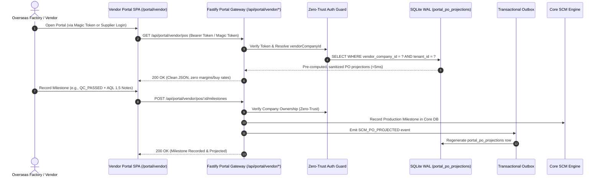

# 0035. Zero-Trust B2B Customer & Vendor Portal Experience and CQRS Projections Engine

- **Status**: Accepted
- **Date**: 2026-11-23
- **Context**: Atlas Logistics Architecture, SCM, Visibility, Security & External Partner Teams
- **Quadrant**: Explanation & Architectural Decisions (`docs/adr/`)
- **See Also**: [ADR 0004](0004-zero-cost-local-architecture.md), [ADR 0008](0008-scm-sqlite-cqrs-workflow-engine.md), [ADR 0009](0009-sqlite-wal-mandatory-foreign-keys.md), [ADR 0010](0010-zero-mock-live-persistence-standard.md), [ADR 0020](0020-frontend-modular-decomposition-and-file-size-guardrails.md), [ADR 0031](0031-sovereign-native-identity-and-authentication-engine.md), [ADR 0032](0032-supply-chain-purchase-order-and-booking-allocation-engine.md), [ADR 0033](0033-supply-chain-visibility-and-predictive-milestone-tracking.md), [ADR 0034](0034-carrier-track-and-trace-async-ingestion-and-predictive-resolution.md)

---

## 1. Context & Problem Statement

Global supply chain execution requires close collaboration between freight forwarders, cargo owners (importers/buyers), and overseas manufacturers (vendors/suppliers). While [ADR 0032](0032-supply-chain-purchase-order-and-booking-allocation-engine.md) established the Purchase Order and Booking Allocation data model, [ADR 0033](0033-supply-chain-visibility-and-predictive-milestone-tracking.md) created the visibility ledger and predictive exceptions engine, and [ADR 0034](0034-carrier-track-and-trace-async-ingestion-and-predictive-resolution.md) implemented multi-modal carrier track & trace telemetry, interactions with external parties remained centralized and manual:

1. **Information Asymmetry & Operational Email Overload**: External factories reported manufacturing milestones (`QC_PASSED`, `PACKED`, `CARGO_READY`) via unstructured spreadsheets, emails, or messaging apps, requiring manual re-entry by forwarder operators.
2. **Confidentiality Leaks on Internal Queries**: Core operational tables (`purchase_orders`, `po_line_items`, `contracts`, `charges`) contain commercially sensitive data—such as internal buy rates, carrier tariffs, commercial margins, and internal liability estimates. Querying operational tables directly from external client portals risked catastrophic leakage of proprietary pricing.
3. **Authentication Friction for External Factories**: Requiring full corporate identity onboarding, MFA passkeys, or VPNs for third-party manufacturing clerks in multiple international jurisdictions created prohibitive adoption barriers, while completely unauthenticated endpoints created severe data exposure risks.
4. **Heavy Multi-Join Performance Bottlenecks**: Exposing external client tracking queries directly to operational SQLite WAL tables risked query contention and transaction lock delays during peak batch carrier event ingestion.

---

## 2. Decision Drivers

- **Zero-Trust Application-Layer Isolation (`atlas-customer-portal-experience`)**: External portals (`/api/portal/vendor/*` and `/api/portal/customer/*`) are physically and logically segregated from internal operational routes (`/api/scm/*`). Every query and mutation strictly enforces `WHERE company_id = ? AND tenant_id = ?`.
- **Materialized Read-Only CQRS Projection (`portal_po_projections`)**: Specialized projection table in SQLite WAL containing pre-computed, sanitized views of purchase orders, milestone progressions, and public exceptions. All internal commercial margins, buy rates, and proprietary financial penalties are stripped at the database projection layer, never relying on UI hiding.
- **Hybrid Sovereign Authentication & Magic Tokens**:
  - *Registered Partner Login*: Standard JWT/session with scoped roles (`VENDOR_SUPPLIER`, `CUSTOMER_CLIENT`) bound to `company_id`.
  - *Cryptographic Magic Access Tokens (`portal_access_tokens`)*: Secure 256-bit entropy tokens hashed with SHA-256 for instantaneous single-PO access, with explicit expiration timestamps (`expires_at`) and revocation tracking.
- **Supplier Empowerment Suite**: Direct decentralized factory actions:
  - Record manufacturing milestones (`QC_PASSED`, `PACKED`, `CARGO_READY`) with inspection notes and AQL parameters.
  - Formally confirm orders with locked Promised Cargo Ready Date (`promised_cargo_ready_date`).
  - Acknowledge predictive exception alerts with structured mitigation notes.
- **Focused External SPA Experience**: Dedicated frontend module (`packages/frontend/src/pages/PortalVendorModule.tsx`) free of internal ERP navigation chrome, with responsive glassmorphism aesthetic, zero `.innerHTML` sinks, and strict `< 700` line limits.

---

## 3. Considered Options

### Option 1: Direct Internal API Reuse with Role-Based Field Filtering in Fastify Serializer
- *Pros*: Zero new database tables; minimal initial code.
- *Cons*: High vulnerability to regression leaks (a single schema mistake or missing filter exposes internal buy rates and profit margins); heavy queries degrade internal operational database throughput.

### Option 2: SQLite Dynamic Views (`CREATE VIEW`) with SQL Expressions
- *Pros*: Masks sensitive fields at database level without duplicate rows.
- *Cons*: Views are computed dynamically on every request, requiring joins across `purchase_orders`, `po_line_items`, `scm_milestone_tracking`, and `scm_predictive_exceptions`; lacks dedicated B-Tree indexing on external vendor company IDs and cannot store pre-computed JSON summaries.

### Option 3 (Chosen): Materialized CQRS Projections (`portal_po_projections`) & Magic Token Ledger
- *Pros*:
  - Sub-5ms query response times via dedicated composite B-Tree indexes on `(tenantId, vendorCompanyId)`.
  - Absolute data sanitization: sensitive financial columns do not exist in the projection table.
  - Event-driven updates via Transactional Outbox ensure eventual consistency with zero locks on core tables.
  - Full cryptographic auditability for single-PO Magic Access Tokens.

---

## 4. Architectural Design & Flow

---

## 5. Security Invariants & Data Masking Boundaries

| Field in Internal Core (`purchase_orders` / `charges`) | Status in Portal Projection (`portal_po_projections`) | Masking Policy |
| :--- | :--- | :--- |
| `original_unit_price` | **STRIPPED** | Excluded completely from `line_items_summary_json` |
| `original_currency` | **STRIPPED** | Excluded completely |
| `carrier_buy_rate` & `margins` | **STRIPPED** | Never written to projection tables |
| `financial_risk_amount` | **STRIPPED** | Only `severity` and `delay_estimate_hours` exposed |
| `sku_code`, `description`, `quantity`, `uom` | **EXPOSED** | Required for factory verification |
| `expected_cargo_ready_date` | **EXPOSED** | Master benchmark for factory production |
| `promised_cargo_ready_date` | **EXPOSED & MUTABLE** | Locked upon supplier confirmation |
| `milestones_summary_json` | **EXPOSED** | Aggregated status of factory & transit milestones |

---

## 6. Multi-Terminal Execution Split (IPC Hub v2)

- **Terminal A (Fase 1 — T-44)**:
  - Formalización de ADR 0035 e indexación Diátaxis en `docs/README.md`.
  - Esquema Drizzle SQLite WAL: `src/db/schema/portal_projections.ts` (`portal_po_projections`, `portal_access_tokens`).
  - Migración Drizzle generada y aplicada en `./data/dev.db` (264 tablas, 0 drift).
  - Motor de Proyección y Máscara: `src/scm/engines/portal-projection.engine.ts` con tests unitarios Vitest (`100% PASS`).
- **Terminal B (Fase 2 — T-45)**:
  - Rutas Fastify segregadas `/api/portal/vendor/*` con OpenAPI schemas TypeBox.
  - Middleware de autenticación Zero-Trust (JWT de proveedor + validador de Magic Access Tokens).
  - Servicio `VendorPortalService` con outbox triggers y tests de integración.
- **Terminal A (Fase 3 — T-46)**:
  - Frontend React Portal SPA: `packages/frontend/src/pages/PortalVendorModule.tsx`.
  - Stepper interactivo de hitos de fábrica, confirmación de PO y modal de reconocimiento de excepciones.
  - Verificación Zero Mocks, Zero `innerHTML` y monorepo type-check.
