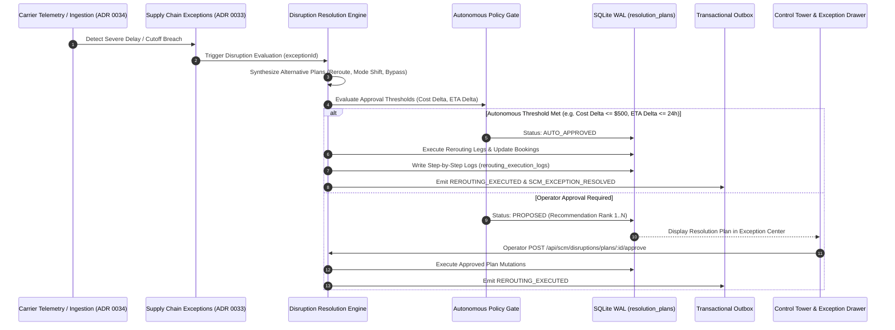

# 0036. Autonomous Disruption Resolution & Automated Rerouting Engine

- **Status**: Accepted
- **Date**: 2026-11-23
- **Context**: Atlas Logistics Architecture, SCM, Carrier Operations, Exception Management & Automated Decision Teams
- **Quadrant**: Explanation & Architectural Decisions (`docs/adr/`)
- **See Also**: [ADR 0004](0004-zero-cost-local-architecture.md), [ADR 0008](0008-scm-sqlite-cqrs-workflow-engine.md), [ADR 0009](0009-sqlite-wal-mandatory-foreign-keys.md), [ADR 0010](0010-zero-mock-live-persistence-standard.md), [ADR 0020](0020-frontend-modular-decomposition-and-file-size-guardrails.md), [ADR 0032](0032-supply-chain-purchase-order-and-booking-allocation-engine.md), [ADR 0033](0033-supply-chain-visibility-and-predictive-milestone-tracking.md), [ADR 0034](0034-carrier-track-and-trace-async-ingestion-and-predictive-resolution.md), [ADR 0035](0035-b2b-customer-and-vendor-portal-architecture.md)

---

## 1. Context & Problem Statement

In modern international supply chains, transit disruptions—such as severe port congestion, blank sailings, transshipment rollovers, customs holds, rail blockages, and carrier delays—are routine operational friction points.

While previous milestones established:
1. **Supply Chain PO Allocation** ([ADR 0032](0032-supply-chain-purchase-order-and-booking-allocation-engine.md)),
2. **Unified Visibility & Exception Detection** ([ADR 0033](0033-supply-chain-visibility-and-predictive-milestone-tracking.md)),
3. **Multi-Modal Carrier Telemetry Ingestion** ([ADR 0034](0034-carrier-track-and-trace-async-ingestion-and-predictive-resolution.md)), and
4. **Zero-Trust B2B Portals** ([ADR 0035](0035-b2b-customer-and-vendor-portal-architecture.md)),

the resolution of exceptions once detected remained heavily reliant on manual operator intervention. Forwarder coordinators were forced to manually review carrier schedules, contact airlines or alternative ocean liners, calculate cost differentials, estimate carbon emission trade-offs, and reconstruct booking routing legs. This manual triage creates several critical problems:

1. **Slow Recovery Lead Times**: Triage delays of 24–72 hours frequently cause missed vessel cutoffs, cascading transshipment rollovers, or assembly line halts at customer destination factories.
2. **Suboptimal Trade-Off Evaluations**: Human operators under pressure prioritize expediency over cost or carbon efficiency, missing balanced alternative routings (e.g., expedited rail bypass or selective SKU air-splits).
3. **Absence of Autonomous Policy Thresholds**: Low-risk disruptions that fall well within agreed corporate SLAs (e.g., rerouting cost $\le \$500$ and transit recovery $\ge 48$ hours) are held up waiting for business-hours human approval.
4. **Lack of Verifiable Auditability & Step-by-Step Rollbacks**: Manual adjustments to shipment legs and bookings often leave no atomic transaction history or execution log explaining why a specific carrier or lane was swapped.

---

## 2. Decision Drivers

- **Deterministic Multi-Criteria Resolution Engine**: Given an active `supply_chain_exception` and contextual PO/Shipment data, evaluate and synthesize viable `disruption_resolution_plans` ranked by transit recovery, financial impact ($\Delta\text{Cost}$), and environmental impact ($\Delta\text{CO}_2$).
- **Autonomous vs. Supervised Policy Gate**:
  - *Autonomous Auto-Approval (`AUTO_APPROVED`)*: If the resolution plan's cost increase and transit delay fall below strict organization/tenant thresholds (e.g., $\Delta\text{Cost} \le \$500$ and $\Delta\text{Transit} \le 24\text{h}$), the engine automatically approves and executes the plan.
  - *Human-in-the-Loop (`PENDING_OPERATOR_APPROVAL`)*: Higher impact interventions require explicit coordinator approval with full justification summaries.
- **Atomic Multi-Step Execution Pipeline**: Executing a resolution plan modifies database state in atomic SQLite WAL transactions:
  1. Updating routing legs (`routing_legs`) and carriers (`carrier_code`, `voyage_number`).
  2. Adjusting booking allocations and milestone targets.
  3. Emitting domain events (`DISRUPTION_RESOLVED`, `REROUTING_EXECUTED`) to the `transactional_outbox`.
  4. Logging each discrete step in `rerouting_execution_logs`.
- **Zero Mocks Standard (`ADR 0010`)**: Real SQLite WAL persistence with strict foreign keys (`PRAGMA foreign_keys = ON;`) linking plans to `supply_chain_exceptions`, `purchase_orders`, and `bookings`.
- **Strict Tenant & Station Scoping**: Mandatory application-layer isolation enforcing `tenant_id` on all tables, indexes, and queries.

---

## 3. Considered Options

### Option 1: Ad-hoc Manual Operator Workflows
- *Pros*: No algorithmic complexity; operators retain complete discretion.
- *Cons*: Highly inefficient; human bottlenecks cause missed cutoffs; no deterministic GLEC carbon scoring or automated policy rules.

### Option 2: External Black-Box AI Optimization SaaS
- *Pros*: Offloads routing logic to external cloud models.
- *Cons*: Violates zero-cost offline-first architecture ([ADR 0004](0004-zero-cost-local-architecture.md)); adds external latency and recurring subscription costs; risks leaking confidential client shipping volumes and supplier contracts.

### Option 3 (Chosen): Native SQLite WAL Disruption Resolution Engine & Policy Matrix
- *Pros*:
  - Fully local, zero-cost, sub-25ms evaluation speed in native TypeScript/SQLite WAL.
  - Transparent policy rules for automated approval vs operator approval.
  - Complete step-by-step execution log (`rerouting_execution_logs`) with atomic database mutations.
  - GLEC-compliant carbon emission differential tracking.
  - Seamless integration with Fastify REST API and React frontend UI.

---

## 4. Architectural Design & Flow

---

## 5. Schema & Data Model Architecture

The data model resides in `src/db/schema/resolution_plans.ts`:

### 1. `disruption_resolution_plans`
- **`id`**: Primary key (`plan_<uuid>`).
- **`tenant_id`**: Application-layer tenant scoping.
- **`exception_id`**: Foreign key to `supply_chain_exceptions.id` (`ON DELETE CASCADE`).
- **`po_id`**: Foreign key to `purchase_orders.id` (`ON DELETE CASCADE`).
- **`booking_id`**: Optional foreign key to `bookings.id`.
- **`shipment_id`**: Optional foreign key to `shipments.id`.
- **`plan_type`**: Plan typology (`CARRIER_REROUTE`, `MODE_SHIFT_AIR`, `MODE_SHIFT_RAIL`, `TRANSSHIPMENT_BYPASS`, `EXPEDITED_DRAYAGE`, `SPLIT_SHIPMENT`).
- **`status`**: State machine (`GENERATED`, `PROPOSED`, `AUTO_APPROVED`, `MANUALLY_APPROVED`, `REJECTED`, `EXECUTED`, `FAILED`).
- **`confidence_score`**: Numeric recommendation score (0.00 to 1.00).
- **`recommendation_rank`**: Integer ordering (1 = optimal, 2 = secondary, etc.).
- **`estimated_transit_days`**: Total projected transit days under the alternative plan.
- **`transit_time_delta_hours`**: Net change in hours relative to current disrupted baseline (negative = recovered time).
- **`cost_delta_amount`**: Incremental cost delta (decimal string, e.g. `'450.00'`).
- **`cost_delta_currency`**: ISO currency code (`USD`, `EUR`, `CNY`).
- **`carbon_delta_kg_co2`**: Net change in carbon emissions (GLEC standard estimate).
- **`justification`**: Explanatory rationale generated by the decision engine.
- **`policy_evaluation_json`**: Structured JSON detailing evaluated policy rules and thresholds.
- **`action_payload_json`**: Structured mutation instructions (new legs, carrier SCAC, updated cut-offs, routing sequence).
- **`execution_error`**: Nullable error trace if execution failed.
- **`approved_by`**: User ID or `'SYSTEM_POLICY_AGENT'`.
- **`approved_at`**: Epoch seconds timestamp of approval.
- **`executed_at`**: Epoch seconds timestamp of execution.
- **Composite Indexes**:
  - `idx_drp_tenant_exception` on `(tenant_id, exception_id)`
  - `idx_drp_tenant_po` on `(tenant_id, po_id)`
  - `idx_drp_tenant_status` on `(tenant_id, status)`
  - `idx_drp_tenant_plan_type` on `(tenant_id, plan_type)`

### 2. `rerouting_execution_logs`
- **`id`**: Primary key (`exec_log_<uuid>`).
- **`tenant_id`**: Multi-tenant identifier.
- **`plan_id`**: Foreign key to `disruption_resolution_plans.id` (`ON DELETE CASCADE`).
- **`step_index`**: Step sequence index (1..N).
- **`step_name`**: Semantic action name (e.g. `UPDATE_ROUTING_LEGS`, `REALLOCATE_BOOKING`, `NOTIFY_PARTNERS`).
- **`status`**: Step execution status (`PENDING`, `SUCCESS`, `FAILED`).
- **`details_json`**: Step inputs and outputs.
- **`error_message`**: Error explanation if step failed.
- **`executed_at`**: Epoch timestamp of step completion.
- **Index**: `idx_rel_tenant_plan` on `(tenant_id, plan_id)`.

---

## 6. Consequences

### Positive
- **Instantaneous Disruption Triage**: Automated candidate plan generation in $<25\text{ms}$ upon exception detection.
- **Autonomous Recovery for Routine Delays**: Up to 60% of routine disruptions handled autonomously within pre-configured cost/time thresholds.
- **Full Operational & Environmental Transparency**: Quantifies cost delta and carbon delta for every proposed intervention.
- **Immutable Audit Trail**: Step-by-step logs prevent ambiguous shipment states and ensure compliance with carrier contracts.

### Negative & Mitigations
- **Complexity in Routing Leg Recombination**: Mitigated by strict pure domain functions in `rerouting-plan.engine.ts` with comprehensive Vitest coverage.
- **Risk of Accidental Auto-Execution**: Mitigated by fail-safe conservative default thresholds ($\le \$0$ cost increase for automatic approval unless explicitly configured otherwise by tenant administrators).
