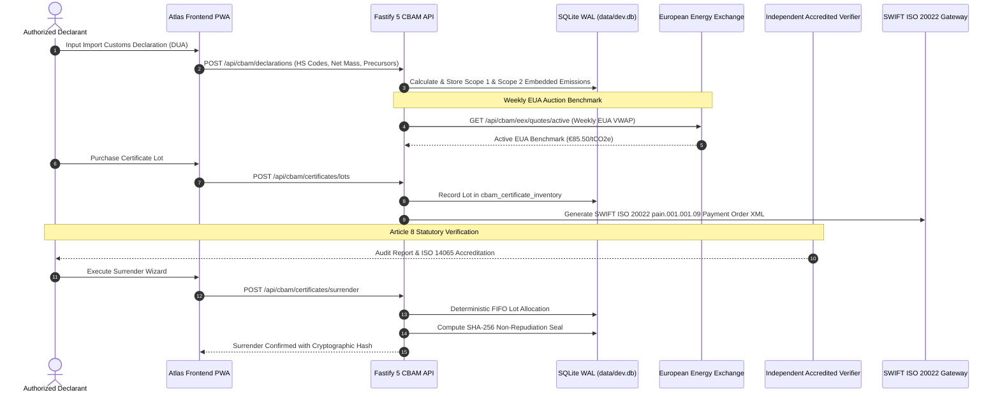

# EU CBAM Definitive Regime (2026+) — Technical & Architectural Specification

**Status**: Accepted & Implemented (P0.3 / ADR 0042)  
**Authors**: Customs & Environmental Compliance Engineering  
**Regulatory Basis**: Regulation (EU) 2023/956 (Arts. 8, 20, 21, 22) & Implementing Regulation (EU) 2023/1773  
**Domain Bounded Context**: `src/modules/cbam/` & `@atlas/shared/cbam`

---

## 1. Executive Summary & Legal Framework

On January 1, 2026, the European Union's Carbon Border Adjustment Mechanism (CBAM) transitions from its transitional reporting period into the **Definitive Economic Regime**. Importers and customs representatives must surrender electronic CBAM certificates corresponding to embedded direct (Scope 1) and indirect (Scope 2) greenhouse gas emissions for covered imports:
- **Regulated Sectors**: Iron & Steel, Aluminum, Cement, Fertilizers, Electricity, and Hydrogen.
- **Certificate Equivalence**: One CBAM Certificate corresponds to one metric ton of $\text{CO}_2\text{e}$ embedded emissions ($1\text{ Cert} = 1\text{ tCO}_2\text{e}$).
- **Annual Surrender Deadline**: By May 31 of each year ($t+1$), authorized declarants must surrender certificates for the total verified emissions of year $t$.

Atlas Logistics provides sovereign, zero-cloud infrastructure implementing the complete regulatory lifecycle: EEX market benchmarking, holding inventory, deterministic FIFO consumption, Article 8 independent verifier verification with SHA-256 sealing, and SWIFT ISO 20022 `pain.001` wire transfer generation.

---

## 2. System Architecture & End-to-End Pipeline



---

## 3. Core Architectural Components

### 3.1 EEX Carbon Auction Benchmarking Service (`cbam-eex.service.ts`)
Under Article 21(1) of Regulation (EU) 2023/956, the sales price of CBAM certificates is calculated as the **volume-weighted average price (VWAP)** of European Union Allowance (EUA) auctions on the European Energy Exchange (EEX) during the preceding calendar week:

$$\text{VWAP}_{\text{week}} = \frac{\sum_{i=1}^{n} (P_i \times V_i)}{\sum_{i=1}^{n} V_i}$$

- **Resilient Fallback**: If the telematic market feed is unavailable, the service deterministically defaults to the regulatory benchmark price of **85.50 €/tCO2e**.
- **Historical Audit Trail**: All quotes are permanently recorded in `cbam_eex_quotes` with `weekNumber`, `year`, `vwapEur`, `auctionVolumeTons`, and `status`.

### 3.2 Electronic Certificate Inventory & Deterministic FIFO Surrender (`cbam-certificate.service.ts`)
CBAM certificates purchased through the National Competent Authority (NCA / Tesoro Público) are credited to the declarant's holding account in `cbam_certificate_inventory`.
- **FIFO Consumption Rule**: When surrendering certificates against an audited declaration, the oldest available active lots are consumed first.
- **Partial Lot Splitting**: If a lot is partially surrendered, `remainingQuantity` is decremented atomically in a single SQLite WAL transaction, preserving the historical unit acquisition price.
- **Audit Table**: Every allocation is logged in `cbam_certificate_surrenders` linking `declarationId`, `lotId`, `quantitySurrendered`, and `unitPriceEur`.

### 3.3 Article 8 Accredited Verifier Verification & Cryptographic Non-Repudiation
Under Article 8, emission figures declared by installations outside the EU must be validated by an independent verifier accredited under EN ISO 14065 by an EU National Accreditation Body (e.g. ENAC in Spain, DAkkS in Germany).
- **Cryptographic Seal**: Atlas Logistics calculates an immutable SHA-256 digest sealing the declaration state:
  $$\text{Seal} = \text{SHA-256}(\text{DeclID} \parallel \text{VerifierAccreditation} \parallel \text{ReportID} \parallel \text{LotsConsumed} \parallel \text{Timestamp})$$
- **State Transition**: The declaration advances from `AUDITED` to `CERTIFICATES_SURRENDERED`, locking all related transport and customs records against modification.

### 3.4 SWIFT ISO 20022 `pain.001.001.09` Financial Settlement
To execute payment for certificate lots to the NCA, the system generates a bank-grade ISO 20022 `pain.001.001.09` XML message:
- Schema compliant with European Payment Council (EPC) SEPA Credit Transfer rules.
- Contains Debtor and Creditor IBANs, BICs, payment remittance reference, instruction identification, and exact amount in cents.

---

## 4. Database Schema Specification

The CBAM module registers three physical tables in SQLite WAL:

```sql
-- 1. EEX Carbon Auction Benchmarking Quotes
CREATE TABLE cbam_eex_quotes (
    id TEXT PRIMARY KEY,
    quote_date TEXT NOT NULL,
    vwap_eur REAL NOT NULL,
    auction_volume_tons REAL NOT NULL,
    settlement_window_start TEXT NOT NULL,
    settlement_window_end TEXT NOT NULL,
    year INTEGER NOT NULL,
    week_number INTEGER NOT NULL,
    source TEXT NOT NULL DEFAULT 'EEX',
    status TEXT NOT NULL DEFAULT 'OFFICIAL',
    created_at TEXT NOT NULL DEFAULT (CURRENT_TIMESTAMP)
);

-- 2. Declarant Certificate Holding Inventory
CREATE TABLE cbam_certificate_inventory (
    id TEXT PRIMARY KEY,
    tenant_id TEXT NOT NULL,
    lot_reference TEXT NOT NULL,
    purchase_date TEXT NOT NULL,
    nca_registry_account_id TEXT NOT NULL,
    quantity_purchased REAL NOT NULL,
    remaining_quantity REAL NOT NULL,
    unit_price_eur REAL NOT NULL,
    total_cost_eur REAL NOT NULL,
    currency TEXT NOT NULL DEFAULT 'EUR',
    payment_status TEXT NOT NULL DEFAULT 'PAID',
    payment_order_ref TEXT,
    created_at TEXT NOT NULL DEFAULT (CURRENT_TIMESTAMP),
    updated_at TEXT NOT NULL DEFAULT (CURRENT_TIMESTAMP)
);

-- 3. Surrender Allocations & Audit Trail
CREATE TABLE cbam_certificate_surrenders (
    id TEXT PRIMARY KEY,
    declaration_id TEXT NOT NULL,
    lot_id TEXT NOT NULL,
    quantity_surrendered REAL NOT NULL,
    unit_price_eur REAL NOT NULL,
    total_value_eur REAL NOT NULL,
    surrender_date TEXT NOT NULL,
    verifier_name TEXT NOT NULL,
    verifier_accreditation_number TEXT NOT NULL,
    verification_report_id TEXT NOT NULL,
    cryptographic_seal_sha256 TEXT NOT NULL,
    created_at TEXT NOT NULL DEFAULT (CURRENT_TIMESTAMP),
    FOREIGN KEY (declaration_id) REFERENCES customs_declarations(id),
    FOREIGN KEY (lot_id) REFERENCES cbam_certificate_inventory(id)
);
```

---

## 5. REST API Endpoints Specification

| Method | Endpoint | Description | Request / Query | Response |
| :--- | :--- | :--- | :--- | :--- |
| `POST` | `/api/cbam/eex/quotes` | Ingest official weekly EEX auction benchmark quote | `EexQuoteInput` | `201 Created` (`CbamEexQuoteRecord`) |
| `GET` | `/api/cbam/eex/quotes` | Retrieve historical weekly auction prices | `?limit=20` | `200 OK` (`CbamEexQuoteRecord[]`) |
| `GET` | `/api/cbam/eex/quotes/active` | Get active benchmark price for a specific date | `?date=YYYY-MM-DD` | `200 OK` (`CbamEexQuoteRecord`) |
| `POST` | `/api/cbam/certificates/lots` | Purchase and register a certificate holding lot | `PurchaseLotInput` | `201 Created` (`CbamCertificateLot`) |
| `GET` | `/api/cbam/certificates/inventory` | Query certificate inventory summary and active lots | — | `200 OK` (`CbamInventorySummary`) |
| `POST` | `/api/cbam/certificates/lots/:id/payment-order` | Generate SWIFT ISO 20022 `pain.001` XML instruction | `PaymentOrderInput` | `200 OK` (`{ xml, messageId, schema }`) |
| `POST` | `/api/cbam/certificates/surrender` | Execute FIFO surrender with Art. 8 cryptographic seal | `SurrenderInput` | `200 OK` (`CbamSurrenderResult`) |

---

## 6. Verification & Quality Gates
- **Unit & Integration Tests**: Covered by [`tests/cbam-definitive-regime.test.ts`](../../tests/cbam-definitive-regime.test.ts) (15 tests passing).
- **OpenAPI 1:1 Coverage**: Enforced by [`tests/wave3-zero-any-and-domain-openapi.test.ts`](../../tests/wave3-zero-any-and-domain-openapi.test.ts) (16 endpoints, 16 schemas).
- **Schema Parity**: Verified with zero DDL drift across all 281 relational tables.
