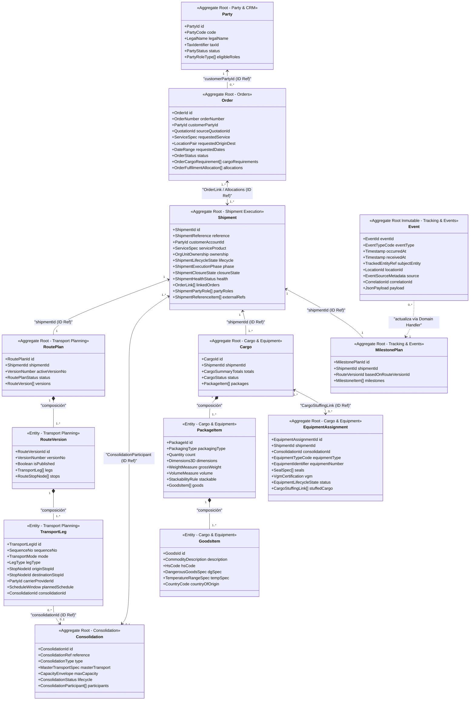
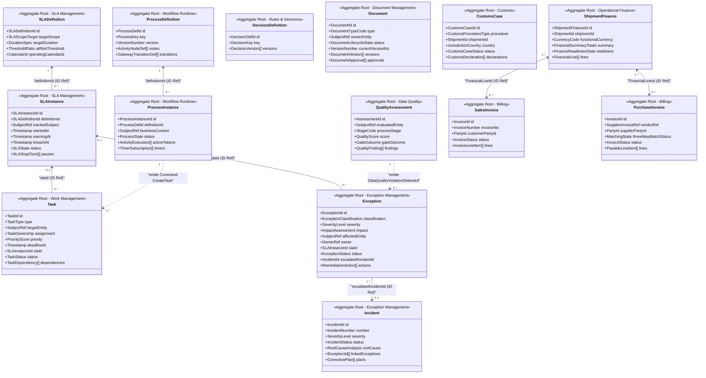
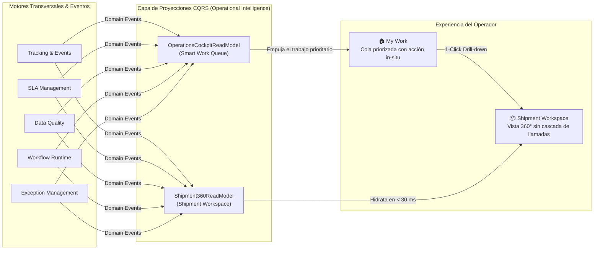
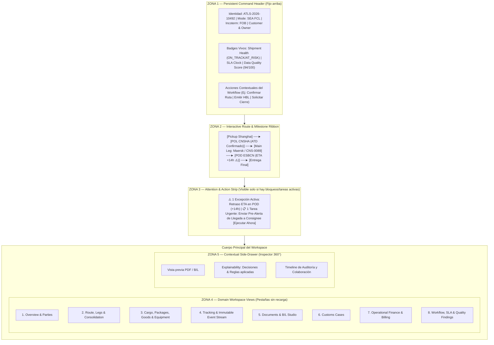
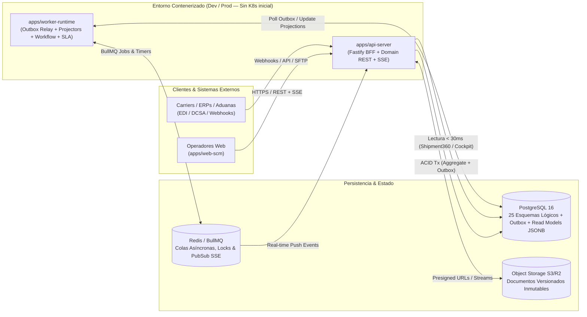

# Atlas-Logistics SCM — Software Architecture Blueprint v1

> [!IMPORTANT]
> **Diez Reglas Arquitectónicas Cerradas (Baseline Inmutable)**:
> 1. `Shipment` **no** será un aggregate gigante; coordina el expediente sin absorber el resto de dominios.
> 2. `RoutePlan`, `Cargo`, `Document`, `Task`, `Exception`, `ShipmentFinance`, etc. tienen **ownership independiente**.
> 3. **Estado operacional** (`Milestone` / `Lifecycle`) y **hechos ocurridos** (`Event`) están estrictamente separados.
> 4. `Workflow Runtime` decide el proceso; `Rules & Decisions` evalúa condiciones; `Work Management` representa el trabajo (`Task`).
> 5. Las integraciones externas (`Integration Hub`) nunca contaminan directamente el modelo canónico.
> 6. **Ningún bounded context lee tablas privadas de otro** (`Nunca OrderRepository → shipment_table`).
> 7. Las pantallas de alta composición utilizan **Read Models / Projections** (`Shipment360ReadModel`, `OperationsCockpitReadModel`).
> 8. **Consistencia fuerte (ACID)** dentro del límite del Aggregate; **consistencia eventual** entre contextos.
> 9. `Domain Events` + `Transactional Outbox` + `Idempotencia` forman la columna vertebral asíncrona.
> 10. Las **25 fronteras de dominio** viven dentro de un **Modular Monolith Event-Driven** (`Área ≠ Módulo UI ≠ Bounded Context ≠ Package ≠ Microservicio`).

---

## Parte I — Mapa Maestro (10 Áreas de Producto y 25 Bounded Contexts)

| # | Bounded Context | Área de Producto | Tipo DDD | Aggregate Principal | Responsabilidad |
| :-: | :--- | :--- | :---: | :--- | :--- |
| 01 | `Identity & Organization` | 09. Platform | 🔵 Platform | `Organization`, `UserAccess` | Estructura organizativa (`Group → LegalEntity → Branch → Dept → Team`), RBAC + ABAC |
| 02 | `Party & CRM` | 02. Commercial | 🟠 Supporting | `Party` | Modelo unificado de partes (Customer, Supplier, Carrier, Agent, Shipper, Consignee), contactos y relaciones |
| 03 | `Master Data` | 09. Platform | 🔵 Platform | `MasterDataItem` | UN/LOCODEs, puertos, aeropuertos, países, monedas, unidades, tipos de equipo y clasificación de mercancías |
| 04 | `Quotations` | 02. Commercial | 🟠 Supporting | `Quotation` | Ofertas comerciales, simulación de escenarios y routing comercial |
| 05 | `Procurement` | 03. Procurement | 🟠 Supporting | `RateContract` | Tarifas de compra, contratos con carriers, surcharges y vigencias |
| 06 | `Orders` | 04. Operations | 🔴 **Core** | `Order` | Demanda logística contratada por el cliente y requisitos de fulfilment |
| 07 | `Shipment Execution` | 04. Operations | 🔴 **Core** | `Shipment` | Coordinación logística central, ciclo de vida del expediente, ownership y `Shipment Health` |
| 08 | `Transport Planning` | 04. Operations | 🔴 **Core** | `RoutePlan` | `RouteVersion`, `TransportLeg`, `Stop/Node`, modos de transporte y horarios planificados |
| 09 | `Consolidation` | 04. Operations | 🔴 **Core** | `Consolidation` | Agrupación N↔N `Shipment` (House) con `Master Transport` y gestión de capacidad |
| 10 | `Cargo & Equipment` | 04. Operations | 🔴 **Core** | `Cargo`, `EquipmentAssignment` | Jerarquía desacoplada `Cargo → Packages → Goods` y vínculo `Cargo ↔ Equipment` |
| 11 | `Tracking & Events` | 04. Operations | 🔴 **Core** | `EventStream`, `MilestonePlan` | Registro inmutable de hechos (`Event`) y matriz de hitos (`Planned` / `Estimated` / `Actual`) |
| 12 | `Work Management` | 01. Workspace | 🔴 **Core** | `Task` | Trabajo humano y de sistema (`Human`, `System`, `Approval`, `Review`, `Follow-up`), base de la Smart Work Queue |
| 13 | `Exception Management` | 01. Workspace | 🔴 **Core** | `Exception`, `Incident` | Desviaciones operativas (`Exception`) y problemas formales de remediación/root-cause (`Incident`) |
| 14 | `Document Management` | 05. Trade & Docs | 🟠 Supporting | `Document` | Plantillas, versiones, aprobaciones y artefactos (`Draft → Review → Approved → Issued`) |
| 15 | `Customs` | 05. Trade & Docs | 🟠 Supporting | `CustomsCase` | Expedientes y declaraciones aduaneras con ciclo de vida propio |
| 16 | `Operational Finance` | 06. Finance | 🟠 Supporting | `ShipmentFinance` | `FinancialLine` (Cost/Revenue, estimado/confirmado, divisa), margen, rentabilidad y accruals |
| 17 | `Billing` | 06. Finance | 🟠 Supporting | `SalesInvoice`, `PurchaseInvoice` | Facturación formal a cliente y de proveedor (`Finance ≠ Invoice`) |
| 18 | `SLA Management` | 07. Op. Control | 🔴 **Core** | `SLADefinition`, `SLAInstance` | Compromisos contractuales/operativos y evaluación en tiempo real de riesgo e incumplimiento |
| 19 | `Data Quality` | 07. Op. Control | 🟠 Supporting | `QualityAssessment` | Evaluación contextual de completitud/consistencia (`Rule`, `Finding`, `Score`, `Severity`) |
| 20 | `Workflow Runtime` | 08. Automation | 🔴 **Core** | `ProcessDefinition`, `ProcessInstance` | Motor BPMN-like agnóstico del dominio logístico (tasks, gateways, timers, events, subprocesses) |
| 21 | `Rules & Decisions` | 08. Automation | 🔴 **Core** | `DecisionDefinition` | Tablas de decisión versionadas (`Inputs → Decision → Output`) con trazabilidad de explainability |
| 22 | `Notifications` | 08. Automation | 🔵 Platform | `Notification` | Resolución de destinatarios, canales, plantillas y políticas anti-ruido |
| 23 | `Integration Hub` | 09. Platform | 🔵 Platform | `IntegrationFlow` | Conectores externos, autenticación, mapeo, validación y traducción a `Canonical Command/Event` |
| 24 | `Operational Intelligence` | 07. Op. Control | 🟠 Supporting | `Read Models` | Proyecciones CQRS (`Shipment360ReadModel`, `OperationsCockpitReadModel`, Control Tower, KPIs) |
| 25 | `Configuration & Governance` | 10. Governance | 🔵 Platform | `ConfigurationSet` | Configuración funcional versionada, auditoría inmutable y observabilidad |

---

## Parte II — Domain Model v1 del Núcleo Operativo

Bajamos ahora al diseño táctico DDD (**`Aggregate → Entity → Value Object → Relación → Cardinalidad → Invariantes`**) para la cadena nuclear:

`Party` / `Order` → `Shipment` → `RoutePlan` → `TransportLeg` → `Consolidation` → `Cargo` → `Package` → `Goods` → `Equipment` → `Milestone` → `Event`

### 1. Vista Global del Modelo de Dominio Nuclear (Fronteras de Aggregate)



---

### 2. Especificación Detallada de Aggregates, Entidades, Value Objects e Invariantes

---

#### 2.1. Contexto `Party & CRM` — Aggregate `Party`

- **Propósito**: Evitar silos duplicados de tablas `Customer`, `Supplier`, `Carrier`, `Agent`. Una misma organización jurídica o sede puede actuar como `Customer` en una orden, `Shipper` en un expediente y `Supplier` en otro.
- **Estructura del Aggregate**:
  - **Aggregate Root**: `Party` (`partyId: PartyId`)
  - **Entidades Internas**:
    - `PartyOrganizationUnit`: Sedes/oficinas operativas de la parte (`branchCode`, `address: PostalAddress`, `unlocode: LocationId`).
    - `PartyContact`: Personas o buzones operativos (`name`, `email`, `phone`, `contactRole`: *BookingDesk, Documentation, Customs, Billing*).
    - `PartyRoleCapability`: Roles habilitados para esta parte (`CUSTOMER`, `CARRIER`, `FREIGHT_FORWARDER_AGENT`, `CUSTOMS_BROKER`, `TERMINAL_DEPOT`, `TRUCKER`) con sus metadatos (`scacCode`, `iataCode`, `creditStatus`).
  - **Value Objects**: `PartyId`, `TaxIdentifier` (`countryCode + vatNumber`), `PostalAddress`, `ExternalCarrierCode` (`SCAC` / `IATA`).
- **Invariantes**:
  1. Un `Party` activo con rol `CUSTOMER` o `SUPPLIER` debe tener al menos una dirección fiscal válida y `TaxIdentifier` verificado antes de permitir facturación (`Billing`), aunque puede operar en modo `PROSPECT` durante `Quotation`.
  2. Si desempeña el rol `CARRIER` marítimo o aéreo, debe poseer un identificador estándar (`SCAC` o prefijo `IATA`) único.
  3. Un `Party` no se elimina físicamente si está referenciado por cualquier `Order`, `Shipment` o `FinancialLine`; solo admite transición a `INACTIVE` o `BLOCKED`.

---

#### 2.2. Contexto `Orders` — Aggregate `Order`

- **Propósito**: Representar **qué** demanda logística ha contratado el cliente, desacoplado de **cómo** se ejecutará físicamente.
- **Estructura del Aggregate**:
  - **Aggregate Root**: `Order` (`orderId: OrderId`)
  - **Entidades Internas**:
    - `OrderCargoRequirement` (`lineId`, `commoditySummary`, `requestedPackageCount`, `requestedGrossWeight: Weight`, `requestedVolume: Volume`, `equipmentPreference`, `isDangerousGoods`, `isTemperatureControlled`).
    - `OrderFulfilmentAllocation` (`allocationId`, `shipmentId: ShipmentId`, `allocatedPackages`, `allocatedWeight: Weight`, `allocatedVolume: Volume`, `allocationStatus`).
    - `OrderCommercialReference` (`refType`: *CUSTOMER_PO, SALES_CONTRACT, LC_NUMBER*, `refValue`).
  - **Value Objects**:
    - `OrderId`, `OrderNumber` (ej. `ORD-2026-00412`)
    - `RequestedServiceSpec` (`serviceMode`: *FCL, LCL, AIR, ROAD, MULTIMODAL*, `incoterm`: *EXW, FOB, CIF, DAP, DDP*, `movementScope`: *DOOR_TO_DOOR, PORT_TO_PORT, DOOR_TO_PORT*)
    - `RequestedRouteEndpoints` (`originLocationId`, `destinationLocationId`, `pickupAddress?`, `deliveryAddress?`)
    - `RequestedScheduleWindow` (`cargoReadyDate`, `latestDepartureDate?`, `requiredDeliveryDate?`)
    - `OrderFulfilmentState` (`DRAFT`, `CONFIRMED`, `READY_FOR_FULFILMENT`, `PARTIALLY_FULFILLED`, `FULFILLED`, `CANCELLED`)
- **Cardinalidad con `Shipment`**:
  - **`1 Order → N Shipments`** (Split / Partial Shipments: un pedido de 10 contenedores se ejecuta en 3 expedientes distintos).
  - **`N Orders → 1 Shipment`** (Buyer's Consolidation / Combinación operativa: 4 pedidos del mismo comprador en Asia se agrupan en un único expediente).
  - Por tanto, la relación general es **`N Orders ↔ N Shipments`**, materializada mediante `OrderFulfilmentAllocation` (en `Orders`) y `OrderLink` (en `Shipment Execution`).
- **Invariantes**:
  1. Una `Order` no puede pasar a `CONFIRMED` ni `READY_FOR_FULFILMENT` sin `customerPartyId`, `originLocationId`, `destinationLocationId`, `incoterm`, `cargoReadyDate` y al menos un `OrderCargoRequirement` con peso/bultos $> 0$.
  2. La suma de cantidades asignadas en `OrderFulfilmentAllocation` solo puede superar lo pedido si existe una tolerancia comercial explícita configurada (ej. $\pm 5\%$).
  3. Una `Order` no puede pasar a `CANCELLED` si tiene alguna `OrderFulfilmentAllocation` vinculada a un `Shipment` activo no cancelado.

---

#### 2.3. Contexto `Shipment Execution` — Aggregate `Shipment`

- **Propósito**: Ser el **coordinador central del expediente logístico** sin convertirse en un objeto monolítico omnisciente.
- **Estructura del Aggregate**:
  - **Aggregate Root**: `Shipment` (`shipmentId: ShipmentId`)
  - **Entidades Internas**:
    - `ShipmentOrderLink` (`orderId: OrderId`, `orderNumberSnapshot`, `allocationType`: *FULL, SPLIT, COMBINED*).
    - `ShipmentPartyRole` (`role`: *CUSTOMER_ACCOUNT, SHIPPER, CONSIGNEE, NOTIFY_PARTY, ORIGIN_AGENT, DESTINATION_AGENT, CUSTOMS_BROKER*, `partyId: PartyId`, `contactId?`).
    - `ShipmentAssignment` (`organizationId`, `branchId`, `departmentId`, `teamId`, `ownerUserId`, `assignedAt`).
    - `ShipmentReference` (`refType`: *BOOKING_REF, CARRIER_BOOKING_NO, MASTER_BL, HOUSE_BL, PO_NUMBER, CUSTOMS_MRN*, `refValue`, `isPrimary`).
  - **Value Objects**:
    - `ShipmentId`, `ShipmentReferenceCode` (ej. `ATLS-2026-10492`)
    - `ShipmentServiceSpec` (`transportModeSummary`, `serviceType`: *FCL, LCL, AIR_STD, AIR_EXPRESS, FTL, LTL*, `incoterm`, `direction`: *EXPORT, IMPORT, CROSS_TRADE*)
    - `ShipmentLifecycleState` (`CREATED`, `PLANNED`, `BOOKED`, `IN_EXECUTION`, `ARRIVED`, `DELIVERED`, `CLOSURE_REQUESTED`, `CLOSED`, `CANCELLED`)
    - `ShipmentExecutionPhase` (`PRE_CARRIAGE`, `ORIGIN_TERMINAL`, `MAIN_TRANSIT`, `TRANSSHIPMENT`, `DESTINATION_TERMINAL`, `ON_CARRIAGE`, `COMPLETED`)
    - `ShipmentClosureState` (`OPEN`, `OPERATIONS_COMPLETED`, `FINANCIALLY_READY`, `LOCKED_AND_ARCHIVED`)
    - `ShipmentHealth` (`status`: *ON_TRACK, AT_RISK, CRITICAL, BLOCKED*, `score`: $0\text{--}100$, `activeRiskDrivers`: *SLA_RISK, EXCEPTION_OPEN, DATA_QUALITY_LOW, DELAYED_ETA*)
- **Invariantes**:
  1. Todo `Shipment` debe tener en todo momento una organización/branch responsable (`ShipmentAssignment`) y una cuenta de cliente (`CUSTOMER_ACCOUNT`).
  2. Un `Shipment` no puede transitar a `IN_EXECUTION` si no tiene al menos un rol `SHIPPER` y `CONSIGNEE` asignados y una referencia a un `RoutePlan` publicado.
  3. Un `Shipment` no puede transitar a `CLOSED` (`RequestShipmentClosure` → `ShipmentClosed`) si su `closureState` no confirma que los hitos físicos de entrega se han completado y no existen bloqueos críticos abiertos.
  4. `ReopenShipment` requiere motivo auditable y emite `ShipmentReopened` (que notifica a `Operational Finance` por si requiere ajustes de accrual).

---

#### 2.4. Contexto `Transport Planning` — Aggregate `RoutePlan`

- **Propósito**: Definir y versionar **cómo** se transporta el `Shipment` a través de nodos y tramos multimodales, preservando el historial de replanificaciones.
- **Estructura del Aggregate**:
  - **Aggregate Root**: `RoutePlan` (`routePlanId: RoutePlanId`, `shipmentId: ShipmentId`)
  - **Entidades Internas**:
    - `RouteVersion` (`routeVersionId`, `versionNumber`: $1, 2, \dots$, `status`: *DRAFT, PUBLISHED, SUPERSEDED*, `changeReason`, `publishedAt`).
    - `StopNode` (`stopId`, `sequenceNumber`, `locationId: LocationId`, `facilityCode?`, `stopFunction`: *PICKUP, ORIGIN_CFS, PORT_OF_LOADING, TRANSSHIPMENT_PORT, PORT_OF_DISCHARGE, DESTINATION_CFS, FINAL_DELIVERY*, `cutOffs`: `CutOffSet`).
    - `TransportLeg` (`legId: TransportLegId`, `sequenceNumber`, `originStopId`, `destinationStopId`, `transportMode`: *SEA, AIR, ROAD, RAIL, INLAND_WATERWAY*, `legRole`: *PRE_CARRIAGE, MAIN_CARRIAGE, ON_CARRIAGE*, `carrierPartyId: PartyId`, `meansOfTransport`: `TransportMeansSpec`, `plannedSchedule`: `PlannedScheduleWindow`, `consolidationId?: ConsolidationId`).
  - **Value Objects**:
    - `PlannedScheduleWindow` (`plannedDeparture: Timestamp`, `plannedArrival: Timestamp`, `transitDurationHours: number`)
    - `TransportMeansSpec` (`vesselName?`, `imoNumber?`, `voyageNumber?`, `flightNumber?`, `vehiclePlate?`, `serviceLoopCode?`)
    - `CutOffSet` (`documentationCutOff?`, `vgmCutOff?`, `cargoGateInCutOff?`, `customsCutOff?`)
- **Invariantes**:
  1. **Continuidad topológica de la ruta**: En cualquier `RouteVersion` publicada, para todo tramo $i > 1$, el `originStopId` del tramo $i$ debe coincidir exactamente con el `destinationStopId` del tramo $i-1$.
  2. **Monotonía cronológica**: En cada `TransportLeg`, `plannedDeparture < plannedArrival`; y entre tramos consecutivos, `leg[i].plannedDeparture >= leg[i-1].plannedArrival`.
  3. **Inmutabilidad de versiones publicadas**: Una `RouteVersion` en estado `PUBLISHED` no se sobrescribe destructivamente al cambiar un tramo o proveedor; `ChangeSchedule` / `ReplaceLeg` genera una nueva `RouteVersion` ($v+1$) y al publicarla (`PublishRouteVersion`) marca la anterior como `SUPERSEDED` y emite `RouteVersionPublished`.

---

#### 2.5. Contexto `Consolidation` — Aggregate `Consolidation`

- **Propósito**: Gestionar el transporte compartido (`House ↔ Master`) sin distorsionar el aggregate `Shipment`.
- **Estructura del Aggregate**:
  - **Aggregate Root**: `Consolidation` (`consolidationId: ConsolidationId`)
  - **Entidades Internas**:
    - `ConsolidationParticipant` (`participantId`, `shipmentId: ShipmentId`, `transportLegId?: TransportLegId`, `allocatedPackages: number`, `allocatedWeight: Weight`, `allocatedVolume: Volume`, `houseReference`, `joinedAt`).
  - **Value Objects**:
    - `ConsolidationId`, `ConsolidationNumber` (ej. `CNS-2026-0089`)
    - `ConsolidationType` (`OCEAN_LCL_CONSOLE`, `OCEAN_FCL_BUYERS_CONSOLE`, `AIR_MASTER_CONSOLE`, `ROAD_GROUPAGE`)
    - `MasterTransportReference` (`carrierPartyId`, `masterDocNumber` [*MBL / MAWB / CMR*], `originTerminalId`, `destinationTerminalId`, `vesselOrFlight`, `voyageOrDate`, `etd`, `eta`)
    - `CapacityAllocation` (`maxWeightKg`, `maxVolumeCbm`, `currentWeightKg`, `currentVolumeCbm`, `utilizationPercentage`)
    - `ConsolidationLifecycle` (`OPEN`, `PLANNED`, `STUFFING_IN_PROGRESS`, `CLOSED`, `IN_TRANSIT`, `DECONSOLIDATED`, `CANCELLED`)
- **Relación Cardinal**:
  - `Shipment` `N ↔ N` `Consolidation` (un `Shipment` puede participar en un consolidado de origen y otro de destino en rutas complejas; una `Consolidation` agrupa $1..N$ `Shipments`).
- **Invariantes**:
  1. No se puede añadir un `Shipment` (`ShipmentAddedToConsolidation`) si el estado de `Consolidation` es `CLOSED`, `IN_TRANSIT` o `DECONSOLIDATED`.
  2. La suma de `allocatedWeight` y `allocatedVolume` de todos los `ConsolidationParticipant` no puede exceder `maxCapacity` salvo autorización explícita de sobre-estiba.
  3. Todos los `Shipments` participantes en una misma `Consolidation` deben compartir compatibilidad de mercancía (ej. no mezclar mercancía peligrosa incompatible `IMO` con carga alimentaria si las reglas ADR/IMDG lo prohíben).

---

#### 2.6. Contexto `Cargo & Equipment` — Aggregates `Cargo` y `EquipmentAssignment`

- **Propósito**: Modelar qué se transporta (`Goods`), cómo se embala (`Packages`), cómo se agrupa operativamente (`Cargo`) y en qué unidad física viaja (`Equipment`), de forma 100% agnóstica al modo de transporte.

##### A. Aggregate `Cargo`
- **Aggregate Root**: `Cargo` (`cargoId: CargoId`, `shipmentId: ShipmentId`)
- **Entidades Internas**:
  - `Package` (`packageId: PackageId`, `packageTypeCode` [*PALLET, CARTON, CRATE, DRUM, BAG, BUNDLE, LOOSE*], `quantity: number`, `dimensions: Dimensions3D`, `grossWeight: Weight`, `netWeight?: Weight`, `volume: Volume`, `marksAndNumbers: string`, `isStackable: boolean`)
    - Contiene $1..N$ **`Goods`** (`goodsId: GoodsId`, `commodityCode`, `description`, `hsCode: HsCode`, `countryOfOrigin`, `customsValue?: Money`, `dangerousGoods?: DangerousGoodsProfile`, `temperatureControl?: TemperatureProfile`).
- **Value Objects**:
  - `Dimensions3D` (`lengthCm`, `widthCm`, `heightCm`)
  - `Weight` (`value`, `unit`: *KG, LB*), `Volume` (`value`, `unit`: *CBM, CFT*)
  - `ChargeableWeight` (`actualGrossKg`, `volumetricFactor`, `chargeableKg`)
  - `DangerousGoodsProfile` (`unNumber`, `imoClass`, `packingGroup`, `flashPointCelsius?`, `emergencyContact`)
  - `TemperatureProfile` (`minCelsius`, `maxCelsius`, `setPointCelsius`, `ventilationCbmPerHour?`)
- **Invariantes de `Cargo`**:
  1.Todo `Cargo` debe contener al menos un `Package`, y todo `Package` debe describir al menos un `Goods` item.
  2. El peso bruto total de `Cargo` es invariablemente igual a la suma de los pesos brutos de sus `Packages`, y nunca inferior a la suma de pesos netos de sus `Goods`.
  3. Si algún `Goods` declara `dangerousGoods != null`, el aggregate `Cargo` marca automáticamente `hasDangerousGoods = true` y emite `DangerousGoodsDeclared` en la misma transacción.

##### B. Aggregate `EquipmentAssignment`
- **Aggregate Root**: `EquipmentAssignment` (`equipmentAssignmentId: EquipmentAssignmentId`)
- **Entidades Internas**:
  - `CargoEquipmentAllocation` (`allocationId`, `cargoId: CargoId`, `packageId?: PackageId`, `loadedPackageCount: number`, `loadedWeightKg: number`, `loadedVolumeCbm: number`).
- **Value Objects**:
  - `EquipmentSpec` (`category`: *MARITIME_CONTAINER, ROAD_TRAILER, AIR_ULD, RAIL_WAGON, SWAP_BODY*, `isoTypeCode`: *20GP, 40GP, 40HC, 40RF, 45HC, AKE, PMC*)
  - `EquipmentUnitIdentity` (`equipmentNumber` ej. `MSKU9284712`, validado con dígito de control ISO 6346 cuando es contenedor marítimo)
  - `SealRecord` (`sealNumber`, `sealSource`: *CARRIER, SHIPPER, CUSTOMS, TERMINAL*, `appliedAt`)
  - `VgmRecord` (`verifiedGrossMassKg`, `method`: *METHOD_1_WEIGHING, METHOD_2_CALCULATION*, `authorizedSignatory`, `verifiedAt`)
  - `EquipmentStatus` (`REQUESTED`, `RESERVED`, `RELEASED_FROM_DEPOT`, `STUFFED`, `SEALED`, `GATED_IN`, `IN_TRANSIT`, `GATED_OUT`, `RETURNED_EMPTY`)
- **Relación `Cargo ↔ Equipment`**:
  - Relación **`N:M` (`CargoEquipmentAllocation`)**:
    - Un `Cargo` grande (ej. 50 pallets) puede repartirse en **varios `Equipment`** (3 contenedores).
    - Varios `Cargo` (de distintos pedidos o expedientes LCL) pueden estibarse dentro de **un mismo `Equipment`**.
    - En carga suelta / convencional (*Breakbulk* o paquetería aérea suelta), `Cargo` existe válidamente con `0` `EquipmentAssignments`.
- **Invariantes de `EquipmentAssignment`**:
  1. Un `EquipmentAssignment` no puede pasar a estado `SEALED` o `GATED_IN` sin un `equipmentNumber` válido y al menos un `SealRecord` activo (cuando el tipo de equipo requiere precinto).
  2. Para transporte marítimo FCL, `vgm.verifiedGrossMassKg` debe ser $\ge \text{tareWeightKg} + \sum \text{loadedWeightKg}$.

---

#### 2.7. Contexto `Tracking & Events` — Aggregates `Event` y `MilestonePlan`

- **Propósito**: Separar radicalmente **los hechos ocurridos (`Event`)** de **las expectativas operativas del proceso (`MilestonePlan`)**.

##### A. Aggregate `Event` (Inmutable / Append-Only)
- **Aggregate Root**: `Event` (`eventId: EventId`)
- **Value Objects**:
  - `EventType` (código canónico: `BOOKING_CONFIRMED`, `EMPTY_PICKED_UP`, `GATE_IN_FULL`, `LOADED_ON_VESSEL`, `VESSEL_DEPARTED`, `TRANSSHIPMENT_ARRIVED`, `VESSEL_ARRIVED`, `DISCHARGED_AT_POD`, `CUSTOMS_RELEASED`, `GATE_OUT_FULL`, `DELIVERED_TO_CONSIGNEE`, `POSITION_REPORTED`, `ESTIMATED_TIME_UPDATED`)
  - `SubjectEntityRef` (`entityType`: *SHIPMENT, TRANSPORT_LEG, CONSOLIDATION, EQUIPMENT*, `entityId: string`, `externalNaturalKey`: ej. `containerNumber` o `masterBlNumber`)
  - `EventTimestamps` (`occurredAt: Timestamp` [cuándo sucedió en el mundo físico], `receivedAt: Timestamp` [cuándo lo recibió la plataforma])
  - `EventSource` (`sourceType`: *CARRIER_EDI, DCSA_API, AIS_SATELLITE, PORT_COMMUNITY_SYSTEM, IOT_DEVICE, MANUAL_USER*, `providerCode`, `idempotencyKey`)
- **Invariantes de `Event`**:
  1. **Inmutabilidad absoluta**: Una vez persistido, un `Event` jamás se edita ni se borra (`UPDATE`/`DELETE` prohibidos). Si un carrier corrige una fecha anterior, entra un nuevo `Event` con su propio `eventId` y `receivedAt` posterior.
  2. **Idempotencia**: Dos mensajes con la misma `idempotencyKey` (`source + entityRef + eventType + occurredAt`) no duplican el hecho.

##### B. Aggregate `MilestonePlan`
- **Aggregate Root**: `MilestonePlan` (`milestonePlanId: MilestonePlanId`, `shipmentId: ShipmentId`)
- **Entidades Internas**:
  - `Milestone` (`milestoneId`, `sequenceNo`, `milestoneCode`: *ETD_POL, ATD_POL, ETA_POD, ATA_POD, POD_DELIVERY*, `relatedLegId?: TransportLegId`, `locationId: LocationId`, `plannedAt?: Timestamp`, `estimatedAt?: Timestamp`, `actualAt?: Timestamp`, `status`: *UPCOMING, ON_TIME, AT_RISK, DELAYED, COMPLETED, CANCELLED*)
  - `MilestoneEstimationHistory` (`historyId`, `previousEstimatedAt`, `newEstimatedAt`, `causedByEventId: EventId`, `recordedAt`, `deltaMinutes`).
- **Invariantes de `MilestonePlan`**:
  1. `plannedAt` se fija al publicar la `RouteVersion` base y solo cambia ante una replanificación formal autorizada (`RouteVersionPublished`).
  2. Un evento de tipo estimado (`ESTIMATED_TIME_UPDATED`) actualiza `estimatedAt` y añade una entrada en `MilestoneEstimationHistory`, sin sobrescribir `plannedAt` ni `actualAt`.
  3. Un hecho real confirmado (`actualAt != null`) marca el `Milestone` como `COMPLETED`, calcula la desviación definitiva (`actualAt - plannedAt`) y bloquea futuras actualizaciones meramente estimadas sobre ese hito.

---

### 3. Tabla Resumen de Relaciones y Cardinalidades del Núcleo

| Origen | Destino | Cardinalidad | Tipo de Vínculo | Regla de Integridad |
| :--- | :--- | :---: | :--- | :--- |
| `Party` | `Order` | `1 : N` | Referencia por ID (`customerPartyId`) | `Order` referencia `PartyId`; no embebe ni muta la tabla de `Party` |
| `Order` | `Shipment` | `N : M` | Referencia por ID (`OrderFulfilmentAllocation` / `OrderLink`) | Soportado Split (`1→N`), Consolidación comercial (`N→1`) y combinación (`N→M`) |
| `Shipment` | `RoutePlan` | `1 : 1` (activo) | Referencia por ID (`shipmentId`) | Un `RoutePlan` por `Shipment`, con $1..N$ `RouteVersions` históricas |
| `RouteVersion` | `TransportLeg` | `1 : N` | **Composición interna** (dentro de `RoutePlan`) | Continuidad topológica y cronológica garantizada por `RoutePlan` |
| `Shipment` | `Consolidation` | `N : M` | Referencia por ID (`ConsolidationParticipant`) | Un House participa en $0..N$ consolidaciones; un Master agrupa $1..N$ Houses |
| `TransportLeg` | `Consolidation` | `N : 1` (opcional) | Referencia por ID (`consolidationId`) | Tramo compartido apunta al `ConsolidationId` que gestiona el Master Transport |
| `Shipment` | `Cargo` | `1 : N` | Referencia por ID (`shipmentId`) | El manifiesto de carga del expediente vive en el contexto `Cargo & Equipment` |
| `Cargo` | `Package` | `1 : N` | **Composición interna** (dentro de `Cargo`) | Todo `Cargo` agrega el peso/volumen de sus `Packages` |
| `Package` | `Goods` | `1 : N` | **Composición interna** (dentro de `Cargo`) | Permite pallets/cajas mixtas con múltiples partidas `Goods` / HS Codes |
| `Cargo` | `EquipmentAssignment` | `N : M` | Referencia por ID (`CargoEquipmentAllocation`) | Desacopla mercancía de contenedor/camión/ULD; soporta FCL, LCL y carga suelta |
| `Shipment` | `MilestonePlan` | `1 : 1` | Referencia por ID (`shipmentId`) | Matriz de expectativas `Planned / Estimated / Actual` del expediente |
| `Event` | `MilestonePlan` | `N : 1` | Correlación por Evento de Dominio | `Event` es el hecho inmutable; `MilestonePlan` actualiza su estado en reacción al hecho |

---

## Parte III — Domain Model v1: Control Operativo, Automatización y Soporte de Negocio

Completamos el modelo de dominio táctico (**`Aggregate → Entity → Value Object → Relación → Cardinalidad → Invariantes`**) para los 10 contextos de Control, Automatización, Documentación, Aduanas y Finanzas.

### 1. Vista Global de Aggregates de Control, Automatización y Soporte



---

### 2. Especificación Detallada de Aggregates de Control y Experiencia

#### 2.1. Contexto `12. Work Management` — Aggregate `Task`
- **Propósito**: Representar cualquier unidad de trabajo accionable (humana o automática) sin acoplarla a un único tipo de entidad. Alimenta directamente la **Smart Work Queue**.
- **Aggregate Root**: `Task` (`taskId: TaskId`)
- **Entidades Internas**:
  - `TaskDependency` (`dependencyId`, `predecessorTaskId: TaskId`, `dependencyType`: *FINISH_TO_START*, `isSatisfied: boolean`)
  - `TaskChecklistItem` (`itemId`, `label`, `isMandatory`, `completedAt?`, `completedBy?`)
- **Value Objects**:
  - `TaskType` (`HUMAN_ACTION`, `SYSTEM_AUTOMATION`, `APPROVAL_GATE`, `QUALITY_REVIEW`, `FOLLOW_UP`)
  - `SubjectRef` (`entityType`: *SHIPMENT, ORDER, DOCUMENT, CUSTOMS_CASE, EXCEPTION, INVOICE, TRANSPORT_LEG*, `entityId: string`, `displayReference: string`)
  - `TaskAssignment` (`organizationId`, `branchId`, `teamId`, `assigneeUserId?`, `requiredRole?`)
  - `PriorityScore` (`basePriority`: *LOW, NORMAL, HIGH, URGENT*, `dynamicUrgencyScore`: $0\text{--}100$, `rankingFactors`: *SLA_PROXIMITY, SHIPMENT_HEALTH, CUSTOMER_TIER*)
  - `TaskResolution` (`outcomeCode`, `notes?`, `completedByUserId`, `completedAt`)
  - `TaskLifecycleState` (`CREATED`, `ASSIGNED`, `IN_PROGRESS`, `BLOCKED`, `COMPLETED`, `CANCELLED`, `OVERDUE`)
- **Invariantes**:
  1. Una `Task` no puede transitar a `IN_PROGRESS` ni a `COMPLETED` si tiene alguna `TaskDependency` obligatoria con `isSatisfied == false` (permanece en `BLOCKED`).
  2. Una `Task` de tipo `APPROVAL_GATE` o `QUALITY_REVIEW` exige que `completedByUserId` tenga permisos `RBAC/ABAC` de aprobador y que `outcomeCode` sea explícito (`APPROVED` / `REJECTED` con motivo).
  3. Toda `Task` activa vinculada a un `deadlineAt` vencido transita automáticamente a `OVERDUE` (o marca flag de vencimiento) y emite `TaskOverdue`.

---

#### 2.2. Contexto `13. Exception Management` — Aggregates `Exception` e `Incident`
- **Propósito**: Separar una **desviación operativa puntual (`Exception`)** de un **problema formal o sistémico que requiere investigación y remediación estructurada (`Incident`)**.

##### A. Aggregate `Exception`
- **Aggregate Root**: `Exception` (`exceptionId: ExceptionId`)
- **Entidades Internas**:
  - `ExceptionActionLog` (`actionId`, `actionDescription`, `takenByUserId`, `takenAt`, `linkedTaskId?: TaskId`)
- **Value Objects**:
  - `ExceptionClassification` (`category`: *SCHEDULE_DELAY, MISSING_DATA, MISSING_DOCUMENT, CUSTOMS_HOLD, EQUIPMENT_SHORTAGE, COST_OVERRUN, SLA_RISK, DAMAGE_OR_LOSS*, `subCategoryCode`)
  - `SeverityLevel` (`LOW`, `MEDIUM`, `HIGH`, `CRITICAL`)
  - `ImpactAssessment` (`scheduleImpactHours?`, `financialExposureEst?: Money`, `customerImpact`: *NONE, INTERNAL_ONLY, CUSTOMER_VISIBLE, CONTRACT_BREACH*)
  - `SubjectRef` (`entityType`, `entityId`, `shipmentId?`)
  - `RootCauseSpec` (`causeCategory`, `responsiblePartyType`: *CARRIER, CUSTOMER, CUSTOMS, INTERNAL_OPS, FORCE_MAJEURE*, `summary`)
  - `ExceptionState` (`DETECTED`, `ASSIGNED`, `IN_REMEDIATION`, `ESCALATED`, `RESOLVED`, `CLOSED`)
- **Invariantes de `Exception`**:
  1. Dos señales idénticas sobre el mismo `SubjectRef` y misma `ExceptionClassification` mientras existe una `Exception` abierta no crean duplicados: actualizan la severidad/evidencia de la excepción activa (deduplicación anti-tormenta).
  2. Una `Exception` de severidad `HIGH` o `CRITICAL` no puede pasar a `RESOLVED` sin registrar un `RootCauseSpec` y al menos una acción de remediación.

##### B. Aggregate `Incident`
- **Aggregate Root**: `Incident` (`incidentId: IncidentId`)
- **Entidades Internas**:
  - `LinkedExceptionRef` (`exceptionId: ExceptionId`, `linkedAt`)
  - `CorrectiveActionPlan` (`planId`, `preventiveMeasure`, `ownerUserId`, `targetCompletionDate`, `status`)
- **Value Objects**:
  - `IncidentNumber` (`INC-YYYY-XXXX`), `IncidentSeverity` (`MAJOR`, `CRITICAL`, `CATASTROPHIC`), `IncidentState` (`OPEN`, `INVESTIGATING`, `MITIGATING`, `RESOLVED`, `POST_MORTEM_CLOSED`)
- **Cardinalidad `Exception ↔ Incident`**:
  - `0..N Exceptions → 0..1 Incident`: Una excepción menor se resuelve sola (`0 Incident`); una excepción grave se escala a `1 Incident`; o un evento masivo (ej. huelga portuaria o omisión de escala de un buque) agrupa $N$ `Exceptions` de distintos `Shipments` bajo un único `Incident` maestro.

---

#### 2.3. Contexto `18. SLA Management` — Aggregates `SLADefinition` y `SLAInstance`
- **Propósito**: Medir compromisos operativos y contractuales en tiempo real con calendarios hábiles y pausas auditables (*Stop-Clock*).

##### A. Aggregate `SLADefinition`
- **Aggregate Root**: `SLADefinition` (`slaDefinitionId: SLADefinitionId`)
- **Value Objects**:
  - `SLATargetScope` (`appliesToEntityType`: *SHIPMENT, ORDER, MILESTONE, TASK, EXCEPTION, CUSTOMS_CASE*, `customerPartyId?`, `serviceCode?`, `milestoneCode?`)
  - `SLATimePolicy` (`targetDurationMinutes: number`, `atRiskThresholdPercent: number` [ej. $80\%$], `operatingCalendarId`, `countBusinessHoursOnly: boolean`)
  - `SLATriggerSpec` (`startOnEventType`, `stopOnEventType`, `pauseOnConditions`: string[])

##### B. Aggregate `SLAInstance`
- **Aggregate Root**: `SLAInstance` (`slaInstanceId: SLAInstanceId`)
- **Entidades Internas**:
  - `SLAStopClockEntry` (`pauseId`, `pausedAt`, `resumedAt?`, `reasonCode`: *AWAITING_CUSTOMER_DOCS, CUSTOMS_INSPECTION_HOLD, FORCE_MAJEURE*, `elapsedPausedMinutes`)
- **Value Objects**:
  - `SLAState` (`ACTIVE_ON_TRACK`, `PAUSED`, `AT_RISK`, `BREACHED`, `RECOVERED`, `MET`, `CANCELLED`)
  - `SLAClockMetrics` (`startedAt`, `warningThresholdAt`, `breachDeadlineAt`, `completedAt?`, `netElapsedMinutes`, `remainingMinutes`)
- **Invariantes**:
  1. Para toda `SLAInstance`, `startedAt < warningThresholdAt < breachDeadlineAt`.
  2. Cuando el reloj está en `PAUSED` (`SLAStopClockEntry` abierta), al reanudarse desplaza `warningThresholdAt` y `breachDeadlineAt` exactamente por la duración de la pausa autorizada.
  3. Una vez que `completedAt <= breachDeadlineAt`, el estado final es `MET` (o `RECOVERED` si previamente estuvo `AT_RISK`) y el reloj queda congelado.

---

#### 2.4. Contexto `19. Data Quality` — Aggregate `QualityAssessment`
- **Propósito**: Centralizar la evaluación de completitud, validez y consistencia contextual del dato fuera de los formularios individuales.
- **Aggregate Root**: `QualityAssessment` (`assessmentId: AssessmentId`)
- **Entidades Internas**:
  - `QualityFinding` (`findingId`, `ruleCode`, `fieldPath`, `dimension`: *COMPLETENESS, VALIDITY, CONSISTENCY, TIMELINESS*, `severity`: *INFO, WARNING, BLOCKING_ERROR*, `message`, `detectedAt`, `isResolved: boolean`)
- **Value Objects**:
  - `SubjectRef` (`entityType`: *ORDER, SHIPMENT, CARGO, CUSTOMS_CASE, PARTY*, `entityId`)
  - `EvaluationStage` (`ORDER_CONFIRMATION`, `BOOKING_REQUEST`, `SI_SUBMISSION`, `CUSTOMS_FILING`, `FINANCIAL_CLOSURE`)
  - `QualityScore` (`overallScore`: $0\text{--}100$, `blockingErrorsCount`, `warningsCount`, `gateStatus`: *PASSED, PASSED_WITH_WARNINGS, BLOCKED*)
- **Invariantes**:
  1. Si `blockingErrorsCount > 0` para la etapa evaluada (`EvaluationStage`), `gateStatus` es invariablemente `BLOCKED` y se emite `DataQualityViolationDetected` (que puede impedir el avance de un gateway en `Workflow Runtime`).
  2. `overallScore` es determinista a partir de los pesos de las reglas evaluadas sobre el snapshot de la entidad.

---

### 3. Especificación Detallada de Aggregates de Automatización

#### 3.1. Contexto `20. Workflow Runtime` — Aggregates `ProcessDefinition` y `ProcessInstance`
- **Propósito**: Ejecutar procesos BPMN-like desacoplados del dominio logístico (el motor conoce nodos, tokens, gateways, timers y eventos; nunca conceptos de negocio como contenedores o facturas).

##### A. Aggregate `ProcessDefinition`
- **Aggregate Root**: `ProcessDefinition` (`processDefinitionId`, `processKey`, `versionNumber`)
- **Entidades Internas**:
  - `ActivityNodeDef` (`nodeId`, `nodeType`: *START_EVENT, HUMAN_TASK, SERVICE_COMMAND, CALL_DECISION_RULE, EXCLUSIVE_GATEWAY, PARALLEL_GATEWAY, WAIT_FOR_DOMAIN_EVENT, TIMER_CATCH, SUBPROCESS, END_EVENT*, `configPayload`)
  - `SequenceFlowDef` (`flowId`, `sourceNodeId`, `targetNodeId`, `conditionExpression?`, `isDefaultFlow: boolean`)
- **Invariantes**:
  1. Grafo dirigido conexo: todo `ActivityNodeDef` debe estar en un camino válido entre al menos un `START_EVENT` y un `END_EVENT`.
  2. Una `ProcessDefinition` publicada con `ProcessInstances` activas es inmutable; cualquier cambio publica la versión $v+1$.

##### B. Aggregate `ProcessInstance`
- **Aggregate Root**: `ProcessInstance` (`processInstanceId: ProcessInstanceId`)
- **Entidades Internas**:
  - `ActivityExecutionToken` (`tokenId`, `currentNodeId`, `state`: *ACTIVE, WAITING_EXTERNAL, COMPLETED, FAILED, CANCELLED*, `enteredAt`, `completedAt?`)
  - `ProcessEventSubscription` (`subscriptionId`, `tokenId`, `expectedEventType`, `correlationKey`, `isConsumed: boolean`)
  - `ProcessTimerSubscription` (`timerId`, `tokenId`, `dueAt: Timestamp`, `timerAction`: *ADVANCE_TOKEN, ESCALATE, FAIL_PROCESS*, `status`)
- **Value Objects**:
  - `BusinessCorrelationContext` (`businessKey`, `subjectEntityType`, `subjectEntityId`, `variablesSnapshotJson`)
  - `ProcessInstanceState` (`RUNNING`, `SUSPENDED`, `COMPLETED`, `TERMINATED`, `FAILED`)
- **Invariantes**:
  1. Una `ProcessInstance` solo transita a `COMPLETED` cuando todos sus `ActivityExecutionTokens` activos han alcanzado un nodo `END_EVENT`.
  2. Cuando la instancia está en `SUSPENDED`, ningún token avanza ni procesa eventos hasta que se invoque `ResumeProcess`.

---

#### 3.2. Contexto `21. Rules & Decisions` — Aggregate `DecisionDefinition` y `DecisionEvaluationRecord`
- **Propósito**: Responder preguntas deterministas de negocio (`Inputs → Decision → Output`) mediante tablas de decisión versionadas y 100% explicables (*Explainability*).

##### A. Aggregate `DecisionDefinition`
- **Aggregate Root**: `DecisionDefinition` (`decisionDefinitionId`, `decisionKey`)
- **Entidades Internas**:
  - `DecisionVersion` (`versionId`, `versionNumber`, `status`: *DRAFT, ACTIVE, RETIRED*, `hitPolicy`: *UNIQUE, FIRST, PRIORITY, COLLECT*, `effectiveFrom`, `effectiveTo?`)
  - `DecisionColumnSpec` (`columnId`, `direction`: *INPUT, OUTPUT*, `fieldName`, `dataType`: *STRING, NUMBER, BOOLEAN, ENUM*, `allowedValues?`)
  - `DecisionRuleRow` (`rowId`, `priorityOrder`, `inputConditionsJson`, `outputValuesJson`, `ruleAnnotation`)
- **Invariantes**:
  1. Solo puede existir una `DecisionVersion` en estado `ACTIVE` para un mismo `decisionKey` y rango de vigencia.
  2. Toda `DecisionRuleRow` debe definir expresiones compatibles con el tipo de dato de cada `DecisionColumnSpec`.

##### B. Aggregate `DecisionEvaluationRecord` (Inmutable / Audit Explainability)
- **Aggregate Root**: `DecisionEvaluationRecord` (`evaluationId: EvaluationId`)
- **Atributos**: `decisionKey`, `versionNumber`, `inputsSnapshotJson`, `matchedRowIds: string[]`, `outputSnapshotJson`, `evaluatedAt`, `correlationId`, `callerContext`.
- **Invariante**: Registro append-only inmutable que garantiza poder explicar en cualquier auditoría futura *por qué* el sistema asignó un equipo, bloqueó un cierre o exigió aprobación en aquel instante.

---

### 4. Especificación Detallada de Aggregates de Soporte de Negocio

#### 4.1. Contexto `14. Document Management` — Aggregate `Document`
- **Propósito**: Gestionar el ciclo de vida documental, plantillas, generación, versiones y aprobaciones, usando una referencia genérica (`entityType + entityId`) sin acoplarse internamente a `Shipment`.
- **Aggregate Root**: `Document` (`documentId: DocumentId`)
- **Entidades Internas**:
  - `DocumentVersion` (`versionId`, `versionNumber`: $1, 2, \dots$, `storageObjectKey`, `fileName`, `mimeType`, `byteSize`, `sha256Hash`, `structuredDataSnapshotJson?`, `createdBy`, `createdAt`)
  - `DocumentApproval` (`approvalId`, `versionNumber`, `reviewerRole`, `reviewerUserId?`, `decision`: *PENDING, APPROVED, REJECTED*, `comments?`, `decidedAt?`)
- **Value Objects**:
  - `DocumentTypeCode` (`HOUSE_BL`, `MASTER_BL`, `AIR_WAYBILL`, `CMR`, `COMMERCIAL_INVOICE`, `PACKING_LIST`, `CERTIFICATE_OF_ORIGIN`, `CUSTOMS_SAD_DUA`, `POD_RECEIPT`, `DEPOT_RELEASE_ORDER`)
  - `DocumentOwnerRef` (`entityType`: *SHIPMENT, ORDER, CONSOLIDATION, CUSTOMS_CASE, INVOICE, PARTY*, `entityId: string`)
  - `DocumentLifecycleState` (`DRAFT`, `GENERATED`, `UNDER_REVIEW`, `APPROVED`, `REJECTED`, `ISSUED`, `SUPERSEDED`, `ARCHIVED`)
- **Invariantes**:
  1. Ninguna `DocumentVersion` emitida se sobrescribe en Object Storage; cada modificación sube un nuevo objeto con su propio `sha256Hash` e incrementa `versionNumber`.
  2. Un `Document` que requiera revisión según su tipo no puede pasar a `ISSUED` sin una `DocumentApproval` en estado `APPROVED` para la `currentVersionNo`.
  3. Una vez en estado `ISSUED`, el documento es inmutable; si se requiere corrección posterior (ej. *Manifest Corrector / Amendment*), la versión actual pasa a `SUPERSEDED` y se abre un nuevo ciclo de revisión.

---

#### 4.2. Contexto `15. Customs` — Aggregate `CustomsCase`
- **Propósito**: Gestionar procedimientos aduaneros con su propio ciclo de vida (permitiendo que un mismo `Shipment` tenga despacho de exportación, tránsito T1 y despacho de importación independientes).
- **Aggregate Root**: `CustomsCase` (`customsCaseId: CustomsCaseId`)
- **Entidades Internas**:
  - `CustomsDeclaration` (`declarationId`, `mrnOrDeclarationNumber?`, `filingType`: *STANDARD, SIMPLIFIED, PRE_LODGED*, `customsOfficeCode`, `submittedAt?`, `channelAssigned?`: *GREEN, YELLOW_DOC_CHECK, ORANGE, RED_PHYSICAL_INSPECTION*, `releasedAt?`)
  - `CustomsTariffItem` (`itemNo`, `hsCode: HsCode`, `goodsDescription`, `countryOfOrigin`, `customsProcedureCode`, `statisticalValue: Money`, `calculatedDuty: Money`, `calculatedVat: Money`, `requiredCertificates`: string[])
  - `CustomsHoldRecord` (`holdId`, `reasonCode`, `authorityNotes`, `openedAt`, `clearedAt?`)
- **Value Objects**:
  - `CustomsProcedureType` (`EXPORT_CLEARANCE`, `IMPORT_CLEARANCE`, `TRANSIT_BONDED`, `SECURITY_FILING_ENS_ISF_AMS`)
  - `CustomsPartiesSpec` (`exporterPartyId`, `importerOfRecordPartyId`, `customsBrokerPartyId`, `declarantEoriOrTaxId`)
  - `CustomsCaseState` (`CREATED`, `DATA_PREPARATION`, `READY_FOR_FILING`, `SUBMITTED`, `UNDER_INSPECTION_HOLD`, `DUTIES_ASSESSED`, `RELEASED`, `CANCELLED`)
- **Invariantes**:
  1. `DeclarationSubmitted` exige que todas las `CustomsTariffItems` tengan `hsCode` válido de al menos 6–10 dígitos según la jurisdicción, `countryOfOrigin`, `statisticalValue > 0` y `declarantEoriOrTaxId`.
  2. Un `CustomsCase` no puede transitar a `RELEASED` (`CustomsReleased`) si tiene algún `CustomsHoldRecord` abierto sin `clearedAt`.

---

#### 4.3. Contexto `16. Operational Finance` — Aggregate `ShipmentFinance` (Decisión 20B)
- **Propósito**: Mantener la visión económica integral del `Shipment` (Costes, Ventas, Margen esperado vs real y Accruals) mediante `FinancialLines`, sin atomizar inicialmente la contabilidad en mini-subledgers por tramo.
- **Aggregate Root**: `ShipmentFinance` (`shipmentFinanceId: ShipmentFinanceId`, `shipmentId: ShipmentId`)
- **Entidades Internas**:
  - `FinancialLine` (`lineId: FinancialLineId`, `lineType`: *COST, REVENUE*, `chargeCode` [*OCEAN_FREIGHT, BAF, THC_ORIGIN, THC_DEST, CUSTOMS_CLEARANCE, HAULAGE, DEMURRAGE*], `description`, `partnerPartyId: PartyId` [Supplier para Cost / Customer para Revenue], `calculationBasis`: *PER_CONTAINER, PER_KG, PER_CBM,Per_SHIPMENT, PERCENTAGE*, `quantity: number`, `unitPrice: Money`, `transactionCurrency: CurrencyCode`, `exchangeRate: ExchangeRateSnapshot`, `functionalAmount: Money`, `confirmationState`: *ESTIMATED, QUOTED, CONFIRMED, ACCRUED, FINALIZED*, `invoiceLinkState`: *UNINVOICED, PARTIALLY_INVOICED, FULLY_INVOICED*, `linkedInvoiceIds`: string[])
- **Value Objects**:
  - `ExchangeRateSnapshot` (`fromCurrency`, `toFunctionalCurrency`, `rate`, `rateDate`, `source`)
  - `FinancialSummaryMetrics` (`expectedCostTotal`, `confirmedCostTotal`, `expectedRevenueTotal`, `confirmedRevenueTotal`, `expectedGrossMargin`, `actualGrossMargin`, `marginPercentage`, `openAccrualAmount`)
  - `ShipmentFinancialState` (`OPEN`, `ACCRUALS_POSTED`, `FINANCIALLY_READY`, `SOFT_CLOSED`, `HARD_LOCKED`)
- **Invariantes**:
  1. **Consistencia aritmética**: En toda `FinancialLine`, `transactionAmount = round(quantity * unitPrice)`, y `functionalAmount = round(transactionAmount * exchangeRate.rate)`.
  2. **Bloqueo de líneas facturadas**: Una `FinancialLine` con `invoiceLinkState == FULLY_INVOICED` no puede modificarse en importe, moneda ni `partnerPartyId` (cualquier ajuste posterior requiere añadir una nueva línea de ajuste/abono).
  3. `ShipmentFinanciallyReady` solo se emite cuando existe al menos una línea de `REVENUE` y una de `COST` confirmadas, y no quedan cargos obligatorios en estado meramente `ESTIMATED` sin accrual.

---

#### 4.4. Contexto `17. Billing` — Aggregates `SalesInvoice` y `PurchaseInvoice` (`Finance ≠ Invoice`)
- **Propósito**: Gestionar los documentos fiscales/contables formales de venta (a clientes) y de compra (de proveedores), separados del cálculo operativo de `ShipmentFinance`.

##### A. Aggregate `SalesInvoice`
- **Aggregate Root**: `SalesInvoice` (`invoiceId: InvoiceId`)
- **Entidades Internas**:
  - `SalesInvoiceLine` (`invoiceLineId`, `sourceShipmentId: ShipmentId`, `sourceFinancialLineId: FinancialLineId`, `chargeCode`, `description`, `taxCode`, `taxRatePercent`, `netAmount: Money`, `taxAmount: Money`, `grossAmount: Money`)
- **Value Objects**:
  - `InvoiceNumber` (secuencia fiscal legal inmutable una vez emitida, ej. `INV-2026-000841`)
  - `InvoiceParties` (`issuerLegalEntityId`, `billToCustomerPartyId`, `customerTaxIdSnapshot`, `billingAddressSnapshot`)
  - `PaymentTerms` (`paymentDueDays`, `issueDate`, `dueDate`, `bankAccountIban`)
  - `SalesInvoiceStatus` (`DRAFT`, `APPROVED`, `ISSUED`, `POSTED_TO_ERP`, `PAID`, `CANCELLED`, `CREDITED`)
- **Invariantes de `SalesInvoice`**:
  1. Todas las `SalesInvoiceLines` de una misma `SalesInvoice` deben pertenecer al mismo `billToCustomerPartyId` y expresarse en la moneda de facturación del documento.
  2. Una vez transita a `ISSUED` (`InvoiceIssued`), el `InvoiceNumber`, importes, impuestos y datos fiscales quedan **estrictamente inmutables**; cualquier anulación o rectificación debe ejecutarse mediante una Nota de Crédito (`CreditNote` vinculada).

##### B. Aggregate `PurchaseInvoice`
- **Aggregate Root**: `PurchaseInvoice` (`purchaseInvoiceId: InvoiceId`)
- **Entidades Internas**:
  - `PurchaseInvoiceLine` (`payableLineId`, `targetShipmentId: ShipmentId`, `matchedFinancialLineId?: FinancialLineId`, `claimedAmount: Money`, `expectedCostAmount?: Money`, `varianceAmount: Money`, `matchOutcome`: *EXACT_MATCH, WITHIN_TOLERANCE, OVERCHARGE_DISCREPANCY, UNPLANNED_CHARGE*)
- **Value Objects**:
  - `VendorInvoiceReference` (`supplierPartyId`, `supplierInvoiceNumber`, `receivedDate`, `dueDate`)
  - `ThreeWayMatchStatus` (`PENDING_MATCH`, `AUTO_MATCHED`, `BLOCKED_FOR_VARIANCE`, `VARIANCE_APPROVED`, `REJECTED_TO_VENDOR`)
  - `PurchaseInvoiceStatus` (`REGISTERED`, `UNDER_VERIFICATION`, `APPROVED_FOR_PAYMENT`, `POSTED_TO_ERP`, `PAID`, `DISPUTED`)
- **Invariantes de `PurchaseInvoice`**:
  1. Unicidad anti-doble-pago: La combinación `(supplierPartyId + supplierInvoiceNumber + fiscalYear)` debe ser única.
  2. Una `PurchaseInvoice` con alguna `PurchaseInvoiceLine` en `OVERCHARGE_DISCREPANCY` o `UNPLANNED_CHARGE` fuera del umbral de tolerancia no puede pasar a `APPROVED_FOR_PAYMENT` sin que se apruebe explícitamente la desviación (lo cual actualiza o añade la `FinancialLine` correspondiente en `ShipmentFinance`).

---

## Parte IV — Modelo de Navegación, Read Models CQRS y Anatomía Definitiva de UX ("Work-to-User")

### 1. El Paradigma "Work-to-User" frente al ERP Tradicional

En un TMS/ERP clásico, el operador invierte gran parte de su jornada buscando en listados qué expedientes tienen un cut-off próximo, qué documentos faltan o qué facturas presentan discrepancias. En **Atlas-Logistics SCM**, la interfaz invierte ese flujo:



---

### 2. Arquitectura de Navegación Principal y Filtrado RBAC + ABAC

Los **25 Bounded Contexts** no se exponen crudos en el menú lateral. Se organizan en **8 bloques de navegación** filtrados dinámicamente según los permisos de rol (`RBAC`) y el ámbito organizativo/atributos (`ABAC`: `Organization`, `LegalEntity`, `Branch`, `Department`, `Team`, `ServiceMode`):

| Bloque de Navegación | Vistas / Módulos UI | Bounded Contexts que alimentan la vista | Perfil Principal (RBAC) |
| :--- | :--- | :--- | :--- |
| **🏠 My Workspace** | `Overview` · `My Work` · `Monitoring` · `Exceptions` | `Work Management`, `Exception Management`, `SLA Management`, `Operational Intelligence` | Todos los roles operativos y supervisores |
| **💼 Commercial** | `Customers & Partners` · `Opportunities` · `Quotations` · `Orders` | `Party & CRM`, `Quotations`, `Orders` | Comercial, Inside Sales, Customer Service |
| **📦 Operations** | `Shipments` · `Consolidations` · `Transport` · `Tracking` | `Shipment Execution`, `Transport Planning`, `Consolidation`, `Cargo & Equipment`, `Tracking & Events` | Tráfico (Ocean/Air/Road), Operaciones, Booking Desk |
| **💰 Procurement** | `Rates` · `Contracts` · `Suppliers` · `Rate Search` | `Procurement`, `Party & CRM`, `Master Data` | Pricing, Procurement, Trade Lane Managers |
| **📄 Trade & Documents** | `Documents` · `Customs` | `Document Management`, `Customs` | Documentación, Despachantes de Aduanas |
| **💳 Finance** | `Operational Finance` · `Purchase Invoices` · `Sales Invoices` | `Operational Finance`, `Billing` | Administración, Facturación, Controlling Operativo |
| **📊 Intelligence** | `Control Tower` · `SLA` · `Data Quality` · `Analytics` | `Operational Intelligence`, `SLA Management`, `Data Quality` | Dirección de Operaciones, Key Account Managers |
| **⚙️ Control Center** | `Organizations` · `Users & Permissions` · `Master Data` · `Workflows` · `Decision Tables` · `Integrations` · `Configuration` · `Audit` | `Identity & Organization`, `Master Data`, `Workflow Runtime`, `Rules & Decisions`, `Integration Hub`, `Configuration & Governance` | Administradores de Plataforma, Arquitectos de Procesos |

> [!NOTE]
> **Seguridad Backend-First**: La visibilidad del menú adapta la ergonomía del rol, pero **toda consulta (`Query`) y comando (`Command`) valida `RBAC + ABAC` en el backend** verificando el `UserContext` (`userId`, `roles`, `allowedBranchIds`, `allowedTeams`).

---

### 3. Anatomía de `My Work` y la `Smart Work Queue` (`OperationsCockpitReadModel`)

La pantalla **`My Work`** es el punto de entrada diario del operador. Se alimenta exclusivamente del Read Model **`OperationsCockpitReadModel`**, evitando hacer joins en tiempo real entre `tasks`, `shipments`, `sla_instances` y `exceptions`.

#### 3.1. Fórmula de Priorización Dinámica (`AttentionScore` $0\text{--}100$)
Cada ítem accionable en la `Smart Work Queue` se ordena por un índice determinista recalculado ante cambios de SLA o eventos:

$$\text{AttentionScore} = 0.35 \cdot S_{\text{SLA}} + 0.25 \cdot S_{\text{Health}} + 0.20 \cdot S_{\text{Severity}} + 0.10 \cdot S_{\text{Commercial}} + 0.10 \cdot S_{\text{WorkflowGate}}$$

Donde:
- $S_{\text{SLA}}$ ($0\text{--}100$): Cercanía al vencimiento del `SLAInstance` o `CutOff` portuario/aeroportuario ($100$ si está en `BREACHED` o $<2\text{h}$ del cut-off VGM/SI; $80$ si está `AT_RISK`).
- $S_{\text{Health}}$ ($0\text{--}100$): Estado de salud del `Shipment` relacionado (`CRITICAL` $= 100$, `WARNING` $= 60$, `ON_TRACK` $= 10$).
- $S_{\text{Severity}}$ ($0\text{--}100$): Severidad de la `Exception` o bloqueo de `Data Quality` asociado.
- $S_{\text{Commercial}}$ ($0\text{--}100$): Nivel de servicio del cliente (*VIP / Strategic Account* vs *Standard*).
- $S_{\text{WorkflowGate}}$ ($0\text{--}100$): Penalización si la tarea mantiene detenido un gateway crítico del `Workflow Runtime` (ej. emisión de B/L o despacho aduanero).

#### 3.2. Estructura de `OperationsCockpitReadModel`
```typescript
export interface OperationsCockpitItemReadModel {
  workItemId: string;               // TaskId o ExceptionId accionable
  workItemType: "HUMAN_TASK" | "APPROVAL" | "REVIEW" | "FOLLOW_UP" | "ACTIVE_EXCEPTION";
  title: string;                    // Ej: "Validar y aprobar Borrador HBL antes de SI Cut-Off"
  attentionScore: number;           // 0..100 para ordenación en la Smart Work Queue
  urgencyBucket: "IMMEDIATE_ACTION" | "DUE_TODAY" | "AT_RISK" | "UPCOMING";

  // Contexto de Asignación (para filtrado ABAC instantáneo)
  organizationId: string;
  branchId: string;
  teamId: string;
  assigneeUserId: string | null;

  // Contexto del Sujeto (Polimórfico enriquecido)
  subject: {
    entityType: "SHIPMENT" | "ORDER" | "DOCUMENT" | "CUSTOMS_CASE" | "INVOICE";
    entityId: string;
    referenceNumber: string;        // Ej: "ATLS-2026-10492"
    shipmentId: string | null;
    customerName: string;
    routeSummary: string;           // Ej: "CNSHA → ESBCN (FCL 2x40HC)"
    transportMode: "SEA" | "AIR" | "ROAD" | "RAIL" | "MULTIMODAL";
  };

  // Señales de Control
  shipmentHealth: "ON_TRACK" | "AT_RISK" | "CRITICAL" | "BLOCKED";
  slaSnapshot: {
    slaInstanceId: string | null;
    status: "ON_TRACK" | "AT_RISK" | "BREACHED" | "PAUSED" | null;
    deadlineAt: string | null;
    remainingMinutes: number | null;
  };
  dataQualityGate: "PASSED" | "WARN" | "BLOCKED";

  // Acción Rápida In-Situ (Quick Action Contract)
  primaryAction: {
    commandName: string;            // Ej: "ApproveDocumentCommand" | "ConfirmCarrierBookingCommand"
    actionLabel: string;            // Ej: "Aprobar Documento"
    requiresModalConfirmation: boolean;
  };
  updatedAt: string;
}
```

#### 3.3. Anatomía Visual de `My Work` (Layout de 3 Paneles)
1. **Barra Superior de Filtros de Atención (KPI Pills)**:
   - `🔥 Críticos / SLA en Riesgo` · `⏱️ Vencen Hoy (Cut-offs)` · `🚧 Bloqueos de Calidad (Data Quality)` · `✍️ Mis Aprobaciones` · `👥 Cola de mi Equipo`.
2. **Lista Izquierda/Central (`Smart Work Queue`)**:
   - Tarjetas compactas de alta densidad informativa ordenadas por `attentionScore`, mostrando el reloj regresivo de SLA, el badge de `ShipmentHealth`, la ruta (`CNSHA → ESBCN`) y el motivo exacto por el que requiere atención.
3. **Panel Derecho (`In-Situ Execution Drawer`)**:
   - Al seleccionar una tarjeta en la cola, el operador puede **ejecutar la tarea directamente en el panel lateral** (ej. corregir un HS Code faltante, aprobar una variación de factura de compra o adjuntar el número de contenedor) sin perder su posición en la cola, o hacer clic en `"Abrir Shipment 360°"` si necesita inspección profunda.

---

### 4. Anatomía Definitiva del `Shipment Workspace` (`Shipment360ReadModel`)

El **`Shipment Workspace`** es el centro de mando del expediente. Sustituye las pantallas fragmentadas por una vista 360° alimentada por la proyección **`Shipment360ReadModel`**.

#### 4.1. Distribución Espacial de 5 Zonas del `Shipment Workspace`



#### 4.2. Contrato Estructural de `Shipment360ReadModel`

La proyección `Shipment360ReadModel` se almacena en PostgreSQL (en el esquema `operational_intelligence.shipment_360_views`) indexada por `shipment_id`, `reference_number`, `customer_account_id`, `branch_id` y `health_status`, permitiendo hidratar la pantalla completa en **una única lectura (`GET /api/bff/shipments/:id/360`)**:

```typescript
export interface Shipment360ReadModel {
  shipmentId: string;
  referenceNumber: string;
  projectionVersion: number;
  lastUpdatedAt: string;

  // 1. Header & Lifecycle (desde Shipment Execution)
  header: {
    lifecycleState: string;
    executionPhase: string;
    closureState: string;
    serviceProduct: { mode: string; serviceType: string; incoterm: string; direction: string };
    ownership: { organizationId: string; branchName: string; teamName: string; ownerUserName: string };
    externalReferences: Array<{ type: string; value: string; isPrimary: boolean }>;
  };

  // 2. Health, SLA & Data Quality Summary (desde SLA, Data Quality y Exception Management)
  controlSummary: {
    health: { status: "ON_TRACK" | "AT_RISK" | "CRITICAL" | "BLOCKED"; score: number; drivers: string[] };
    dataQuality: { score: number; gateStatus: "PASSED" | "WARN" | "BLOCKED"; openFindingsCount: number };
    sla: { activeCount: number; atRiskCount: number; breachedCount: number; nextDeadlineAt: string | null };
    openTasksCount: number;
    openExceptionsCount: number;
  };

  // 3. Customer, Parties & Linked Orders (desde Party & CRM + Orders)
  commercialContext: {
    customerAccount: { partyId: string; name: string; tier: string };
    parties: Array<{ role: string; partyId: string; name: string; locationCode: string; contactEmail?: string }>;
    linkedOrders: Array<{ orderId: string; orderNumber: string; poNumber?: string; allocationType: string; status: string }>;
  };

  // 4. Routing, Legs & Consolidation (desde Transport Planning + Consolidation)
  routing: {
    routePlanId: string;
    activeVersionNumber: number;
    originStop: { locode: string; name: string; plannedDeparture: string };
    destinationStop: { locode: string; name: string; plannedArrival: string; estimatedArrival: string };
    legs: Array<{
      legId: string;
      sequenceNo: number;
      mode: string;
      legCategory: string;
      originLocode: string;
      destinationLocode: string;
      carrierName: string;
      vesselOrFlight?: string;
      voyageNumber?: string;
      etdPlanned: string;
      etaPlanned: string;
      consolidation?: { consolidationId: string; reference: string; masterDocNo: string; type: string };
    }>;
    cutOffs: Array<{ code: string; label: string; deadlineAt: string; status: "SAFE" | "URGENT" | "EXPIRED" | "COMPLETED" }>;
  };

  // 5. Cargo, Packages, Goods & Equipment (desde Cargo & Equipment)
  cargoAndEquipment: {
    totals: { packagesCount: number; grossWeightKg: number; volumeCbm: number; chargeableWeightKg: number; hasDG: boolean; hasReefer: boolean };
    cargoItems: Array<{
      cargoId: string;
      packages: Array<{
        packageId: string;
        type: string;
        quantity: number;
        dimensionsDesc: string;
        grossWeightKg: number;
        goods: Array<{ description: string; hsCode?: string; dgClass?: string; tempRange?: string }>;
      }>;
    }>;
    equipment: Array<{
      equipmentAssignmentId: string;
      unitNumber: string;
      isoType: string;
      category: string;
      seals: string[];
      vgmWeightKg?: number;
      status: string;
      pickupPin?: string;
    }>;
  };

  // 6. Milestones & Recent Events (desde Tracking & Events)
  tracking: {
    milestones: Array<{
      milestoneCode: string;
      label: string;
      locationLocode: string;
      plannedAt?: string;
      estimatedAt?: string;
      actualAt?: string;
      varianceMinutes?: number;
      status: "PLANNED" | "ESTIMATED" | "DELAYED" | "COMPLETED";
    }>;
    recentEvents: Array<{
      eventId: string;
      eventType: string;
      occurredAt: string;
      locationLocode: string;
      source: string;
      summary: string;
    }>;
  };

  // 7. Active Work & Exceptions (desde Work Management + Exception Management)
  actionableItems: {
    tasks: Array<{ taskId: string; title: string; type: string; assigneeName?: string; deadlineAt?: string; status: string }>;
    exceptions: Array<{ exceptionId: string; category: string; severity: string; summary: string; status: string; incidentNumber?: string }>;
  };

  // 8. Documents & Customs (desde Document Management + Customs)
  tradeAndDocs: {
    documents: Array<{ documentId: string; type: string; reference: string; versionNo: number; status: string; downloadUrl: string }>;
    customsCases: Array<{ customsCaseId: string; procedure: string; country: string; mrn?: string; channel?: string; status: string }>;
  };

  // 9. Operational Finance & Billing Summary (desde Operational Finance + Billing)
  finance: {
    currency: string;
    expectedCost: number;
    actualCost: number;
    expectedRevenue: number;
    actualRevenue: number;
    grossMargin: number;
    marginPercent: number;
    openAccruals: number;
    financiallyReady: boolean;
    linesCount: number;
    invoices: Array<{ invoiceId: string; number: string; direction: "SALES" | "PURCHASE"; amount: number; status: string }>;
  };

  // 10. Workflow & Active Gates (desde Workflow Runtime)
  workflowState: {
    processInstanceId: string;
    currentActivities: string[];
    availableUserCommands: string[];
  };
}
```

---

### 5. Matriz de Sincronización Event-Driven de los Read Models

Los Read Models nunca modifican datos de negocio; se actualizan asíncronamente (en $<100\text{ ms}$ dentro del Modular Monolith) escuchando los **Domain Events** publicados vía Transactional Outbox:

| Bounded Context Emisor | Eventos Consumidos por el Proyector | Sección de `Shipment360ReadModel` Actualizada | Impacto en `OperationsCockpitReadModel` |
| :--- | :--- | :--- | :--- |
| `Shipment Execution` | `ShipmentCreated`, `ShipmentAssigned`, `ShipmentServiceChanged`, `ShipmentClosed` | `header` | Actualiza `ownership` y retira ítems cerrados de la cola activa |
| `Orders` | `OrderConfirmed`, `OrderChanged` | `commercialContext.linkedOrders` | Crea/actualiza ítems de planificación de orden |
| `Transport Planning` | `RouteVersionPublished`, `LegChanged`, `TransportProviderChanged` | `routing.legs`, `routing.cutOffs` | Recalcula urgencia por proximidad de `CutOff` |
| `Consolidation` | `ShipmentAddedToConsolidation`, `ConsolidationClosed` | `routing.legs[*].consolidation` | Agrupa alertas de los Houses bajo el Master |
| `Cargo & Equipment` | `CargoDeclared`, `EquipmentAssigned`, `DangerousGoodsDeclared` | `cargoAndEquipment` | Activa revisión obligatoria si `DangerousGoodsDeclared` |
| `Tracking & Events` | `TransportEventReceived`, `MilestoneUpdated`, `ETAChanged` | `tracking.milestones`, `tracking.recentEvents` | Recalcula `AttentionScore` si hay retraso de ETA |
| `Work Management` | `TaskCreated`, `TaskAssigned`, `TaskCompleted`, `TaskOverdue` | `actionableItems.tasks`, `controlSummary.openTasksCount` | Inserta, reasigna o elimina la tarjeta en la `Smart Work Queue` |
| `Exception Management` | `ExceptionDetected`, `ExceptionEscalated`, `ExceptionResolved`, `IncidentCreated` | `actionableItems.exceptions`, `controlSummary.health` | Eleva `AttentionScore` al máximo para excepciones críticas |
| `SLA Management` | `SLAStarted`, `SLAAtRisk`, `SLABreached`, `SLAMet` | `controlSummary.sla` | Dispara reordenación inmediata de la `Smart Work Queue` |
| `Data Quality` | `QualityAssessmentCompleted`, `DataQualityViolationDetected` | `controlSummary.dataQuality` | Marca `dataQualityGate = BLOCKED` en la cola y cabecera |
| `Document Management` | `DocumentGenerated`, `DocumentApproved`, `DocumentIssued` | `tradeAndDocs.documents` | Resuelve tareas de revisión documental en `My Work` |
| `Customs` | `CustomsCaseCreated`, `CustomsReleased`, `CustomsBlocked` | `tradeAndDocs.customsCases` | Si `CustomsBlocked`, inyecta alerta prioritaria en `My Work` |
| `Operational Finance` & `Billing` | `FinancialLineAdded`, `ShipmentFinanciallyReady`, `InvoiceIssued`, `PurchaseInvoiceDisputed` | `finance` | Añade tareas de resolución de discrepancia de factura de proveedor |

---

## Parte V — Arquitectura Física en PostgreSQL, Monorepo Definitivo, Contratos TypeScript y Roadmap de Vertical Slices

### 1. Arquitectura de Datos en PostgreSQL (Ownership por Esquema + Outbox/Inbox)

Dentro del **Modular Monolith**, todos los contextos comparten inicialmente un único clúster físico de **PostgreSQL 16+**, pero están **estrictamente aislados mediante esquemas lógicos (`CREATE SCHEMA`)**.

#### 1.1. Mapa de Esquemas PostgreSQL y Reglas de Aislamiento

| Esquema PostgreSQL (`schema`) | Bounded Context Propietario | Tablas Principales | Regla de Acceso Física |
| :--- | :--- | :--- | :--- |
| `identity_org` | `01. Identity & Organization` | `organizations`, `legal_entities`, `branches`, `teams`, `user_access`, `role_policies` | Solo `IdentityModule` escribe; expone `UserContext` vía contrato |
| `party_crm` | `02. Party & CRM` | `parties`, `party_branches`, `party_contacts`, `party_role_capabilities` | Sin `FOREIGN KEY` desde otros esquemas; referencia lógica por `party_id` |
| `master_data` | `03. Master Data` | `locations`, `location_aliases`, `currencies`, `exchange_rates`, `equipment_types`, `charge_codes` | Caché en memoria + consultas vía `MasterDataQueryContract` |
| `quotations` | `04. Quotations` | `quotations`, `quotation_scenarios`, `quotation_charge_lines` | Sin `JOIN` directo a `orders` ni `shipments` |
| `procurement` | `05. Procurement` | `rate_contracts`, `freight_rate_matrices`, `surcharge_rules`, `rate_import_batches` | Alimenta a `Quotations` y `Operational Finance` vía Query/Event |
| `orders` | `06. Orders` | `customer_orders`, `order_cargo_requirements`, `order_fulfilment_allocations` | Comunica con `Shipment Execution` por `Command` y `DomainEvent` |
| `shipment_exec` | `07. Shipment Execution` | `shipments`, `shipment_order_links`, `shipment_party_roles`, `shipment_assignments`, `shipment_references` | Núcleo coordinador; guarda IDs externos sin `JOIN` inter-esquema |
| `transport_plan` | `08. Transport Planning` | `route_plans`, `route_versions`, `stop_nodes`, `transport_legs` | Versionado inmutable de rutas (`route_versions`) |
| `consolidation` | `09. Consolidation` | `consolidations`, `consolidation_members` | Relación `N:M` entre `shipment_id` y `consolidation_id` |
| `cargo_equip` | `10. Cargo & Equipment` | `cargos`, `packages`, `goods`, `equipment_assignments`, `cargo_equipment_links` | Jerarquía física de 4 niveles + VGM y precintos |
| `tracking_events` | `11. Tracking & Events` | `events_stream` *(append-only)*, `milestone_plans`, `milestones`, `estimation_history` | `events_stream` particionada por mes (`occurred_at`) |
| `work_mgmt` | `12. Work Management` | `tasks`, `task_dependencies`, `task_checklists` | Almacena tareas polimórficas por `(subject_type, subject_id)` |
| `exception_mgmt` | `13. Exception Management` | `exceptions`, `exception_actions`, `incidents`, `incident_exception_links` | Deduplicación activa por `(subject_id, classification)` |
| `document_mgmt` | `14. Document Management` | `documents`, `document_versions`, `document_approvals` | Metadatos y `sha256_hash` en PG; binarios en Object Storage (S3/R2) |
| `customs` | `15. Customs` | `customs_cases`, `customs_declarations`, `customs_tariff_items`, `customs_holds` | Soporta múltiples despachos por `shipment_id` |
| `op_finance` | `16. Operational Finance` | `shipment_finances`, `financial_lines`, `accrual_snapshots` | Modelo unificado `FinancialLine` (Decisión 20B) |
| `billing` | `17. Billing` | `sales_invoices`, `sales_invoice_lines`, `purchase_invoices`, `purchase_invoice_lines` | Secuencias fiscales y estado de *3-Way Matching* |
| `sla_mgmt` | `18. SLA Management` | `sla_definitions`, `sla_instances`, `sla_stop_clocks` | Índices sobre `(status, warning_at, breach_at)` para el scheduler |
| `data_quality` | `19. Data Quality` | `quality_assessments`, `quality_findings` | Evaluación por etapa (`stage_code`) |
| `workflow_rt` | `20. Workflow Runtime` | `process_definitions`, `process_instances`, `activity_tokens`, `event_subscriptions`, `timer_subscriptions` | Motor BPMN-like agnóstico del dominio |
| `rules_decisions` | `21. Rules & Decisions` | `decision_definitions`, `decision_versions`, `decision_evaluation_logs` | `decision_evaluation_logs` inmutable para *Explainability* |
| `notifications` | `22. Notifications` | `notification_requests`, `notification_deliveries`, `suppression_buckets` | Control anti-ruido y trazabilidad de envíos |
| `integration_hub` | `23. Integration Hub` | `connectors`, `inbound_messages`, `outbound_dispatches`, `partner_mappings` | Traducción de EDI 301/304/315, DCSA, AIS y ERP a modelo canónico |
| `op_intelligence` | `24. Operational Intelligence` | `shipment_360_views`, `operations_cockpit_items`, `kpi_snapshots` | **Read Models CQRS** (`JSONB` + columnas indexadas + `GIN` index) |
| `platform_gov` | `25. Configuration & Gov.` | `configuration_sets`, `audit_trail_logs`, `outbox_messages`, `inbox_processed_messages` | Infraestructura de mensajería transaccional y auditoría |

> [!CAUTION]
> **Guardia Arquitectónica en CI/CD (Linter + Drizzle Schema Boundary)**:
> 1. **Prohibido `FOREIGN KEY` entre esquemas distintos**: Las referencias entre contextos usan `UUID` / `VARCHAR` validados por contrato de aplicación o evento.
> 2. **Prohibido `JOIN` SQL entre esquemas distintos**: Cada repositorio Drizzle instancia únicamente las tablas de su propio esquema. Si una pantalla necesita datos combinados, consulta el Read Model en `op_intelligence`.

---

#### 1.2. Transactional Outbox + Idempotent Consumer Inbox (Garantía At-Least-Once + Efecto Exactly-Once)

Toda mutación de un Aggregate sigue estrictamente el patrón **Transactional Outbox** dentro de la misma transacción ACID de PostgreSQL:

```sql
-- 1. Tabla Transactional Outbox (escrita en la misma transacción ACID que el Aggregate)
CREATE TABLE platform_gov.outbox_messages (
  event_id          UUID PRIMARY KEY,
  event_type        VARCHAR(120) NOT NULL,          -- Ej: 'shipment_execution.ShipmentCreated.v1'
  bounded_context   VARCHAR(64)  NOT NULL,          -- Ej: 'shipment_execution'
  aggregate_type    VARCHAR(64)  NOT NULL,          -- Ej: 'Shipment'
  aggregate_id      VARCHAR(64)  NOT NULL,          -- Ej: 'shp_01HV...'
  aggregate_version INTEGER      NOT NULL,
  correlation_id    UUID         NOT NULL,
  causation_id      UUID,
  actor_context     JSONB        NOT NULL,          -- { userId, orgId, branchId, roles }
  payload           JSONB        NOT NULL,
  occurred_at       TIMESTAMPTZ  NOT NULL DEFAULT NOW(),
  status            VARCHAR(20)  NOT NULL DEFAULT 'PENDING', -- PENDING | PROCESSING | PUBLISHED | DEAD_LETTER
  retry_count       INTEGER      NOT NULL DEFAULT 0,
  next_attempt_at   TIMESTAMPTZ  NOT NULL DEFAULT NOW(),
  published_at      TIMESTAMPTZ,
  last_error        TEXT
);

CREATE INDEX idx_outbox_pending_poll
  ON platform_gov.outbox_messages (status, next_attempt_at, occurred_at)
  WHERE status = 'PENDING';

-- 2. Tabla Consumer Inbox (garantiza idempotencia por consumidor ante reintentos)
CREATE TABLE platform_gov.inbox_processed_messages (
  consumer_name     VARCHAR(120) NOT NULL,          -- Ej: 'sla_mgmt.OnShipmentCreatedHandler'
  event_id          UUID         NOT NULL,
  processed_at      TIMESTAMPTZ  NOT NULL DEFAULT NOW(),
  PRIMARY KEY (consumer_name, event_id)
);
```

**Flujo de Ejecución Garantizado**:
1. El `CommandHandler` carga el Aggregate, valida sus invariantes, incrementa `version` (concurrencia optimista `WHERE id = $1 AND version = $2`), guarda el Aggregate en su esquema y escribe el/los `DomainEvent` en `platform_gov.outbox_messages` dentro del mismo `db.transaction(...)`.
2. El `OutboxRelayWorker` (BullMQ / Polling con `SELECT ... FOR UPDATE SKIP LOCKED`) despacha los eventos a los consumidores suscritos.
3. Cada consumidor de otro Bounded Context (o proyector de Read Model) abre su propia transacción e inserta `(consumer_name, event_id)` en `inbox_processed_messages` (`ON CONFLICT DO NOTHING`): si ya existía, ignora el mensaje duplicado de forma 100% segura.

---

### 2. Contratos TypeScript Canónicos (`Command`, `Query`, `DomainEvent`)

En el paquete compartido de contratos (`packages/contracts`), todo mensaje entre módulos obedece estas interfaces estrictas:

```typescript
// packages/contracts/src/core/envelope.ts

export interface SecurityActorContext {
  readonly userId: string;
  readonly organizationId: string;
  readonly legalEntityId: string;
  readonly branchId: string;
  readonly departmentId?: string;
  readonly teamIds: readonly string[];
  readonly roles: readonly string[];
}

export interface CommandEnvelope<TPayload = unknown> {
  readonly commandId: string;
  readonly commandType: string;           // Ej: "shipment_execution.CreateShipment"
  readonly targetContext: string;         // Ej: "shipment_execution"
  readonly targetAggregateId?: string;
  readonly expectedVersion?: number;      // Concurrencia optimista
  readonly idempotencyKey: string;
  readonly correlationId: string;
  readonly actor: SecurityActorContext;
  readonly issuedAt: string;
  readonly payload: TPayload;
}

export interface QueryEnvelope<TFilter = unknown> {
  readonly queryId: string;
  readonly queryType: string;             // Ej: "operational_intelligence.GetShipment360"
  readonly actor: SecurityActorContext;   // Para filtrado obligatorio RBAC + ABAC
  readonly filter: TFilter;
}

export interface DomainEventEnvelope<TPayload = unknown> {
  readonly eventId: string;
  readonly eventType: string;             // Ej: "tracking_events.TransportEventReceived.v1"
  readonly schemaVersion: number;
  readonly producerContext: string;
  readonly aggregateType: string;
  readonly aggregateId: string;
  readonly aggregateVersion: number;
  readonly correlationId: string;
  readonly causationId: string;
  readonly actor: SecurityActorContext;
  readonly occurredAt: string;
  readonly payload: TPayload;
}
```

---

### 3. Estructura Definitiva del Monorepo (`apps/*` y `packages/*`)

Aplicamos la regla **`Bounded Context ≠ Módulo UI ≠ Package ≠ Servicio Desplegable`** para evitar una explosión de 75 paquetes minúsculos, manteniendo al mismo tiempo fronteras estrictas verificadas por TypeScript Project References y ESLint (`eslint-plugin-boundaries`):

```text
Atlas-Logistics/
├── apps/
│   ├── web-scm/                        # Shell Frontend React + Vite (SPA / MFE Host con los 8 bloques de navegación)
│   ├── api-server/                     # Fastify BFF + REST Domain API (Punto de entrada HTTP/SSE del Modular Monolith)
│   └── worker-runtime/                 # Proceso Worker (Outbox Relay, Workflow Timers, SLA Evaluators, Projectors, Integrations)
│
├── packages/
│   ├── kernel/                         # Primitivas DDD (AggregateRoot, Entity, ValueObject, Result, Outbox, Inbox, EventBus, RBAC/ABAC Guard)
│   ├── contracts/                      # Contratos puros TypeScript + Zod (Commands, Queries, DomainEvents y DTOs de los 25 contextos)
│   │
│   ├── modules-commercial/             # Bounded Contexts: [02] Party & CRM, [04] Quotations, [05] Procurement
│   ├── modules-execution-core/         # Bounded Contexts: [06] Orders, [07] Shipment Execution, [08] Transport Planning,
│   │                                   #                   [09] Consolidation, [10] Cargo & Equipment, [11] Tracking & Events
│   ├── modules-control-work/           # Bounded Contexts: [12] Work Management, [13] Exception Management,
│   │                                   #                   [18] SLA Management, [19] Data Quality
│   ├── modules-automation/             # Bounded Contexts: [20] Workflow Runtime, [21] Rules & Decisions, [22] Notifications
│   ├── modules-trade-finance/          # Bounded Contexts: [14] Document Management, [15] Customs,
│   │                                   #                   [16] Operational Finance, [17] Billing
│   ├── modules-intelligence/           # Bounded Context:  [24] Operational Intelligence (Projectors CQRS: Shipment360 & Cockpit)
│   ├── modules-platform/               # Bounded Contexts: [01] Identity & Org, [03] Master Data, [23] Integration Hub, [25] Config & Audit
│   │
│   ├── ui-design-system/               # Componentes visuales atómicos y moléculas logísticas (Ribbon de Hitos, Reloj SLA, Badges)
│   └── ui-features/                    # Vistas modulares de dominio (MyWorkFeature, ShipmentWorkspace360, ConsolidationDesk, FinanceStudio)
│
├── drizzle/                            # Migraciones SQL versionadas por esquema PostgreSQL
└── tests/
    ├── unit/                           # Tests puros de Invariantes de Aggregates y Decision Tables (sin I/O, < 5ms)
    ├── contract/                       # Tests de compatibilidad de Commands / Queries / DomainEvents
    └── vertical-slices/                # Tests de integración End-to-End por flujo de negocio
```

**Estructura interna estándar de cada Bounded Context (ej. dentro de `packages/modules-execution-core/src/shipment-execution/`)**:
```text
shipment-execution/
├── domain/                  # Aggregate Shipment, Entidades, Value Objects e Invariantes puras (0 dependencias de infraestructura)
├── application/             # CommandHandlers, QueryHandlers y DomainEventSubscribers
├── infrastructure/          # Esquema Drizzle privado (shipment_exec.*), ShipmentRepository
└── index.ts                 # Public API del Bounded Context (solo exporta Handlers y Facade; oculta domain/ e infrastructure/)
```

---

### 4. Infraestructura, Despliegue (`Dev + Prod` — Decisión 149A) y Observabilidad



- **Topología de Entornos (Decisión 149A)**:
  - **`Dev`**: Entorno local/integrado reproducible con Docker Compose (`postgres`, `redis`, `minio/s3-mock`) + migraciones automáticas y datos semilla de todos los modos (`FCL`, `LCL`, `AIR`, `ROAD`).
  - **`Prod`**: Contenedores gestionados (`api-server` + `worker-runtime` escalables horizontalmente de forma independiente) + PostgreSQL gestionado con backups continuos PITR + Object Storage S3/R2 + Redis gestionado. Preparado mediante variables de entorno y pipelines CI/CD para añadir un entorno `Staging/QA` intermedio en el futuro con cero cambios de código.
- **Observabilidad y Auditoría**:
  - Cada `Command`, `DomainEvent`, `DecisionEvaluation` y llamada externa propaga `correlationId` y `causationId` en cabeceras OpenTelemetry y en `platform_gov.audit_trail_logs`.

---

### 5. Roadmap de Implementación por Vertical Slices

Para evolucionar **Atlas-Logistics** hacia esta arquitectura sin interrumpir lo ya construido ni caer en meses de programación horizontal sin valor visible, ejecutaremos **7 Vertical Slices incrementales**:

| Slice | Nombre del Vertical Slice | Bounded Contexts Activados | Entregable Funcional y Técnico Verificable |
| :---: | :--- | :--- | :--- |
| **Slice 0** | **Foundation Kernel & Outbox Bus** | `kernel`, `contracts`, `Identity & Org`, `Master Data`, `Configuration & Audit` | Primitivas `AggregateRoot`, `TransactionalOutbox`, `Inbox`, `RBAC/ABAC Context` y proyectores base funcionando con tests en verde. |
| **Slice 1** | **De Demanda a Expediente Nuclear (`Order → Shipment → RoutePlan → Cargo`)** | `Party & CRM`, `Quotations`, `Orders`, `Shipment Execution`, `Transport Planning`, `Cargo & Equipment` | Flujo completo desde `OrderConfirmed` hasta `ShipmentCreated` (esbelto), `RoutePlan` versionado ($v1$) y manifiesto `Cargo → Packages → Goods ↔ Equipment`. |
| **Slice 2** | **Hechos Operativos, Milestones y `Shipment Workspace 360°`** | `Tracking & Events`, `Operational Intelligence` (`Shipment360ReadModel`) | Ingesta de eventos inmutables (`Event`), cálculo de hitos (`Planned/Estimated/Actual`), proyector `Shipment360ReadModel` y nueva pantalla **Shipment Workspace** de 5 zonas. |
| **Slice 3** | **El Cerebro "Work-to-User" (`Tasks`, `SLA`, `Data Quality`, `Exceptions` & `My Work`)** | `Work Management`, `SLA Management`, `Data Quality`, `Exception Management`, `OperationsCockpitReadModel` | Relojes SLA con *Stop-Clock*, evaluación contextual de calidad de datos, detección de excepciones y pantalla **`My Work` (`Smart Work Queue`)** con ejecución in-situ. |
| **Slice 4** | **Automatización Desacoplada (`Workflow Runtime` & `Decision Tables`)** | `Workflow Runtime`, `Rules & Decisions`, `Notifications` | Motor BPMN-like y tablas de decisión versionadas con *Explainability* gobernando asignaciones, aprobaciones y pasos operativos sin hardcodear reglas en `Shipment`. |
| **Slice 5** | **Transporte Compartido (`Consolidation`), Documentos Versionados y Aduanas** | `Consolidation`, `Document Management`, `Customs` | Gestión `N↔N` House/Master (`LCL`, `Grupaje`, `Air Console`), ciclo documental (`Draft → Review → Approved → Issued`) en Object Storage y expedientes `CustomsCase`. |
| **Slice 6** | **Finanzas Operativas (Decisión 20B), Facturación 3-Way Match e Integration Hub** | `Procurement`, `Operational Finance`, `Billing`, `Integration Hub` | `ShipmentFinance` (`FinancialLines`, margen, accruals), emisión de `SalesInvoice`, conciliación de `PurchaseInvoice` (*3-Way Match*) y conectores canónicos EDI/DCSA. |

---

## Estado del Software Architecture Blueprint v1: COMPLETO ✅

El **Software Architecture Blueprint v1** cubre ya de extremo a extremo las **157 decisiones cerradas**:
- **Parte I**: Baseline Técnica, Mapa Maestro de 10 Áreas y 25 Bounded Contexts, y Matriz de Dependencias Autorizadas.
- **Parte II**: Domain Model v1 del Núcleo Operativo (`Party/Order → Shipment → RoutePlan → TransportLeg → Consolidation → Cargo → Package → Goods → Equipment → Milestone → Event`).
- **Parte III**: Domain Model v1 de Control, Automatización y Soporte (`Task`, `Exception/Incident`, `SLA`, `Data Quality`, `Workflow`, `Rules`, `Document`, `Customs`, `ShipmentFinance`, `Billing`).
- **Parte IV**: Modelo de Navegación RBAC/ABAC, Read Models CQRS (`OperationsCockpitReadModel` y `Shipment360ReadModel`) y Anatomía UX (`My Work` + `Shipment Workspace`).
- **Parte V**: Arquitectura Física en PostgreSQL, Patrón Transactional Outbox/Inbox, Contratos TypeScript, Estructura Definitiva del Monorepo (`apps/*`, `packages/*`), Infraestructura `Dev + Prod` y Roadmap de 7 Vertical Slices.


