# Modelo Lógico de Entidades SCM v1 & SQLite Physical Schema Design (Slice 1)

**Estado:** Aprobado / Implementado (Vertical Slice 1 en SQLite)  
**Fecha:** 2026-10-29  
**Motor de Persistencia:** SQLite (Drizzle ORM)  
**Alcance:** Definición del Modelo Lógico Global (43 secciones) y Esquema Físico Normalizado del Primer Vertical Slice.

---

## 1. Principios del Modelo Lógico

1. **Fronteras Transaccionales:** Cada *Aggregate Root* define su frontera de consistencia inmediata y concurrencia optimista (`version`).
2. **Composición Intra-Aggregate:** Las entidades hijas pertenecen estrictamente a su Aggregate Root; su ciclo de vida y persistencia son gobernados por este. En el esquema físico se representan con claves foráneas físicas `ON DELETE CASCADE`.
3. **Asociación de Dominio Intra-Context:** Dos agregados independientes dentro del mismo Bounded Context se relacionan mediante entidades de asociación con significado de negocio (ej. `EquipmentAllocation`, `TaskDependency`) con `ON DELETE RESTRICT`.
4. **Referencias Cross-Context:** Entre distintos Bounded Contexts **no existen claves foráneas físicas**. Se almacenan identificadores lógicos canónicos (`PartyId`, `ShipmentId`) o el Value Object polimórfico `SubjectRef { type, id }`, comunicándose mediante eventos de dominio y contratos.
5. **Separación de Identidades:** El ID canónico interno (`UUID/ULID`) es independiente de las referencias de negocio (`ShipmentReference`, `InvoiceNumber`) y de los identificadores de sistemas externos (`ExternalIdentifier`).
6. **Inmutabilidad y Auditoría:** Eventos (`OperationalEvent`), versiones publicadas (`RouteVersion`) y documentos emitidos son append-only e inmutables. Se erradica el borrado físico de entidades operacionales.

---

## 2. Mapa Lógico Global

```mermaid
flowchart TD
    subgraph PARTY_CRM["Party & CRM Context"]
        Party["Party (AR)"]
        PartyAddress["PartyAddress"]
        Contact["Contact"]
        PartyRole["PartyRole"]
        PartyRelationship["PartyRelationship"]
        ExternalIdentifier["ExternalIdentifier"]
        Party --> PartyAddress
        Party --> Contact
        Party --> PartyRole
        Party --> PartyRelationship
        Party --> ExternalIdentifier
    end

    subgraph ORDERS["Orders Context"]
        Order["Order (AR)"]
        OrderLine["OrderLine"]
        OrderRequirement["OrderRequirement"]
        ShipmentAllocation["ShipmentAllocation"]
        Order --> OrderLine
        Order --> OrderRequirement
        Order --> ShipmentAllocation
    end

    subgraph SHIPMENT_EXEC["Shipment Execution Context"]
        Shipment["Shipment (AR)"]
        ShipmentReference["ShipmentReference"]
        ShipmentPartyRole["ShipmentPartyRole"]
        ShipmentAssignment["ShipmentAssignment"]
        Shipment --> ShipmentReference
        Shipment --> ShipmentPartyRole
        Shipment --> ShipmentAssignment
    end

    subgraph TRANSPORT_PLAN["Transport Planning Context"]
        RoutePlan["RoutePlan (AR)"]
        RouteVersion["RouteVersion"]
        RouteStop["RouteStop"]
        TransportLeg["TransportLeg"]
        RoutePlan --> RouteVersion
        RouteVersion --> RouteStop
        RouteVersion --> TransportLeg
    end

    subgraph CARGO_EQUIP["Cargo & Equipment Context"]
        Cargo["Cargo (AR)"]
        Package["Package"]
        GoodsItem["GoodsItem"]
        Cargo --> Package
        Package --> GoodsItem

        Equipment["Equipment (AR)"]
        EquipmentSeal["EquipmentSeal"]
        Equipment --> EquipmentSeal

        EquipmentAllocation["EquipmentAllocation (N:N)"]
        Cargo -.-> EquipmentAllocation
        Equipment -.-> EquipmentAllocation
    end

    subgraph TRACKING["Tracking & Operational Reality"]
        MilestonePlan["MilestonePlan (AR)"]
        Milestone["Milestone"]
        EstimateRevision["EstimateRevision"]
        MilestonePlan --> Milestone
        Milestone --> EstimateRevision

        OperationalEvent["OperationalEvent (Append-only)"]
    end

    subgraph WORK_MGMT["Work Management Context"]
        Task["Task (AR)"]
        TaskDependency["TaskDependency (DAG)"]
        Task --> TaskDependency
    end

    %% Cross-context logical relationships
    Party -.->|PartyId| Order
    Party -.->|PartyId| ShipmentPartyRole
    Order -.->|ShipmentId| ShipmentAllocation
    Shipment -.->|ShipmentId| RoutePlan
    Shipment -.->|ShipmentId| Cargo
    Shipment -.->|SubjectRef| MilestonePlan
    Shipment -.->|SubjectRef| OperationalEvent
    Shipment -.->|SubjectRef| Task
```

---

## 3. Especificación de Entidades por Bounded Context (Vertical Slice 1)

### 3.1. Party & CRM (`party_crm_*`)
* **`Party` (Aggregate Root):** Identidad canónica (`partyId`), tipo (`ORGANIZATION | PERSON`), `displayName`, `status` (`ACTIVE | INACTIVE | SUSPENDED | RETIRED`), `version`.
* **`PartyAddress` (Entity):** Dirección asociada a la parte (`street`, `city`, `postalCode`, `countryCode`, `locationId`, `isPrimary`). FK física hacia `Party` (`ON DELETE CASCADE`).
* **`Contact` (Entity):** Contactos operacionales/comerciales (`name`, `email`, `phone`, `position`). FK física hacia `Party` (`ON DELETE CASCADE`).
* **`PartyRole` (Entity):** Roles asumidos por la parte (`CUSTOMER`, `SUPPLIER`, `CARRIER`, `AGENT`, `SHIPPER`, `CONSIGNEE`, `NOTIFY_PARTY`, `CUSTOMS_BROKER`). Clave única compuesta `(party_id, role)`. Los roles no duplican la entidad `Party`.
* **`PartyRelationship` (Association):** Relaciones jerárquicas o comerciales entre partes (`PARENT_COMPANY`, `SUBSIDIARY`, `BRANCH`, `AGENT_RELATIONSHIP`, `COMMERCIAL_RELATIONSHIP`). Regla: `from_party_id <> to_party_id` (previene auto-ciclos).
* **`ExternalIdentifier` (Entity):** Mapeo de identificadores de sistemas legacy/externos (`sourceSystem`, `externalId`, `contextScope`). Clave única compuesta `(source_system, external_id, context_scope)`.

### 3.2. Shipment Execution (`shipment_exec_*`)
* **`Shipment` (Aggregate Root):** Cabecera operacional (`shipmentId`, `shipmentReference`, `serviceType`, `owningOrganizationId`, `lifecycle`, `closureStatus`, `version`).  
  *Principio fundamental (Sección 40):* `Shipment` **no** contiene listas embebidas de rutas, bultos, eventos, tareas, documentos o líneas financieras. Esos datos son propiedad de sus respectivos agregados.
* **`ShipmentReference` (Entity):** Referencias externas indexadas (`CUSTOMER_REFERENCE`, `BOOKING_REFERENCE`, `CARRIER_REFERENCE`, etc.). FK física hacia `Shipment`.
* **`ShipmentPartyRole` (Entity):** Asignación de roles de partes en el expediente (`partyId` como referencia lógica cross-context; **sin FK física** hacia `Party`). FK física hacia `Shipment`.
* **`ShipmentAssignment` (Entity):** Gobernanza y ownership interno (`assignmentType`: `GLOBAL_OWNER`, `OPERATIONS_OWNER`, etc.; `organizationId`, `teamId`, `userId`).

### 3.3. Transport Planning (`transport_plan_*`)
* **`RoutePlan` (Aggregate Root):** Plan maestro de transporte vinculado lógicamente a `shipmentId`. Control de versión activa (`currentVersionId`).
* **`RouteVersion` (Entity):** Versión inmutable una vez publicada (`versionNumber`, `status`: `DRAFT | PUBLISHED | SUPERSEDED`, `changeReason`). FK física hacia `RoutePlan`.
* **`RouteStop` (Entity):** Hitos geográficos o paradas nodales (`sequence`, `locationId`, `stopType`: `ORIGIN`, `PORT`, `AIRPORT`, `TRANSSHIPMENT`, `DESTINATION`). Clave única `(route_version_id, sequence)`.
* **`TransportLeg` (Entity):** Tramos modales (`sequence`, `originLocationId`, `destinationLocationId`, `transportMode`, `providerPartyId`, `plannedDeparture`, `plannedArrival`).  
  *Invariante (Sección 8):* `originLocationId <> destinationLocationId` protegido por constraint `CHECK`.

### 3.4. Cargo & Equipment (`cargo_equip_*`)
* **`Cargo` (Aggregate Root):** Mercancía declarada para un `shipmentId`. Medidas globales (`totalWeightKg`, `totalVolumeCbm`) y requisitos especiales.
* **`Package` (Entity):** Unidades de embalaje (`packageType`: `PALLET`, `CARTON`, `DRUM`; `quantity > 0`, pesos y dimensiones). FK física hacia `Cargo`.
* **`GoodsItem` (Entity):** Naturaleza y clasificación arancelaria de la mercancía (`hsCode`, `dangerousGoodsClassificationJson`, `temperatureRequirementJson`, `countryOfOrigin`). FK física hacia `Package`.  
  *Distinción (Sección 12):* `GoodsItem` describe qué es la mercancía; `Package` describe cómo está embalada.
* **`Equipment` (Aggregate Root):** Unidades de transporte intermodal (`equipmentTypeId`: `20GP`, `40HC`, `40RF`; `equipmentNumber`: ISO 6346, `status`).
* **`EquipmentSeal` (Entity):** Histórico de precintos (`sealNumber`, `sealType`, `status`). FK física hacia `Equipment`.
* **`EquipmentAllocation` (Domain Association N:N):** Relación temporal y cuantitativa entre `Cargo` y `Equipment` (`quantity`, `weightKg`, `validFrom`, `validUntil`). FK físicas hacia `Cargo` y `Equipment` (`ON DELETE RESTRICT`).

### 3.5. Tracking & Operational Reality (`tracking_*`)
* **`MilestonePlan` (Aggregate Root):** Plan de seguimiento vinculado polimórficamente mediante `SubjectRef (subjectType, subjectId)`.
* **`Milestone` (Entity):** Hitos operacionales con triple estampa temporal (`plannedAt`, `estimatedAt`, `actualAt`, `status`). Clave única `(milestone_plan_id, sequence)`.
* **`EstimateRevision` (Entity):** Histórico auditable e inmutable de revisiones de estimaciones (ETA/ETD) (`estimatedAt`, `recordedAt`, `source`, `reason`, `triggeringEventId`).
* **`OperationalEvent` (Append-Only Aggregate):** Registro inmutable de eventos operacionales recibidos de terminales, transportistas (EDI/DCSA), IoT o inputs manuales.

### 3.6. Work Management (`work_mgmt_*`)
* **`Task` (Aggregate Root):** Tarea operacional o de control asignada a equipo/usuario, vinculada a un `SubjectRef`. Estados: `OPEN | IN_PROGRESS | BLOCKED | COMPLETED | CANCELLED`.
* **`TaskDependency` (Domain Association DAG):** Dependencias entre tareas (`predecessorTaskId`, `successorTaskId`, `dependencyType`: `FINISH_TO_START`, `status`: `BLOCKING`).  
  *Invariante (Sección 22):* `predecessorTaskId <> successorTaskId` protegido por constraint `CHECK`.

---

## 4. Convenciones Físicas SQLite (Drizzle ORM)

| Concepto | Convención SQLite / Drizzle | Justificación |
| :--- | :--- | :--- |
| **Identificadores (PK)** | `text("..._id").primaryKey()` | Identificadores canónicos UUID v4/v7 o ULID en formato texto estándar. |
| **Sufijo de Tablas** | `_v2` (ej. `shipment_exec_shipments_v2`) | Coexistencia limpia con los esquemas legacy/mock de los Slices 0–6 sin alterar suites de tests preexistentes. |
| **Composición Intra-Aggregate** | `REFERENCES parent(id) ON DELETE CASCADE` | Garantiza consistencia transaccional y limpieza atómica dentro de la frontera del agregado. |
| **Asociación Intra-Context** | `REFERENCES target(id) ON DELETE RESTRICT` | Evita orfandad en asociaciones N:N o DAGs de dependencias. |
| **Referencias Cross-Context** | Campo escalar `text("..._id")` **sin FK física** | Mantiene el desacoplamiento estricto de Bounded Contexts y evita bloqueos o acoplamientos transaccionales. |
| **Polimorfismo (SubjectRef)** | `(subject_type, subject_id)` + `CHECK (subject_type IN (...))` | Referencia genérica auditable para contextos transversales (Tracking, Work Management, SLA, etc.). |
| **Fechas y Timestamps** | `integer("...", { mode: "timestamp_ms" })` o ISO UTC `TEXT` | Precisión de milisegundos en auditoría y ordenación nativa ISO-8601 en SQLite. |
| **Concurrencia Optimista** | `integer("version").notNull().default(1)` | Detección de colisiones y actualizaciones concurrentes en Aggregate Roots. |
| **Valores Numéricos** | `real("...")` con constraints `CHECK (val >= 0)` | Soporte para medidas de peso, volumen y cantidades no negativas. |

---

## 5. Mapeo de Archivos del Proyecto

* **Definición de Esquema Drizzle:**  
  [`src/db/schema/core.ts`](../../src/db/schema/core.ts)
* **Bootstrap DDL en Kernel:**  
  [`src/scm/kernel/operational-core-tables.ts`](../../src/scm/kernel/operational-core-tables.ts) (función `ensureScmOperationalCoreTables()`)
* **Suite de Pruebas Unitarias / Integración:**  
  [`tests/scm-entity-model-sqlite.test.ts`](../../tests/scm-entity-model-sqlite.test.ts) (pruebas exhaustivas verificando los bounded contexts y sus invariantes).
* **Índice Global de Esquemas:**  
  [`src/db/schema/index.ts`](../../src/db/schema/index.ts)
