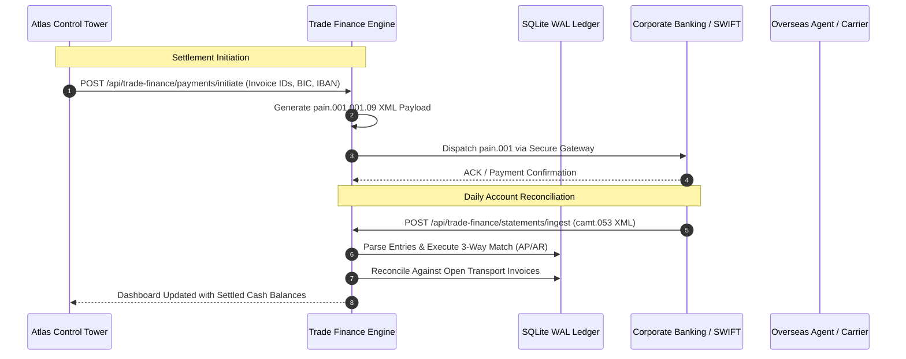
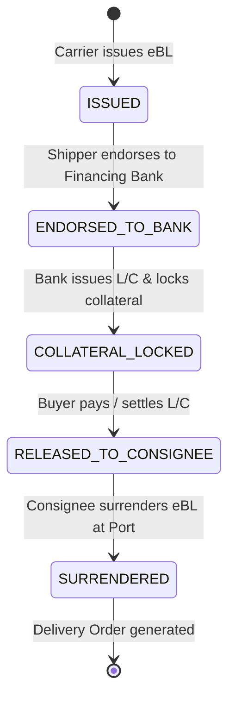

# Sovereign Trade Finance, SWIFT ISO 20022 & MLETR — Technical & Architectural Specification

**Status**: Accepted & Implemented (P1-A / ADR 0011 & ADR 0025)  
**Authors**: Financial Clearing & Treasury Engineering  
**Regulatory & Standards Basis**: ISO 20022 XML Standards, UNCITRAL MLETR (2017), ICC UCP 600 / ISBP 745  
**Domain Bounded Context**: `src/modules/trade-finance/` & `src/modules/ledger/`

---

## 1. Executive Summary & Legal Framework

International trade finance has historically relied on physical paper documents (Bills of Lading, Letters of Credit, commercial invoices) and legacy SWIFT MT messaging (e.g. MT700, MT103). Atlas Logistics provides institutional, sovereign trade finance and settlement infrastructure:
1. **ISO 20022 XML Messaging**: Full support for rich MX formats (`pain.001`, `pacs.008`, `camt.053`, `tsmt.019`).
2. **UNCITRAL MLETR Electronic Records**: Electronic Bills of Lading (eBL) with cryptographic endorsement chains meeting the principle of exclusive control.
3. **Autonomous Multilateral Netting**: Multi-currency integer clearing engine operating in micro-cents, completely eliminating floating-point rounding drift.
4. **ICC UCP 600 Discrepancy Auditing**: Real-time examination of presentation documents against Letter of Credit terms.

---

## 2. SWIFT ISO 20022 Financial Gateway

Atlas Logistics replaces legacy FIN MT messaging with ISO 20022 XML schemas:

### Supported ISO 20022 Message Catalog:
- **`pain.001.001.09` (Customer Credit Transfer Initiation)**: Dispatches payment instructions to corporate banks for carrier freight settlement, customs disbursements, and CBAM certificate purchases.
- **`pacs.008.001.08` (Financial Institution Customer Credit Transfer)**: Interbank credit transfers for high-value cross-border clearing.
- **`camt.053.001.08` (Bank-to-Customer Statement)**: Ingests daily bank statement files and executes deterministic 3-way matching against freight accruals and carrier debit notes.
- **`tsmt.019.001.01` (Trade Status Report)**: Transmits operational freight milestone notices (e.g. Cargo Loaded on Board, Customs Release) to trigger documentary credit drawdown.

---

## 3. Multilateral Netting Engine & Integer Precision

Cross-border freight forwarding networks accumulate bilateral receivables and payables between origin and destination stations. Direct settlement of each individual invoice incurs prohibitive SWIFT transaction fees and FX conversion spreads.

### 3.1 Mathematical Netting Model
For a network of $N$ partner stations with bilateral debt matrix $D_{ij}$ (station $i$ owes station $j$):
1. **Net Position Calculation**:
   $$\text{Net}_i = \sum_{j=1}^{N} D_{ji} - \sum_{j=1}^{N} D_{ij}$$
2. **Minimal Settlement Cycles**: The engine executes an algorithm to clear the entire matrix in at most $N - 1$ net payments.
3. **Micro-Cents Integer Arithmetic**:
   All monetary values are converted to 64-bit integers ($\text{Amount}_{\text{micro}} = \text{Amount}_{\text{EUR}} \times 10^6$) before execution. Floating-point IEEE-754 numbers are strictly prohibited, ensuring exact mathematical zero-sum closure ($\sum_{i=1}^{N} \text{Net}_i = 0$).

---

## 4. UNCITRAL MLETR Digital Transferable Records (eBL)

Under the **UNCITRAL Model Law on Electronic Transferable Records (MLETR 2017)**:
- An electronic document satisfies the legal requirement of a paper Bill of Lading if a reliable method is used to identify the document as a transferable record and ensure **exclusive control**.

### 4.1 Cryptographic Endorsement Chain
Atlas Logistics implements an append-only cryptographic ledger tracking the lifecycle of each eBL:

Every endorsement transition records:
- Previous Block Hash (`parent_hash`)
- Current Owner Public Key (`owner_pubkey`)
- Endorsement Timestamp & WebCrypto Digital Signature
- Canonical Document Fingerprint (SHA-256 of canonical eBL JSON payload)

---

## 5. ICC UCP 600 / ISBP 745 Discrepancy Auditing Engine

When documentary credits (Letters of Credit) are executed, the system validates compliance against the ICC Uniform Customs and Practice for Documentary Credits (UCP 600):

| Statutory Check | UCP 600 Rule | Automated Validation Logic |
| :--- | :--- | :--- |
| **Presentation Window** | Art. 14(c) | $\text{PresentationDate} - \text{ShippedOnBoardDate} \le 21\text{ days}$ (and within L/C expiry date) |
| **Quantity & Amount Tolerance** | Art. 30(b) | Enforces $\pm 5\%$ tolerance unless exact quantity is explicitly mandated |
| **Goods Description** | Art. 18(c) | Exact literal match between Commercial Invoice Box and L/C Box 45A |
| **Clean Transport Document** | Art. 27 | Bill of Lading must lack claused notations (e.g. "damaged packing", "rusty drums") |
| **Minimum Cargo Insurance** | Art. 28(f)(ii) | Sum Insured must equal at least **110% of the CIF or CIP contract value** |

---

## 6. REST API Endpoints Specification (`trade-finance.routes.ts`)

| Method | Endpoint | Description |
| :--- | :--- | :--- |
| `POST` | `/api/trade-finance/instruments` | Register commercial Letter of Credit or Standby Guarantee |
| `POST` | `/api/trade-finance/instruments/:id/audit` | Execute UCP 600 discrepancy audit against transport documents |
| `POST` | `/api/trade-finance/ebl/issue` | Issue MLETR-compliant electronic Bill of Lading |
| `POST` | `/api/trade-finance/ebl/:id/endorse` | Transfer exclusive control of eBL to new holder via cryptographic signature |
| `POST` | `/api/trade-finance/netting/run` | Execute multilateral netting cycle across agent stations |
| `POST` | `/api/trade-finance/payments/pain001` | Generate SWIFT ISO 20022 `pain.001.001.09` XML message |
| `POST` | `/api/trade-finance/statements/camt053` | Ingest and automatically reconcile SWIFT `camt.053` bank statement |

---

## 7. Verification & Quality Gates
- **Contract Tests**: Verified in [`tests/wave3-zero-any-and-domain-openapi.test.ts`](../../tests/wave3-zero-any-and-domain-openapi.test.ts) (Tag: `Trade Finance & Letters of Credit`).
- **Precision Validation**: Micro-cents integer math validated against multi-currency FX matrix.
