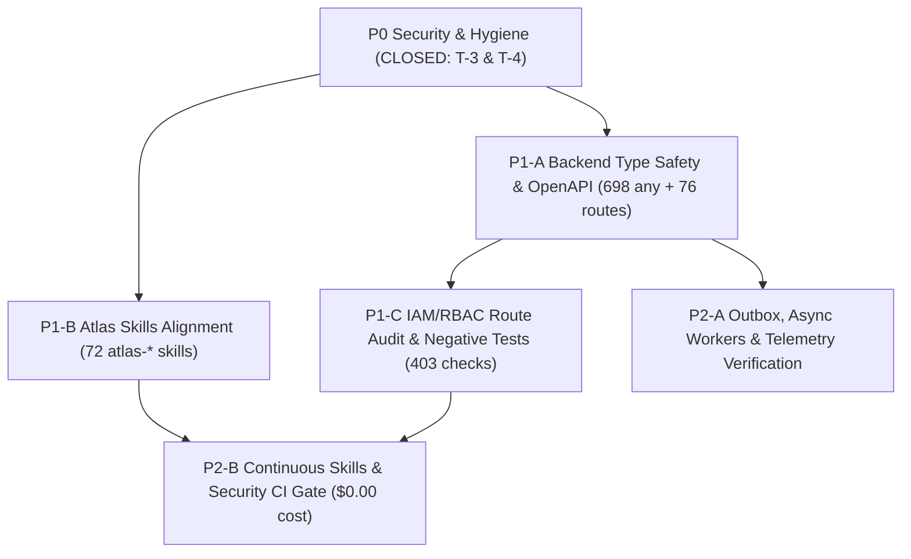

# Atlas Logistics — Joint Platform & Skills Improvement Plan (Terminal A + Terminal B)

> [!NOTE]
> Co-authored autonomously by **Terminal A (Architecture & Implementation)** and **Terminal B (Security, QA & Governance)** over the hardened local IPC channel (`127.0.0.1:12346` + `shared-board.json`), grounded in live repository telemetry and all **72 local `atlas-*` skills**.

---

## 1. Executive Baseline & Empirical Telemetry

Before prioritizing improvements, both terminals executed full automated repository diagnostics against `Atlas-Logistics` (`main`) and audited all 72 `atlas-*` skill definitions.

| Quality Gate / Metric | Baseline Before Joint Remediation | Current Verified State (Post T-3 & T-4) | Target State |
| :--- | :--- | :--- | :--- |
| TypeScript Type-Check (`pnpm run type-check`) | `0` errors | `0` errors | `0` errors |
| SQLite Schema & DDL Drift (`audit:ddl-drift`) | `253` tables, `0` drift, `0` FK violations | `253` tables, `0` drift, `0` FK violations | `0` drift |
| Markdown Relative Links (`audit:links`) | `231/231` valid | Verified on commit | `100%` valid |
| Page File-Size Guardrail (`ADR 0020`, `<1,000` lines) | `65/65` pages compliant | `65/65` pages compliant | `100%` compliant |
| Unsafe HTML Sinks (`dangerouslySetInnerHTML` / `.innerHTML =`) | `26` violations (`4` frontend + `22` `bpmn-modeler`) | **`0` violations across `packages/` (CLOSED)** | `0` |
| Untracked Duplicate Conflict Files (`* (1).*`) | `5` stale duplicates | **`0` stale duplicates (CLOSED)** | `0` |
| Explicit `any` in `@atlas/frontend` | `6` (in unit tests) | **`0` (CLOSED)** | `0` |
| Explicit `any` in Backend `src/` | `698` occurrences | `698` occurrences (P1-A target) | `<50` -> `0` |
| Fastify Route OpenAPI `schema:` Coverage (`src/routes/`) | `1 / 76` route files (`11` use Zod) | `1 / 76` route files (P1-A target) | `100%` core routes |
| Explicit Route-Level RBAC (`preHandler`/`requireRole`) | `7 / 76` route files | Audit & enforce global + route RBAC (P1-C) | `100%` protected |
| Local `atlas-*` Skills Alignment (`72` skills) | `0` YAML errors; `43` legacy DB refs, `30` comment-rule conflicts, `4` P0 contradictions | Scheduled in P1-B (Waves A–C) | `72/72` aligned with [AGENTS.md](../../AGENTS.md) |

---

## 2. Roadmap Architecture & Dependency Flow

---

## 3. Completed P0 Remediation (Zero-Collision Parallel Execution)

| Task ID | Owner | Exclusive Files | Outcome |
| :--- | :--- | :--- | :--- |
| **T-3** | Terminal B | `packages/frontend/src/pages/WikiHubModule.tsx`, `WorkflowManagerModule.tsx`, 3 frontend unit test suites | Replaced all `dangerouslySetInnerHTML` calls with a safe React JSX inline tokenizer (`renderInline`), migrated `.innerHTML = ""` to `.replaceChildren()`, reduced `@atlas/frontend` `any` count from `6` to `0`, removed `5` stale `* (1).*` duplicates (`10/10` Vitest PASS, `0` TS errors). |
| **T-4** | Terminal A | 7 UI modules under `packages/bpmn-modeler/src/ui/` | Eliminated all `22` raw `.innerHTML =` sinks using programmatic `createElement`/`createElementNS`/`textContent`/`replaceChildren`, standardized UI strings & JSDoc to technical English (`@atlas/bpmn-modeler` build PASS, `0` TS errors). |

---

## 4. Prioritized Improvement Waves (P1 – P2)

### Wave P1-A: Unified Backend Type Safety & OpenAPI Contract Modernization
*Aligned Skills: `atlas-logistics-backend`, `atlas-api-openapi-contracts`, `atlas-typescript-styleguide`, `atlas-schema-typebox-mapping`*

1. **Hotspot Service Typing (`-118` `any` in 2 files)**:
   - Refactor `src/services/pdf.service.ts` (`87` `any` occurrences) with typed document DTOs and strict PDFKit helpers.
   - Refactor `src/services/booking-lifecycle.service.ts` (`31` `any` occurrences) with Drizzle inferred select/insert types.
2. **Phased Fastify Route Schema & Typed Request Migration (3 Waves across `76` route files)**:
   - **Wave 1 (Core Operations)**: `shipments`, `bookings`, `quotes`, `invoices`, `customs`, `drayage` — add Fastify OpenAPI `schema` metadata (`tags`, `params`, `querystring`, `body`, `response`) and eliminate untyped request/reply `any` casts.
   - **Wave 2 (High-`any` Domain Modules, `16`–`19` `any`/file)**: `smart-contracts`, `air-cargo`, `customs`, `chartering-laytime`, `aeo-security`, `cargo-insurance`, `bulk-operations`, `dangerous-goods` (~`145` `any` eliminated alongside OpenAPI contracts).
   - **Wave 3 (Administration, Analytics & Support)**: Remaining routes in `src/routes/` and `src/modules/`, converging on a single validation contract (Zod-to-OpenAPI or TypeBox) registered with `@fastify/swagger`.
3. **Standardized Response Envelope**:
   - Enforce consistent `{ success: true, data }` and `{ success: false, code, message }` payloads across newly typed routes with explicit `400/401/403/404/409/500` schema declarations.

### Wave P1-B: Alignment of All 72 Local `atlas-*` Skills with `AGENTS.md`
*Aligned Skills: `atlas-skills-auditor`, `atlas-monorepo-structure`, `atlas-frontend-architecture`, `atlas-typescript-styleguide`, `atlas-test-driven-quality`*

1. **Wave A — 4 P0 Contradictory Skills (Immediate Fix)**:
   - `atlas-skills-auditor`: Update default skills path from legacy `.antigravity\skills` to the canonical `C:\Users\xpall\.gemini\skills` path and add semantic drift checks.
   - `atlas-monorepo-structure`: Update directory layout from legacy `/apps/backend` + `/apps/frontend` to the actual workspace hierarchy (`src/` backend + `packages/frontend`, `packages/shared`, `packages/ui`, `packages/rate-comparer`, `packages/bpmn-modeler`, `packages/mfe-*`).
   - `atlas-frontend-architecture`: Remove contradictory synthetic mock `VITE_DEMO_MODE=true` guidance and align strictly with [ADR 0010](../adr/0010-zero-mock-live-persistence-standard.md) (live SQLite/Fastify data binding).
   - `atlas-typescript-styleguide`: Align commenting directives with `AGENTS.md §6` (mandatory JSDoc utility headers and sectional dividers in English).
2. **Wave B — 43 Data-Layer Skills**:
   - Modernize legacy relational database & row-level security snippets to reflect embedded SQLite WAL (`PRAGMA foreign_keys = ON;`), Drizzle `1.0.0-rc.5` folder-based migrations, and application-layer `organizationId` / station scoping ([ADR 0009](../adr/0009-sqlite-wal-mandatory-foreign-keys.md), [ADR 0022](../adr/0022-enterprise-freight-forwarding-organization-schema-and-governance.md)).
3. **Wave C — 30 Style-Conflict Skills**:
   - Replace legacy `"without inline explanatory comments"` footers with the unified `AGENTS.md §6` file utility header and self-documenting domain logic standard.

### Wave P1-C: IAM / RBAC Route Audit & Negative Security Testing
*Aligned Skills: `atlas-security-iam-rbac`, `atlas-test-driven-quality`, `atlas-code-security-audit`*

- Audit all `76` route files in `src/routes/` and domain modules in `src/modules/` to confirm every mutating and sensitive read endpoint enforces authentication (`authMiddleware`) and role-based authorization (`requireRole`).
- Add negative `app.inject()` integration tests asserting `401 Unauthorized` (unauthenticated) and `403 Forbidden` (wrong role, e.g., `OPERATOR` calling `FINANCE`/`ADMIN` endpoints).
- Add a lightweight zero-cost CI regression check prohibiting `.innerHTML =` and `dangerouslySetInnerHTML` across `packages/` so CWE-79 regressions can never re-enter `main`.

### Wave P2: Operational Resilience, E2E Parity & Zero-Cost Governance
*Aligned Skills: `atlas-e2e-playwright-testing`, `atlas-workflow-operations`, `atlas-native-telemetry`, `atlas-github-actions-pipeline`*

- **P2-A (Workflow & Outbox Reliability)**: Add deterministic fake-timer Vitest tests for outbox retry backoff, DLQ escalation, and idempotent replay across carrier/customs/accounting outbox workers.
- **P2-B (Playwright E2E Smoke Coverage)**: Ensure critical flows (Booking creation -> 25-code Address Selector -> Drayage Dispatch -> UN/EDIFACT & UN/CEFACT XML generation -> Station Switch) run deterministically in CI at `$0.00` cost on `ubuntu-24.04`.
- **P2-C (Windows CRLF Hygiene)**: Add or tighten `.gitattributes` (`* text=auto eol=lf`) to eliminate false-positive `core.autocrlf` dirty stat noise across Windows workstations.

---

## 5. Proposed Parallel Execution Split (Next Sprint — Zero File Collisions)

Using `shared-board.json` declarative `ownedFiles` locks, both terminals can execute P1 in parallel without touching overlapping files:

| Next Task | Assigned Terminal | Scope & Exclusive Ownership | Verification Gate |
| :--- | :--- | :--- | :--- |
| **T-6** | **Terminal A** | P1-A Hotspot Typing (`src/services/pdf.service.ts`, `src/services/booking-lifecycle.service.ts`) + Wave 1 Core Ops OpenAPI schemas | `pnpm run type-check`, targeted `vitest`, `-118` backend `any` |
| **T-7** | **Terminal B** | P1-B Wave A (fix the 4 P0 contradictory `atlas-*` skills) + P1-C zero-`innerHTML` CI guard script + RBAC negative test suite | `Invoke-AtlasSkillsAudit`, `vitest`, `audit:links`, `audit:leaks:staged` |

---

## 6. Cross-References

- [Repository Guardrails & Standards](../../AGENTS.md)
- [Documentation Hub Index](../README.md)
- [Improvement Plan Traceability Matrix (P0–P2)](../reference/improvement-plan-traceability-matrix.md)
- [ADR 0009 — SQLite WAL & Mandatory Foreign Keys](../adr/0009-sqlite-wal-mandatory-foreign-keys.md)
- [ADR 0010 — Zero-Mock Live Enterprise Data Standard](../adr/0010-zero-mock-live-persistence-standard.md)
- [ADR 0030 — 25-Code Logistics Taxonomy & UNECE Standards](../adr/0030-logistics-entity-taxonomy-and-unece-standards-integration.md)
