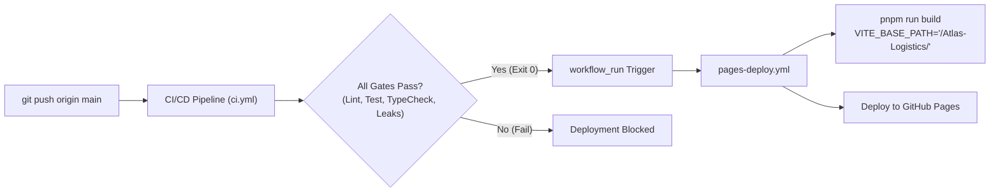

# GitHub Pages Single Page Application (SPA) Deployment Guide

This guide details the continuous deployment architecture, pull request preview environments, and client-side routing fallback mechanics for the Atlas Logistics frontend application hosted on GitHub Pages.

---

## 1. Architectural Overview

Atlas Logistics deploys its production web application as a static Single Page Application (SPA) compiled via Vite. Deployments are managed automatically via GitHub Actions and hosted under GitHub Pages at:

- **Production URL**: `https://xpallares1987-ai.github.io/Atlas-Logistics/`
- **Governing Architecture**: [ADR 0024: GitHub Pages SPA Continuous Deployment and PR Previews](../adr/0024-github-pages-spa-continuous-deployment.md)

---

## 2. Production Deployment Workflow (`pages-deploy.yml`)

The production deployment workflow (`.github/workflows/pages-deploy.yml`) is strictly gated against the repository's primary CI/CD pipeline:



### Key Workflow Characteristics:
- **Strict CI Gating**: The workflow triggers on `workflow_run` when `CI/CD Pipeline` finishes on the `main` branch. It executes only when `github.event.workflow_run.conclusion == 'success'`, preventing broken code from reaching production.
- **Manual Trigger**: Supports `workflow_dispatch` for emergency redeployments.
- **Dual-Hosting Deployment**:
  1. Deploys static build artifacts to the `gh-pages` branch using `peaceiris/actions-gh-pages@v4` with `keep_files: true` (preserving active `/pr-preview/` directories).
  2. Uploads and deploys the GitHub Pages artifact using `actions/upload-pages-artifact@v3` and `actions/deploy-pages@v4`.

---

## 3. Pull Request Preview Workflow (`pr-preview.yml`)

Every pull request opened against the repository automatically receives an ephemeral, isolated preview environment hosted under a dedicated subdirectory:

- **PR Preview URL Format**: `https://xpallares1987-ai.github.io/Atlas-Logistics/pr-preview/pr-<PR_NUMBER>/`

### Lifecycle Automation:
1. **PR Opened / Synchronized**:
   - The workflow compiles the frontend with `VITE_BASE_PATH: "/Atlas-Logistics/pr-preview/pr-${{ github.event.number }}/"`.
   - Utilizes `rossjrw/pr-preview-action@v1` to publish the build into `/pr-preview/pr-<PR_NUMBER>/` on the `gh-pages` branch.
   - Automatically posts or updates a comment on the pull request with a direct link to the live preview.
2. **PR Closed / Merged**:
   - Executes `rossjrw/pr-preview-action@v1` with `action: remove`.
   - Purges the preview directory from `gh-pages`, preventing repository bloat.

---

## 4. Client-Side Routing & 404 Fallback Mechanics

Standard static web servers return HTTP 404 when a user directly accesses a deep URL (e.g. `/Atlas-Logistics/fueleu-maritime`) because no physical directory or `index.html` exists at that route.

Atlas Logistics resolves this using a dual-stage client-side redirect strategy based on the MIT-licensed `rafgraph/spa-github-pages` protocol:

1. **Fallback Redirection (`packages/frontend/public/404.html`)**:
   - When a deep route triggers a 404, GitHub Pages serves `404.html`.
   - The embedded JavaScript inspects `window.location.pathname`:
     - If the path matches `/pr-preview/pr-*`, it preserves 3 path segments (`/Atlas-Logistics/pr-preview/pr-X/`).
     - Otherwise, it preserves 1 path segment (`/Atlas-Logistics/`).
   - Converts the sub-path into a query parameter (e.g., `/?/fueleu-maritime`) and performs a zero-reload `location.replace()`.
2. **History State Restoration (`packages/frontend/index.html`)**:
   - Before React and React Router mount, a synchronous `<script>` in the `<head>` of `index.html` parses the `/?/` query parameter.
   - Restores the clean URL into browser history via `window.history.replaceState()`.
3. **Router Base Configuration (`packages/frontend/src/App.tsx`)**:
   - `<Router basename={import.meta.env.BASE_URL}>` mounts the application seamlessly at the resolved sub-base.

---

## 5. API Backend Configuration & Resolution

The frontend interacts with the Fastify backend deployed on Google Cloud Run:

- **Production Backend Endpoint**: `https://atlas-backend-100198375762.europe-west1.run.app/api`
- **Workflow Secret Override**: Configured via the repository secret `VITE_API_URL`.

All API requests are normalized through `resolveApiUrl()` in `packages/frontend/src/hooks/useApiQuery.ts` and intercepted globally in `packages/frontend/src/main.tsx`. This guarantees that both origin URLs (e.g., `https://domain.com`) and path-prefixed URLs (e.g., `https://domain.com/api`) resolve cleanly without duplicating `/api/api` paths.

---

## 6. Verification & Audit Routines

To test build integrity locally before pushing changes:

```powershell
# 1. Type-check all packages
pnpm run type-check

# 2. Verify production build with Pages base path
$env:VITE_BASE_PATH="/Atlas-Logistics/"; pnpm run build

# 3. Check markdown documentation links
pnpm run audit:links

# 4. Audit staged files for secrets or leaks
pnpm run audit:leaks:staged
```
