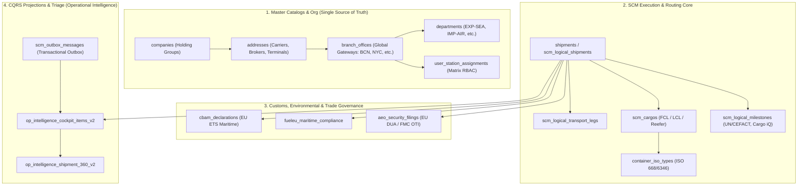

# Comprehensive Database Schema Inventory & Relational Integrity Map

> [!NOTE]
> **Database Engine**: SQLite 3 (LibSQL `@libsql/client` v0.18.0)  
> **Physical Location**: `data/dev.db`  
> **Concurrency Mode**: Write-Ahead Logging (`PRAGMA journal_mode = WAL;`)  
> **Constraint Enforcement**: Active (`PRAGMA foreign_keys = ON;`, `PRAGMA busy_timeout = 5000;`)  
> **Total Physical Tables**: 237  
> **Foreign Key Violations**: 0 (100% Referential Integrity Verified)  
> **Canonical Git Commit**: `e3f2489da150e8b122889b9dc446f47c147dfff1`

---

## 1. Executive Summary & Architecture Blueprint

The Atlas-Logistics database is architected around **Domain-Driven Design (DDD)** and **Command Query Responsibility Segregation (CQRS)** implemented on a high-throughput, zero-cost SQLite foundation in WAL mode per **[ADR 0008](../adr/0008-scm-sqlite-cqrs-workflow-engine.md)** and **[ADR 0009](../adr/0009-sqlite-wal-mandatory-foreign-keys.md)**.

---

## 2. Bounded Context Distribution

| Bounded Context | Table Count | Primary Responsibilities |
| :--- | :---: | :--- |
| **B2B Documents, e-BL, eFirma & DCSA/MLETR Security** | **13** | Total Rows Seeded: 1005 |
| **BPM & Workflow DAG Execution Engine** | **14** | Total Rows Seeded: 4913 |
| **Cargo, Containers, Equipment & Warehousing** | **15** | Total Rows Seeded: 3507 |
| **Customs, AEO, Environmental Compliance & Tariffs** | **34** | Total Rows Seeded: 1235 |
| **Enterprise Organization, Stations & Matrix RBAC** | **8** | Total Rows Seeded: 138 |
| **External Data Governance & Licensing (ADR 0021)** | **3** | Total Rows Seeded: 15 |
| **Financial Controlling, Demurrage & Trade Finance** | **30** | Total Rows Seeded: 5806 |
| **Freight Forwarding Operations & Shipment Execution** | **14** | Total Rows Seeded: 9983 |
| **Master Logistics Catalogs & Party Directory** | **16** | Total Rows Seeded: 1275 |
| **Milestones, Real-Time IoT Telemetry & Exceptions** | **14** | Total Rows Seeded: 3731 |
| **Multimodal Routing & Transport Planning** | **3** | Total Rows Seeded: 3413 |
| **Operational Intelligence, Work-to-User & CQRS Projections** | **6** | Total Rows Seeded: 3131 |
| **System, Audit, Outbox & Migrations** | **67** | Total Rows Seeded: 28.736 |

---

## 3. Relational Integrity & Foreign Key Governance

### Constraint Validation Metrics
- **Foreign Key Check (`PRAGMA foreign_key_check`)**: **0 violations** across all 237 tables.
- **Cascading Policies**:
  - **Internal Aggregate Entities**: Enforce `ON DELETE CASCADE` (e.g., `shipment_items` $\rightarrow$ `shipments`, `departments` $\rightarrow$ `branch_offices`).
  - **Cross-Aggregate References**: Enforce `ON DELETE RESTRICT` / `NO ACTION` to prevent accidental deletion of shared master records (e.g., deleting an `address` assigned to an active booking is strictly prohibited).
  - **Relational Drizzle Imports**: All submodules in `src/db/schema/` import parent tables strictly from their canonical definition file per **[ADR 0022](../adr/0022-enterprise-freight-forwarding-organization-schema-and-governance.md)**.

---

## 4. Detailed Physical Inventory by Bounded Context

### B2B Documents, e-BL, eFirma & DCSA/MLETR Security (13 Tables)

| Table Name | Primary Key | Cols | Rows | Foreign Keys (Parents) | Indexes |
| :--- | :--- | :---: | :---: | :--- | :--- |
| `airway_bills` | `id` | 39 | 14 | None (Root / Independent) | `airway_bills_awb_number_unique` (UNIQUE) `sqlite_autoindex_airway_bills_1` (UNIQUE) |
| `blockchain_blocks` | `id` | 10 | 3 | `contract_id` $\rightarrow$ `smart_escrow_contracts.id` (CASCADE) | `blk_hash_idx` `blk_num_idx` `blk_contract_idx` `sqlite_autoindex_blockchain_blocks_1` (UNIQUE) |
| `carta_porte_declarations` | `id` | 19 | 3 | `shipment_id` $\rightarrow$ `shipments.id` (CASCADE) | `cp_id_ccp_idx` `cp_shipment_idx` `carta_porte_declarations_id_ccp_unique` (UNIQUE) `sqlite_autoindex_carta_porte_declarations_1` (UNIQUE) |
| `dcsa_event_subscriptions` | `subscription_id` | 17 | 25 | None (Root / Independent) | `idx_dcsa_subs_carrier` `sqlite_autoindex_dcsa_event_subscriptions_1` (UNIQUE) |
| `dcsa_events_log` | `event_id` | 23 | 148 | None (Root / Independent) | `idx_dcsa_events_eq` `idx_dcsa_events_bkg` `idx_dcsa_events_type` `sqlite_autoindex_dcsa_events_log_1` (UNIQUE) |
| `document_mgmt_documents` | `id` | 17 | 47 | None (Root / Independent) | `sqlite_autoindex_document_mgmt_documents_1` (UNIQUE) |
| `documents` | `id` | 21 | 386 | `uploaded_by` $\rightarrow$ `users.id` (NO ACTION) `shipment_id` $\rightarrow$ `shipments.id` (NO ACTION) | `sqlite_autoindex_documents_1` (UNIQUE) |
| `edi_interchanges` | `id` | 19 | 103 | None (Root / Independent) | `sqlite_autoindex_edi_interchanges_1` (UNIQUE) |
| `edi_messages` | `id` | 18 | 102 | None (Root / Independent) | `sqlite_autoindex_edi_messages_1` (UNIQUE) |
| `edi_partners` | `id` | 17 | 5 | None (Root / Independent) | `sqlite_autoindex_edi_partners_1` (UNIQUE) |
| `efirma_audit_stamps` | `id` | 17 | 15 | `carta_porte_id` $\rightarrow$ `carta_porte_declarations.id` (SET NULL) `document_id` $\rightarrow$ `documents.id` (SET NULL) `shipment_id` $\rightarrow$ `shipments.id` (SET NULL) | `efirma_serial_idx` `efirma_doc_idx` `efirma_shipment_idx` `sqlite_autoindex_efirma_audit_stamps_1` (UNIQUE) |
| `mletr_endorsements_ledger` | `id` | 16 | 120 | `record_id` $\rightarrow$ `mletr_transferable_records.id` (CASCADE) | `mletr_ledger_hash_idx` `mletr_ledger_seq_idx` `mletr_ledger_rec_idx` `sqlite_autoindex_mletr_endorsements_ledger_1` (UNIQUE) |
| `mletr_transferable_records` | `id` | 18 | 34 | `shipment_id` $\rightarrow$ `shipments.id` (CASCADE) `document_id` $\rightarrow$ `documents.id` (CASCADE) | `mletr_status_idx` `mletr_ref_idx` `mletr_doc_idx` `mletr_shipment_idx` `sqlite_autoindex_mletr_transferable_records_1` (UNIQUE) |

### BPM & Workflow DAG Execution Engine (14 Tables)

| Table Name | Primary Key | Cols | Rows | Foreign Keys (Parents) | Indexes |
| :--- | :--- | :---: | :---: | :--- | :--- |
| `bpmn_diagrams` | `id` | 9 | 67 | None (Root / Independent) | `sqlite_autoindex_bpmn_diagrams_1` (UNIQUE) |
| `bpmn_versions` | `id` | 11 | 199 | `author_id` $\rightarrow$ `users.id` (NO ACTION) `diagram_id` $\rightarrow$ `bpmn_diagrams.id` (NO ACTION) | `sqlite_autoindex_bpmn_versions_1` (UNIQUE) |
| `rules_decisions_definitions` | `id` | 11 | 2 | None (Root / Independent) | `sqlite_autoindex_rules_decisions_definitions_2` (UNIQUE) `sqlite_autoindex_rules_decisions_definitions_1` (UNIQUE) |
| `rules_decisions_evaluation_logs` | `evaluation_id` | 11 | 1427 | None (Root / Independent) | `sqlite_autoindex_rules_decisions_evaluation_logs_1` (UNIQUE) |
| `tasks` | `id` | 13 | 330 | `shipment_id` $\rightarrow$ `shipments.id` (NO ACTION) `assigned_to` $\rightarrow$ `users.id` (NO ACTION) | `sqlite_autoindex_tasks_1` (UNIQUE) |
| `wf_engine_definition_versions_v2` | `workflow_version_id` | 9 | 91 | `workflow_definition_id` $\rightarrow$ `wf_engine_definitions_v2.workflow_definition_id` (CASCADE) | `sqlite_autoindex_wf_engine_definition_versions_v2_2` (UNIQUE) `sqlite_autoindex_wf_engine_definition_versions_v2_1` (UNIQUE) |
| `wf_engine_definitions_v2` | `workflow_definition_id` | 10 | 92 | None (Root / Independent) | `sqlite_autoindex_wf_engine_definitions_v2_2` (UNIQUE) `sqlite_autoindex_wf_engine_definitions_v2_1` (UNIQUE) |
| `wf_engine_dependency_definitions_v2` | `dependency_definition_id` | 6 | 171 | `workflow_version_id` $\rightarrow$ `wf_engine_definition_versions_v2.workflow_version_id` (CASCADE) | `sqlite_autoindex_wf_engine_dependency_definitions_v2_2` (UNIQUE) `sqlite_autoindex_wf_engine_dependency_definitions_v2_1` (UNIQUE) |
| `wf_engine_instances_v2` | `instance_id` | 10 | 547 | `workflow_version_id` $\rightarrow$ `wf_engine_definition_versions_v2.workflow_version_id` (NO ACTION) `workflow_definition_id` $\rightarrow$ `wf_engine_definitions_v2.workflow_definition_id` (NO ACTION) | `sqlite_autoindex_wf_engine_instances_v2_1` (UNIQUE) |
| `wf_engine_task_definitions_v2` | `task_definition_id` | 12 | 224 | `workflow_version_id` $\rightarrow$ `wf_engine_definition_versions_v2.workflow_version_id` (CASCADE) | `sqlite_autoindex_wf_engine_task_definitions_v2_2` (UNIQUE) `sqlite_autoindex_wf_engine_task_definitions_v2_1` (UNIQUE) |
| `wf_engine_task_instances_v2` | `task_instance_id` | 9 | 1641 | `task_id` $\rightarrow$ `work_mgmt_tasks_v2.task_id` (CASCADE) `task_definition_id` $\rightarrow$ `wf_engine_task_definitions_v2.task_definition_id` (NO ACTION) `workflow_instance_id` $\rightarrow$ `wf_engine_instances_v2.instance_id` (CASCADE) | `sqlite_autoindex_wf_engine_task_instances_v2_2` (UNIQUE) `sqlite_autoindex_wf_engine_task_instances_v2_1` (UNIQUE) |
| `workflow_rt_process_definitions` | `id` | 8 | 1 | None (Root / Independent) | `sqlite_autoindex_workflow_rt_process_definitions_1` (UNIQUE) |
| `workflow_rt_process_instances` | `id` | 18 | 118 | None (Root / Independent) | `sqlite_autoindex_workflow_rt_process_instances_2` (UNIQUE) `sqlite_autoindex_workflow_rt_process_instances_1` (UNIQUE) |
| `workflows` | `id` | 11 | 3 | None (Root / Independent) | `sqlite_autoindex_workflows_1` (UNIQUE) |

### Cargo, Containers, Equipment & Warehousing (15 Tables)

| Table Name | Primary Key | Cols | Rows | Foreign Keys (Parents) | Indexes |
| :--- | :--- | :---: | :---: | :--- | :--- |
| `cargo_claims` | `id` | 34 | 20 | None (Root / Independent) | `cargo_claims_claim_number_unique` (UNIQUE) `sqlite_autoindex_cargo_claims_1` (UNIQUE) |
| `cargo_equip_cargos` | `id` | 12 | 59 | None (Root / Independent) | `sqlite_autoindex_cargo_equip_cargos_1` (UNIQUE) |
| `cargo_equip_cargos_v2` | `cargo_id` | 10 | 44 | None (Root / Independent) | `sqlite_autoindex_cargo_equip_cargos_v2_1` (UNIQUE) |
| `cargo_equip_equipment_allocations_v2` | `allocation_id` | 8 | 42 | `equipment_id` $\rightarrow$ `cargo_equip_equipments_v2.equipment_id` (RESTRICT) `cargo_id` $\rightarrow$ `cargo_equip_cargos_v2.cargo_id` (RESTRICT) | `sqlite_autoindex_cargo_equip_equipment_allocations_v2_1` (UNIQUE) |
| `cargo_equip_equipment_assignments` | `id` | 16 | 57 | None (Root / Independent) | `sqlite_autoindex_cargo_equip_equipment_assignments_1` (UNIQUE) |
| `cargo_equip_equipment_seals_v2` | `seal_id` | 7 | 42 | `equipment_id` $\rightarrow$ `cargo_equip_equipments_v2.equipment_id` (CASCADE) | `sqlite_autoindex_cargo_equip_equipment_seals_v2_1` (UNIQUE) |
| `cargo_equip_equipments_v2` | `equipment_id` | 9 | 42 | None (Root / Independent) | `sqlite_autoindex_cargo_equip_equipments_v2_2` (UNIQUE) `sqlite_autoindex_cargo_equip_equipments_v2_1` (UNIQUE) |
| `cargo_equip_goods_items_v2` | `goods_item_id` | 10 | 42 | `package_id` $\rightarrow$ `cargo_equip_packages_v2.package_id` (CASCADE) | `sqlite_autoindex_cargo_equip_goods_items_v2_1` (UNIQUE) |
| `cargo_equip_packages_v2` | `package_id` | 9 | 42 | `cargo_id` $\rightarrow$ `cargo_equip_cargos_v2.cargo_id` (CASCADE) | `sqlite_autoindex_cargo_equip_packages_v2_1` (UNIQUE) |
| `cargo_iq_milestones` | `id` | 18 | 8 | `location_airport_code` $\rightarrow$ `iata_airports.code` (NO ACTION) `awb_number` $\rightarrow$ `airway_bills.awb_number` (CASCADE) | `ciq_sla_idx` `ciq_code_idx` `ciq_awb_idx` `sqlite_autoindex_cargo_iq_milestones_1` (UNIQUE) |
| `cargo_items` | `id` | 18 | 3076 | `container_id` $\rightarrow$ `shipment_containers.id` (NO ACTION) `shipment_id` $\rightarrow$ `shipments.id` (NO ACTION) | `sqlite_autoindex_cargo_items_1` (UNIQUE) |
| `container_stowage_plans` | `id` | 20 | 5 | `shipment_id` $\rightarrow$ `shipments.id` (CASCADE) `container_id` $\rightarrow$ `shipment_containers.id` (CASCADE) | `stowage_shipment_idx` `stowage_container_idx` `sqlite_autoindex_container_stowage_plans_1` (UNIQUE) |
| `inventory_items` | `id` | 11 | 6 | None (Root / Independent) | `inventory_items_sku_unique` (UNIQUE) `sqlite_autoindex_inventory_items_1` (UNIQUE) |
| `warehouse_inventory` | `id` | 18 | 3 | `location_id` $\rightarrow$ `locations.id` (NO ACTION) | `sqlite_autoindex_warehouse_inventory_1` (UNIQUE) |
| `warehouse_traffic` | `id` | 18 | 19 | `shipment_id` $\rightarrow$ `shipments.id` (NO ACTION) | `sqlite_autoindex_warehouse_traffic_1` (UNIQUE) |

### Customs, AEO, Environmental Compliance & Tariffs (34 Tables)

| Table Name | Primary Key | Cols | Rows | Foreign Keys (Parents) | Indexes |
| :--- | :--- | :---: | :---: | :--- | :--- |
| `aeo_audits` | `id` | 19 | 20 | `company_id` $\rightarrow$ `companies.id` (NO ACTION) | `aeo_audits_audit_reference_unique` (UNIQUE) `sqlite_autoindex_aeo_audits_1` (UNIQUE) |
| `aeo_business_partners` | `id` | 18 | 4 | None (Root / Independent) | `sqlite_autoindex_aeo_business_partners_2` (UNIQUE) `sqlite_autoindex_aeo_business_partners_1` (UNIQUE) |
| `aeo_cae_questionnaire_sections` | `id` | 15 | 40 | `audit_id` $\rightarrow$ `aeo_audits.id` (CASCADE) | `sqlite_autoindex_aeo_cae_questionnaire_sections_1` (UNIQUE) |
| `aeo_security_seals` | `id` | 17 | 21 | None (Root / Independent) | `aeo_security_seals_seal_number_unique` (UNIQUE) `sqlite_autoindex_aeo_security_seals_1` (UNIQUE) |
| `aeo_seven_point_inspections` | `id` | 22 | 21 | None (Root / Independent) | `aeo_seven_point_inspections_inspection_reference_unique` (UNIQUE) `sqlite_autoindex_aeo_seven_point_inspections_1` (UNIQUE) |
| `carbon_calculation_legs` | `id` | 15 | 6 | `calculation_id` $\rightarrow$ `carbon_calculations.id` (CASCADE) | `sqlite_autoindex_carbon_calculation_legs_1` (UNIQUE) |
| `carbon_calculations` | `id` | 18 | 3 | None (Root / Independent) | `sqlite_autoindex_carbon_calculations_1` (UNIQUE) |
| `carbon_certificates` | `id` | 11 | 2 | `project_id` $\rightarrow$ `carbon_offset_projects.id` (NO ACTION) `calculation_id` $\rightarrow$ `carbon_calculations.id` (NO ACTION) | `carbon_certificates_certificate_number_unique` (UNIQUE) `sqlite_autoindex_carbon_certificates_2` (UNIQUE) `sqlite_autoindex_carbon_certificates_1` (UNIQUE) |
| `carbon_insetting_allocations` | `id` | 18 | 12 | `beneficiary_company_id` $\rightarrow$ `companies.id` (SET NULL) `shipment_id` $\rightarrow$ `shipments.id` (SET NULL) `token_id` $\rightarrow$ `carbon_insetting_tokens.id` (CASCADE) | `insetting_alloc_hash_idx` `insetting_alloc_shipment_idx` `insetting_alloc_token_idx` `sqlite_autoindex_carbon_insetting_allocations_3` (UNIQUE) `sqlite_autoindex_carbon_insetting_allocations_2` (UNIQUE) `sqlite_autoindex_carbon_insetting_allocations_1` (UNIQUE) |
| `carbon_insetting_tokens` | `id` | 23 | 18 | `fuel_id` $\rightarrow$ `marine_fuels.id` (NO ACTION) | `insetting_tokens_status_idx` `insetting_tokens_fuel_idx` `sqlite_autoindex_carbon_insetting_tokens_2` (UNIQUE) `sqlite_autoindex_carbon_insetting_tokens_1` (UNIQUE) |
| `carbon_offset_projects` | `id` | 12 | 5 | None (Root / Independent) | `sqlite_autoindex_carbon_offset_projects_1` (UNIQUE) |
| `cbam_declaration_lines` | `id` | 19 | 6 | `installation_id` $\rightarrow$ `cbam_installations.id` (NO ACTION) `declaration_id` $\rightarrow$ `cbam_declarations.id` (CASCADE) | `sqlite_autoindex_cbam_declaration_lines_1` (UNIQUE) |
| `cbam_declarations` | `id` | 21 | 4 | None (Root / Independent) | `cbam_declarations_declaration_number_unique` (UNIQUE) `sqlite_autoindex_cbam_declarations_1` (UNIQUE) |
| `cbam_goods_catalog` | `id` | 9 | 6 | None (Root / Independent) | `cbam_goods_catalog_cn_code_unique` (UNIQUE) `sqlite_autoindex_cbam_goods_catalog_1` (UNIQUE) |
| `cbam_installations` | `id` | 13 | 6 | None (Root / Independent) | `sqlite_autoindex_cbam_installations_1` (UNIQUE) |
| `customs_cases` | `id` | 22 | 119 | None (Root / Independent) | `sqlite_autoindex_customs_cases_2` (UNIQUE) `sqlite_autoindex_customs_cases_1` (UNIQUE) |
| `customs_declarations` | `id` | 26 | 828 | `hs_code_id` $\rightarrow$ `hs_codes.id` (NO ACTION) `broker_id` $\rightarrow$ `addresses.id` (NO ACTION) `shipment_id` $\rightarrow$ `shipments.id` (NO ACTION) | `customs_decl_shipment_created_idx` `sqlite_autoindex_customs_declarations_1` (UNIQUE) |
| `customs_discharge_declarations` | `id` | 19 | 2 | `lot_id` $\rightarrow$ `customs_inventory_lots.id` (NO ACTION) | `customs_discharge_declarations_discharge_declaration_number_unique` (UNIQUE) `sqlite_autoindex_customs_discharge_declarations_1` (UNIQUE) |
| `customs_event_logs` | `id` | 5 | 6 | None (Root / Independent) | `sqlite_autoindex_customs_event_logs_1` (UNIQUE) |
| `customs_facilities` | `id` | 18 | 4 | `address_id` $\rightarrow$ `addresses.id` (NO ACTION) | `customs_facilities_facility_code_unique` (UNIQUE) `sqlite_autoindex_customs_facilities_1` (UNIQUE) |
| `customs_guarantees` | `id` | 13 | 2 | None (Root / Independent) | `customs_guarantees_guarantee_reference_number_unique` (UNIQUE) `sqlite_autoindex_customs_guarantees_1` (UNIQUE) |
| `customs_ics2_declarations` | `id` | 13 | 10 | None (Root / Independent) | `sqlite_autoindex_customs_ics2_declarations_2` (UNIQUE) `sqlite_autoindex_customs_ics2_declarations_1` (UNIQUE) |
| `customs_inventory_lots` | `id` | 32 | 6 | `guarantee_id` $\rightarrow$ `customs_guarantees.id` (NO ACTION) `facility_id` $\rightarrow$ `customs_facilities.id` (NO ACTION) | `customs_inventory_lots_lot_number_unique` (UNIQUE) `sqlite_autoindex_customs_inventory_lots_1` (UNIQUE) |
| `customs_stock_ledger_entries` | `id` | 15 | 4 | `facility_id` $\rightarrow$ `customs_facilities.id` (NO ACTION) `lot_id` $\rightarrow$ `customs_inventory_lots.id` (NO ACTION) | `sqlite_autoindex_customs_stock_ledger_entries_1` (UNIQUE) |
| `dg_consignment_items` | `id` | 30 | 26 | `dg_shipment_id` $\rightarrow$ `dg_shipments.id` (CASCADE) | `sqlite_autoindex_dg_consignment_items_1` (UNIQUE) |
| `dg_emergency_cards` | `id` | 12 | 4 | `dg_shipment_id` $\rightarrow$ `dg_shipments.id` (CASCADE) | `dg_emergency_cards_card_reference_unique` (UNIQUE) `sqlite_autoindex_dg_emergency_cards_1` (UNIQUE) |
| `dg_packing_certificates` | `id` | 18 | 1 | `dg_shipment_id` $\rightarrow$ `dg_shipments.id` (CASCADE) | `dg_packing_certificates_certificate_reference_unique` (UNIQUE) `sqlite_autoindex_dg_packing_certificates_1` (UNIQUE) |
| `dg_segregation_audits` | `id` | 11 | 3 | `dg_shipment_id` $\rightarrow$ `dg_shipments.id` (CASCADE) | `sqlite_autoindex_dg_segregation_audits_1` (UNIQUE) |
| `dg_shipments` | `id` | 26 | 25 | None (Root / Independent) | `dg_shipments_shipment_reference_unique` (UNIQUE) `sqlite_autoindex_dg_shipments_1` (UNIQUE) |
| `dgr_registry` | `un_number` | 16 | 6 | None (Root / Independent) | `sqlite_autoindex_dgr_registry_1` (UNIQUE) |
| `fuel_eu_compliance_accounts` | `id` | 15 | 4 | `vessel_id` $\rightarrow$ `marine_vessels.id` (NO ACTION) | `sqlite_autoindex_fuel_eu_compliance_accounts_1` (UNIQUE) |
| `fuel_eu_penalties_ledger` | `id` | 17 | 1 | `pool_offset_id` $\rightarrow$ `fuel_eu_pools.id` (SET NULL) `vessel_id` $\rightarrow$ `marine_vessels.id` (NO ACTION) | `fueleu_penalties_year_idx` `fueleu_penalties_vessel_idx` `sqlite_autoindex_fuel_eu_penalties_ledger_2` (UNIQUE) `sqlite_autoindex_fuel_eu_penalties_ledger_1` (UNIQUE) |
| `fuel_eu_pools` | `id` | 12 | 2 | None (Root / Independent) | `fuel_eu_pools_pool_code_unique` (UNIQUE) `sqlite_autoindex_fuel_eu_pools_1` (UNIQUE) |
| `hs_codes` | `id` | 14 | 8 | None (Root / Independent) | `hs_codes_code_unique` (UNIQUE) `sqlite_autoindex_hs_codes_1` (UNIQUE) |

### Enterprise Organization, Stations & Matrix RBAC (8 Tables)

| Table Name | Primary Key | Cols | Rows | Foreign Keys (Parents) | Indexes |
| :--- | :--- | :---: | :---: | :--- | :--- |
| `branch_offices` | `id` | 19 | 10 | `manager_user_id` $\rightarrow$ `users.id` (NO ACTION) `address_id` $\rightarrow$ `addresses.id` (NO ACTION) `company_id` $\rightarrow$ `companies.id` (NO ACTION) | `idx_branch_offices_un_locode` `idx_branch_offices_company` `branch_offices_station_code_unique` (UNIQUE) `sqlite_autoindex_branch_offices_1` (UNIQUE) |
| `carrier_allocation_contracts` | `id` | 16 | 1 | `branch_id` $\rightarrow$ `branch_offices.id` (NO ACTION) `carrier_address_id` $\rightarrow$ `addresses.id` (NO ACTION) | `sqlite_autoindex_carrier_allocation_contracts_1` (UNIQUE) |
| `departments` | `id` | 15 | 58 | `manager_user_id` $\rightarrow$ `users.id` (NO ACTION) `branch_id` $\rightarrow$ `branch_offices.id` (CASCADE) | `idx_departments_code` `idx_departments_branch` `sqlite_autoindex_departments_1` (UNIQUE) |
| `forwarding_agent_networks` | `id` | 12 | 3 | None (Root / Independent) | `forwarding_agent_networks_network_code_unique` (UNIQUE) `sqlite_autoindex_forwarding_agent_networks_1` (UNIQUE) |
| `permissions` | `id` | 10 | 24 | None (Root / Independent) | `permissions_code_unique` (UNIQUE) `sqlite_autoindex_permissions_1` (UNIQUE) |
| `role_permissions` | `id` | 9 | 33 | `permission_id` $\rightarrow$ `permissions.id` (CASCADE) `role_id` $\rightarrow$ `roles.id` (CASCADE) | `idx_role_permissions_unique` (UNIQUE) `sqlite_autoindex_role_permissions_1` (UNIQUE) |
| `roles` | `id` | 10 | 8 | None (Root / Independent) | `roles_name_unique` (UNIQUE) `sqlite_autoindex_roles_1` (UNIQUE) |
| `user_station_assignments` | `id` | 12 | 1 | `role_id` $\rightarrow$ `roles.id` (CASCADE) `department_id` $\rightarrow$ `departments.id` (SET NULL) `branch_id` $\rightarrow$ `branch_offices.id` (CASCADE) `user_id` $\rightarrow$ `users.id` (CASCADE) | `idx_user_station_assignments_user` `sqlite_autoindex_user_station_assignments_1` (UNIQUE) |

### External Data Governance & Licensing (ADR 0021) (3 Tables)

| Table Name | Primary Key | Cols | Rows | Foreign Keys (Parents) | Indexes |
| :--- | :--- | :---: | :---: | :--- | :--- |
| `data_sources` | `id` | 13 | 4 | None (Root / Independent) | `data_sources_type_idx` `data_sources_code_idx` (UNIQUE) `data_sources_code_unique` (UNIQUE) `sqlite_autoindex_data_sources_2` (UNIQUE) `sqlite_autoindex_data_sources_1` (UNIQUE) |
| `entity_source_links` | `id` | 14 | 4 | `source_record_id` $\rightarrow$ `source_records.id` (NO ACTION) | `entity_source_links_record_idx` `entity_source_links_entity_idx` `sqlite_autoindex_entity_source_links_1` (UNIQUE) |
| `source_records` | `id` | 15 | 7 | `source_id` $\rightarrow$ `data_sources.id` (NO ACTION) | `source_records_hash_idx` `source_records_src_ext_idx` `sqlite_autoindex_source_records_1` (UNIQUE) |

### Financial Controlling, Demurrage & Trade Finance (30 Tables)

| Table Name | Primary Key | Cols | Rows | Foreign Keys (Parents) | Indexes |
| :--- | :--- | :---: | :---: | :--- | :--- |
| `billing_purchase_invoices` | `id` | 22 | 44 | None (Root / Independent) | `sqlite_autoindex_billing_purchase_invoices_2` (UNIQUE) `sqlite_autoindex_billing_purchase_invoices_1` (UNIQUE) |
| `billing_sales_invoices` | `id` | 21 | 46 | None (Root / Independent) | `sqlite_autoindex_billing_sales_invoices_2` (UNIQUE) `sqlite_autoindex_billing_sales_invoices_1` (UNIQUE) |
| `charter_parties` | `id` | 38 | 20 | None (Root / Independent) | `charter_parties_fixture_reference_unique` (UNIQUE) `sqlite_autoindex_charter_parties_1` (UNIQUE) |
| `demurrage_alerts` | `id` | 11 | 35 | `shipment_id` $\rightarrow$ `shipments.id` (NO ACTION) | `sqlite_autoindex_demurrage_alerts_1` (UNIQUE) |
| `demurrage_disputes` | `id` | 15 | 13 | `invoice_id` $\rightarrow$ `demurrage_invoices.id` (CASCADE) | `demurrage_disp_invoice_idx` `sqlite_autoindex_demurrage_disputes_1` (UNIQUE) |
| `demurrage_invoices` | `id` | 27 | 5 | `shipment_id` $\rightarrow$ `shipments.id` (CASCADE) | `demurrage_inv_bl_idx` `demurrage_inv_container_idx` `demurrage_inv_shipment_idx` `sqlite_autoindex_demurrage_invoices_1` (UNIQUE) |
| `demurrage_suspensions` | `id` | 15 | 13 | `evidence_document_id` $\rightarrow$ `documents.id` (NO ACTION) `invoice_id` $\rightarrow$ `demurrage_invoices.id` (CASCADE) | `demurrage_susp_invoice_idx` `sqlite_autoindex_demurrage_suspensions_1` (UNIQUE) |
| `fx_rates` | `id` | 10 | 5 | None (Root / Independent) | `sqlite_autoindex_fx_rates_1` (UNIQUE) |
| `ga_adjustments` | `id` | 24 | 1 | `ga_case_id` $\rightarrow$ `ga_cases.id` (CASCADE) | `ga_adjustments_adjustment_reference_unique` (UNIQUE) `sqlite_autoindex_ga_adjustments_1` (UNIQUE) |
| `ga_allowances` | `id` | 14 | 22 | `ga_case_id` $\rightarrow$ `ga_cases.id` (CASCADE) | `sqlite_autoindex_ga_allowances_1` (UNIQUE) |
| `ga_cases` | `id` | 31 | 20 | None (Root / Independent) | `ga_cases_case_reference_unique` (UNIQUE) `sqlite_autoindex_ga_cases_1` (UNIQUE) |
| `ga_contributory_interests` | `id` | 18 | 22 | `ga_case_id` $\rightarrow$ `ga_cases.id` (CASCADE) | `sqlite_autoindex_ga_contributory_interests_1` (UNIQUE) |
| `ga_securities` | `id` | 24 | 20 | `contributory_interest_id` $\rightarrow$ `ga_contributory_interests.id` (CASCADE) `ga_case_id` $\rightarrow$ `ga_cases.id` (CASCADE) | `ga_securities_security_reference_unique` (UNIQUE) `sqlite_autoindex_ga_securities_1` (UNIQUE) |
| `insurance_bordereau_lines` | `id` | 8 | 4 | `certificate_id` $\rightarrow$ `insurance_certificates.id` (NO ACTION) `bordereau_id` $\rightarrow$ `insurance_bordereaux.id` (NO ACTION) | `sqlite_autoindex_insurance_bordereau_lines_1` (UNIQUE) |
| `insurance_bordereaux` | `id` | 14 | 2 | `open_policy_id` $\rightarrow$ `insurance_open_policies.id` (NO ACTION) | `insurance_bordereaux_bordereau_reference_unique` (UNIQUE) `sqlite_autoindex_insurance_bordereaux_1` (UNIQUE) |
| `insurance_certificates` | `id` | 40 | 22 | `open_policy_id` $\rightarrow$ `insurance_open_policies.id` (NO ACTION) | `insurance_certificates_certificate_number_unique` (UNIQUE) `sqlite_autoindex_insurance_certificates_1` (UNIQUE) |
| `insurance_claims_settlements` | `id` | 18 | 2 | `certificate_id` $\rightarrow$ `insurance_certificates.id` (NO ACTION) | `insurance_claims_settlements_claim_reference_unique` (UNIQUE) `sqlite_autoindex_insurance_claims_settlements_1` (UNIQUE) |
| `insurance_open_policies` | `id` | 20 | 19 | None (Root / Independent) | `insurance_open_policies_policy_number_unique` (UNIQUE) `sqlite_autoindex_insurance_open_policies_1` (UNIQUE) |
| `invoice_event_logs` | `id` | 7 | 6 | `changed_by` $\rightarrow$ `users.id` (NO ACTION) `invoice_id` $\rightarrow$ `invoices.id` (NO ACTION) | `sqlite_autoindex_invoice_event_logs_1` (UNIQUE) |
| `invoice_items` | `id` | 12 | 4706 | `invoice_id` $\rightarrow$ `invoices.id` (NO ACTION) | `sqlite_autoindex_invoice_items_1` (UNIQUE) |
| `invoices` | `id` | 20 | 197 | `updated_by` $\rightarrow$ `users.id` (NO ACTION) `created_by` $\rightarrow$ `users.id` (NO ACTION) `company_id` $\rightarrow$ `companies.id` (NO ACTION) `shipment_id` $\rightarrow$ `shipments.id` (NO ACTION) | `idx_invoices_type_created_at` `invoices_invoiceNumber_unique` (UNIQUE) `sqlite_autoindex_invoices_1` (UNIQUE) |
| `laytime_calculations` | `id` | 26 | 1 | `statement_of_facts_id` $\rightarrow$ `statement_of_facts.id` (CASCADE) `charter_party_id` $\rightarrow$ `charter_parties.id` (CASCADE) | `laytime_calculations_calculation_reference_unique` (UNIQUE) `sqlite_autoindex_laytime_calculations_1` (UNIQUE) |
| `quotes` | `id` | 18 | 41 | `created_by` $\rightarrow$ `users.id` (NO ACTION) `destination_location_id` $\rightarrow$ `locations.id` (NO ACTION) `origin_location_id` $\rightarrow$ `locations.id` (NO ACTION) `customer_id` $\rightarrow$ `companies.id` (NO ACTION) | `sqlite_autoindex_quotes_1` (UNIQUE) |
| `rate_change_logs` | `id` | 7 | 6 | `changed_by` $\rightarrow$ `users.id` (NO ACTION) `rate_id` $\rightarrow$ `rates.id` (NO ACTION) | `sqlite_autoindex_rate_change_logs_1` (UNIQUE) |
| `rate_import_batches` | `id` | 11 | 41 | `imported_by` $\rightarrow$ `users.id` (NO ACTION) `carrier_id` $\rightarrow$ `addresses.id` (NO ACTION) | `sqlite_autoindex_rate_import_batches_1` (UNIQUE) |
| `rate_tiers` | `id` | 11 | 6 | `rate_id` $\rightarrow$ `rates.id` (NO ACTION) | `sqlite_autoindex_rate_tiers_1` (UNIQUE) |
| `rates` | `id` | 21 | 442 | `updated_by` $\rightarrow$ `users.id` (NO ACTION) `created_by` $\rightarrow$ `users.id` (NO ACTION) `company_id` $\rightarrow$ `companies.id` (NO ACTION) `lane_id` $\rightarrow$ `lanes.id` (NO ACTION) `carrier_id` $\rightarrow$ `addresses.id` (NO ACTION) | `sqlite_autoindex_rates_1` (UNIQUE) |
| `sof_events` | `id` | 11 | 23 | `statement_of_facts_id` $\rightarrow$ `statement_of_facts.id` (CASCADE) | `sqlite_autoindex_sof_events_1` (UNIQUE) |
| `statement_of_facts` | `id` | 28 | 19 | `charter_party_id` $\rightarrow$ `charter_parties.id` (CASCADE) | `statement_of_facts_sof_reference_unique` (UNIQUE) `sqlite_autoindex_statement_of_facts_1` (UNIQUE) |
| `treasury_fx_positions` | `id` | 12 | 3 | None (Root / Independent) | `treasury_fx_positions_currency_unique` (UNIQUE) `sqlite_autoindex_treasury_fx_positions_1` (UNIQUE) |

### Freight Forwarding Operations & Shipment Execution (14 Tables)

| Table Name | Primary Key | Cols | Rows | Foreign Keys (Parents) | Indexes |
| :--- | :--- | :---: | :---: | :--- | :--- |
| `bookings` | `id` | 25 | 795 | `customer_id` $\rightarrow$ `companies.id` (NO ACTION) `discharge_agent_address_id` $\rightarrow$ `addresses.id` (NO ACTION) `notify_address_id` $\rightarrow$ `addresses.id` (NO ACTION) `consignee_address_id` $\rightarrow$ `addresses.id` (NO ACTION) `shipper_address_id` $\rightarrow$ `addresses.id` (NO ACTION) | `sqlite_autoindex_bookings_1` (UNIQUE) |
| `consolidation_consolidations` | `id` | 22 | 48 | None (Root / Independent) | `sqlite_autoindex_consolidation_consolidations_2` (UNIQUE) `sqlite_autoindex_consolidation_consolidations_1` (UNIQUE) |
| `fulfillment_tasks` | `id` | 11 | 281 | `assigned_to` $\rightarrow$ `users.id` (NO ACTION) `order_id` $\rightarrow$ `orders.id` (NO ACTION) | `sqlite_autoindex_fulfillment_tasks_1` (UNIQUE) |
| `orders` | `id` | 10 | 281 | None (Root / Independent) | `sqlite_autoindex_orders_1` (UNIQUE) |
| `orders_customer_orders` | `id` | 20 | 64 | None (Root / Independent) | `sqlite_autoindex_orders_customer_orders_2` (UNIQUE) `sqlite_autoindex_orders_customer_orders_1` (UNIQUE) |
| `orders_fulfilment_allocations` | `id` | 9 | 117 | None (Root / Independent) | `sqlite_autoindex_orders_fulfilment_allocations_1` (UNIQUE) |
| `shipment_containers` | `id` | 12 | 3048 | `shipment_id` $\rightarrow$ `shipments.id` (NO ACTION) | `sqlite_autoindex_shipment_containers_1` (UNIQUE) |
| `shipment_event_logs` | `id` | 5 | 596 | None (Root / Independent) | `idx_shipment_event_logs_shipment_id` `sqlite_autoindex_shipment_event_logs_1` (UNIQUE) |
| `shipment_exec_assignments_v2` | `assignment_id` | 8 | 773 | `shipment_id` $\rightarrow$ `shipment_exec_shipments_v2.shipment_id` (CASCADE) | `sqlite_autoindex_shipment_exec_assignments_v2_1` (UNIQUE) |
| `shipment_exec_party_roles_v2` | `shipment_party_role_id` | 6 | 773 | `shipment_id` $\rightarrow$ `shipment_exec_shipments_v2.shipment_id` (CASCADE) | `sqlite_autoindex_shipment_exec_party_roles_v2_1` (UNIQUE) |
| `shipment_exec_references_v2` | `reference_id` | 6 | 777 | `shipment_id` $\rightarrow$ `shipment_exec_shipments_v2.shipment_id` (CASCADE) | `sqlite_autoindex_shipment_exec_references_v2_1` (UNIQUE) |
| `shipment_exec_shipments` | `id` | 26 | 118 | None (Root / Independent) | `sqlite_autoindex_shipment_exec_shipments_2` (UNIQUE) `sqlite_autoindex_shipment_exec_shipments_1` (UNIQUE) |
| `shipment_exec_shipments_v2` | `shipment_id` | 9 | 777 | None (Root / Independent) | `sqlite_autoindex_shipment_exec_shipments_v2_2` (UNIQUE) `sqlite_autoindex_shipment_exec_shipments_v2_1` (UNIQUE) |
| `shipments` | `id` | 28 | 1535 | `updated_by` $\rightarrow$ `users.id` (NO ACTION) `created_by` $\rightarrow$ `users.id` (NO ACTION) `company_id` $\rightarrow$ `companies.id` (NO ACTION) `port_of_entry_id` $\rightarrow$ `locations.id` (NO ACTION) `schedule_id` $\rightarrow$ `schedules.id` (NO ACTION) `lane_id` $\rightarrow$ `lanes.id` (NO ACTION) | `idx_shipments_status_created_at` `sqlite_autoindex_shipments_1` (UNIQUE) |

### Master Logistics Catalogs & Party Directory (16 Tables)

| Table Name | Primary Key | Cols | Rows | Foreign Keys (Parents) | Indexes |
| :--- | :--- | :---: | :---: | :--- | :--- |
| `address_contacts` | `id` | 15 | 42 | `address_id` $\rightarrow$ `addresses.id` (CASCADE) | `sqlite_autoindex_address_contacts_1` (UNIQUE) |
| `address_identifiers` | `id` | 15 | 29 | `address_id` $\rightarrow$ `addresses.id` (CASCADE) | `sqlite_autoindex_address_identifiers_1` (UNIQUE) |
| `address_types` | `code` | 9 | 11 | None (Root / Independent) | `sqlite_autoindex_address_types_1` (UNIQUE) |
| `addresses` | `id` | 28 | 70 | `company_id` $\rightarrow$ `companies.id` (NO ACTION) | `sqlite_autoindex_addresses_1` (UNIQUE) |
| `carrier_invoice_lines` | `id` | 19 | 9 | `carrier_invoice_id` $\rightarrow$ `carrier_invoices.id` (CASCADE) | `sqlite_autoindex_carrier_invoice_lines_1` (UNIQUE) |
| `carrier_invoices` | `id` | 19 | 3 | `carrier_id` $\rightarrow$ `companies.id` (NO ACTION) | `carrier_invoices_invoice_number_unique` (UNIQUE) `sqlite_autoindex_carrier_invoices_1` (UNIQUE) |
| `companies` | `id` | 13 | 131 | None (Root / Independent) | `sqlite_autoindex_companies_1` (UNIQUE) |
| `contacts` | `id` | 12 | 307 | `company_id` $\rightarrow$ `companies.id` (NO ACTION) | `sqlite_autoindex_contacts_1` (UNIQUE) |
| `container_iso_types` | `iso_code` | 29 | 13 | None (Root / Independent) | `idx_container_iso_length` `idx_container_iso_category` `idx_container_iso_industry_code` (UNIQUE) `sqlite_autoindex_container_iso_types_2` (UNIQUE) `sqlite_autoindex_container_iso_types_1` (UNIQUE) |
| `party_crm_addresses_v2` | `address_id` | 11 | 42 | `party_id` $\rightarrow$ `party_crm_parties_v2.party_id` (CASCADE) | `sqlite_autoindex_party_crm_addresses_v2_1` (UNIQUE) |
| `party_crm_contacts_v2` | `contact_id` | 7 | 42 | `party_id` $\rightarrow$ `party_crm_parties_v2.party_id` (CASCADE) | `sqlite_autoindex_party_crm_contacts_v2_1` (UNIQUE) |
| `party_crm_external_identifiers_v2` | `external_identifier_id` | 6 | 42 | `party_id` $\rightarrow$ `party_crm_parties_v2.party_id` (CASCADE) | `sqlite_autoindex_party_crm_external_identifiers_v2_2` (UNIQUE) `sqlite_autoindex_party_crm_external_identifiers_v2_1` (UNIQUE) |
| `party_crm_parties_v2` | `party_id` | 9 | 84 | None (Root / Independent) | `sqlite_autoindex_party_crm_parties_v2_1` (UNIQUE) |
| `party_crm_relationships_v2` | `relationship_id` | 7 | 42 | `to_party_id` $\rightarrow$ `party_crm_parties_v2.party_id` (RESTRICT) `from_party_id` $\rightarrow$ `party_crm_parties_v2.party_id` (CASCADE) | `sqlite_autoindex_party_crm_relationships_v2_1` (UNIQUE) |
| `party_crm_roles_v2` | `party_role_id` | 5 | 84 | `party_id` $\rightarrow$ `party_crm_parties_v2.party_id` (CASCADE) | `sqlite_autoindex_party_crm_roles_v2_2` (UNIQUE) `sqlite_autoindex_party_crm_roles_v2_1` (UNIQUE) |
| `users` | `id` | 11 | 324 | `company_id` $\rightarrow$ `companies.id` (NO ACTION) | `users_email_unique` (UNIQUE) `sqlite_autoindex_users_1` (UNIQUE) |

### Milestones, Real-Time IoT Telemetry & Exceptions (14 Tables)

| Table Name | Primary Key | Cols | Rows | Foreign Keys (Parents) | Indexes |
| :--- | :--- | :---: | :---: | :--- | :--- |
| `cold_chain_profiles` | `id` | 11 | 5 | None (Root / Independent) | `cold_chain_profiles_code_unique` (UNIQUE) `sqlite_autoindex_cold_chain_profiles_1` (UNIQUE) |
| `cold_chain_shipments` | `id` | 26 | 10 | `profile_id` $\rightarrow$ `cold_chain_profiles.id` (NO ACTION) `shipment_id` $\rightarrow$ `shipments.id` (NO ACTION) | `cold_chain_shipments_tracking_number_unique` (UNIQUE) `sqlite_autoindex_cold_chain_shipments_1` (UNIQUE) |
| `incident_reroute_options` | `id` | 13 | 11 | `incident_id` $\rightarrow$ `control_tower_incidents.id` (CASCADE) | `sqlite_autoindex_incident_reroute_options_1` (UNIQUE) |
| `iot_devices` | `id` | 8 | 4 | None (Root / Independent) | `iot_devices_device_code_unique` (UNIQUE) `sqlite_autoindex_iot_devices_1` (UNIQUE) |
| `telemetry_alerts` | `id` | 11 | 4 | `asset_id` $\rightarrow$ `tracked_assets.id` (NO ACTION) | `sqlite_autoindex_telemetry_alerts_1` (UNIQUE) |
| `telemetry_readings` | `id` | 15 | 120 | `device_id` $\rightarrow$ `iot_devices.id` (NO ACTION) `asset_id` $\rightarrow$ `tracked_assets.id` (NO ACTION) | `sqlite_autoindex_telemetry_readings_1` (UNIQUE) |
| `temperature_readings` | `id` | 9 | 146 | `cold_chain_shipment_id` $\rightarrow$ `cold_chain_shipments.id` (CASCADE) | `sqlite_autoindex_temperature_readings_1` (UNIQUE) |
| `tracked_assets` | `id` | 20 | 4 | `device_id` $\rightarrow$ `iot_devices.id` (NO ACTION) | `tracked_assets_asset_code_unique` (UNIQUE) `sqlite_autoindex_tracked_assets_1` (UNIQUE) |
| `tracking_estimate_revisions_v2` | `revision_id` | 7 | 42 | `milestone_id` $\rightarrow$ `tracking_milestones_v2.milestone_id` (CASCADE) | `sqlite_autoindex_tracking_estimate_revisions_v2_1` (UNIQUE) |
| `tracking_events_milestone_plans` | `id` | 6 | 54 | None (Root / Independent) | `sqlite_autoindex_tracking_events_milestone_plans_2` (UNIQUE) `sqlite_autoindex_tracking_events_milestone_plans_1` (UNIQUE) |
| `tracking_events_stream` | `event_id` | 14 | 349 | None (Root / Independent) | `sqlite_autoindex_tracking_events_stream_1` (UNIQUE) |
| `tracking_milestone_plans_v2` | `milestone_plan_id` | 8 | 518 | None (Root / Independent) | `sqlite_autoindex_tracking_milestone_plans_v2_1` (UNIQUE) |
| `tracking_milestones_v2` | `milestone_id` | 9 | 2422 | `milestone_plan_id` $\rightarrow$ `tracking_milestone_plans_v2.milestone_plan_id` (CASCADE) | `sqlite_autoindex_tracking_milestones_v2_2` (UNIQUE) `sqlite_autoindex_tracking_milestones_v2_1` (UNIQUE) |
| `tracking_operational_events_v2` | `event_id` | 12 | 42 | None (Root / Independent) | `sqlite_autoindex_tracking_operational_events_v2_1` (UNIQUE) |

### Multimodal Routing & Transport Planning (3 Tables)

| Table Name | Primary Key | Cols | Rows | Foreign Keys (Parents) | Indexes |
| :--- | :--- | :---: | :---: | :--- | :--- |
| `drayage_transport_orders` | `id` | 33 | 68 | `destination_address_id` $\rightarrow$ `addresses.id` (NO ACTION) `origin_address_id` $\rightarrow$ `addresses.id` (NO ACTION) `haulier_address_id` $\rightarrow$ `addresses.id` (NO ACTION) `shipment_id` $\rightarrow$ `shipments.id` (SET NULL) | `drayage_transport_orders_order_number_unique` (UNIQUE) `sqlite_autoindex_drayage_transport_orders_1` (UNIQUE) |
| `route_segments` | `id` | 15 | 2025 | `destination_location_id` $\rightarrow$ `locations.id` (NO ACTION) `origin_location_id` $\rightarrow$ `locations.id` (NO ACTION) `shipment_id` $\rightarrow$ `shipments.id` (NO ACTION) | `sqlite_autoindex_route_segments_1` (UNIQUE) |
| `schedules` | `id` | 13 | 1320 | `carrier_id` $\rightarrow$ `addresses.id` (NO ACTION) `lane_id` $\rightarrow$ `lanes.id` (NO ACTION) | `sqlite_autoindex_schedules_1` (UNIQUE) |

### Operational Intelligence, Work-to-User & CQRS Projections (6 Tables)

| Table Name | Primary Key | Cols | Rows | Foreign Keys (Parents) | Indexes |
| :--- | :--- | :---: | :---: | :--- | :--- |
| `op_intelligence_cockpit_items` | `work_item_id` | 15 | 200 | None (Root / Independent) | `sqlite_autoindex_op_intelligence_cockpit_items_1` (UNIQUE) |
| `op_intelligence_cockpit_items_v2` | `work_item_id` | 15 | 1691 | None (Root / Independent) | `idx_op_intel_cockpit_v2_urgency` `idx_op_intel_cockpit_v2_status_priority` `idx_op_intel_cockpit_v2_shipment_id` `idx_op_intel_cockpit_v2_task_id` `sqlite_autoindex_op_intelligence_cockpit_items_v2_1` (UNIQUE) |
| `op_intelligence_exceptions_v2` | `exception_id` | 16 | 181 | None (Root / Independent) | `idx_op_intel_exc_v2_team` `idx_op_intel_exc_v2_status_sev` `idx_op_intel_exc_v2_shipment` `sqlite_autoindex_op_intelligence_exceptions_v2_1` (UNIQUE) |
| `op_intelligence_shipment_360_views` | `shipment_id` | 10 | 118 | None (Root / Independent) | `sqlite_autoindex_op_intelligence_shipment_360_views_1` (UNIQUE) |
| `op_intelligence_shipment_360_views_v2` | `shipment_id` | 16 | 776 | None (Root / Independent) | `idx_op_intel_shp360_v2_wf_inst` `idx_op_intel_shp360_v2_health` `idx_op_intel_shp360_v2_service_type` `idx_op_intel_shp360_v2_lifecycle` `idx_op_intel_shp360_v2_ref` `sqlite_autoindex_op_intelligence_shipment_360_views_v2_1` (UNIQUE) |
| `sla_mgmt_instances` | `id` | 15 | 165 | None (Root / Independent) | `sqlite_autoindex_sla_mgmt_instances_1` (UNIQUE) |

### System, Audit, Outbox & Migrations (67 Tables)

| Table Name | Primary Key | Cols | Rows | Foreign Keys (Parents) | Indexes |
| :--- | :--- | :---: | :---: | :--- | :--- |
| `__drizzle_migrations` | `id` | 5 | 32 | None (Root / Independent) | `sqlite_autoindex___drizzle_migrations_1` (UNIQUE) |
| `agent_settlements` | `id` | 14 | 138 | `agent_id` $\rightarrow$ `companies.id` (NO ACTION) | `agent_settlements_statement_number_unique` (UNIQUE) `sqlite_autoindex_agent_settlements_1` (UNIQUE) |
| `audit_logs` | `id` | 8 | 6 | None (Root / Independent) | PK Index only |
| `bulk_draft_surveys` | `id` | 36 | 2 | `operation_id` $\rightarrow$ `bulk_vessel_operations.id` (CASCADE) | `idx_bulk_draft_op` `sqlite_autoindex_bulk_draft_surveys_1` (UNIQUE) |
| `bulk_grain_stability_plans` | `id` | 17 | 2 | `operation_id` $\rightarrow$ `bulk_vessel_operations.id` (CASCADE) | `idx_bulk_grain_ref` `bulk_grain_stability_plans_plan_reference_unique` (UNIQUE) `sqlite_autoindex_bulk_grain_stability_plans_1` (UNIQUE) |
| `bulk_imsbc_declarations` | `id` | 17 | 2 | `operation_id` $\rightarrow$ `bulk_vessel_operations.id` (CASCADE) | `idx_bulk_imsbc_ref` `bulk_imsbc_declarations_declaration_reference_unique` (UNIQUE) `sqlite_autoindex_bulk_imsbc_declarations_1` (UNIQUE) |
| `bulk_ullage_surveys` | `id` | 20 | 1 | `operation_id` $\rightarrow$ `bulk_vessel_operations.id` (CASCADE) | `idx_bulk_ullage_ref` `bulk_ullage_surveys_survey_reference_unique` (UNIQUE) `sqlite_autoindex_bulk_ullage_surveys_1` (UNIQUE) |
| `bulk_vessel_operations` | `id` | 18 | 20 | None (Root / Independent) | `idx_bulk_vessel_port` `idx_bulk_vessel_imo` `sqlite_autoindex_bulk_vessel_operations_1` (UNIQUE) |
| `commercial_contracts` | `id` | 28 | 21 | None (Root / Independent) | `commercial_contracts_contract_number_unique` (UNIQUE) `sqlite_autoindex_commercial_contracts_1` (UNIQUE) |
| `contracts` | `id` | 11 | 6 | `company_id` $\rightarrow$ `companies.id` (NO ACTION) | `sqlite_autoindex_contracts_1` (UNIQUE) |
| `control_tower_incidents` | `id` | 22 | 18 | None (Root / Independent) | `sqlite_autoindex_control_tower_incidents_2` (UNIQUE) `sqlite_autoindex_control_tower_incidents_1` (UNIQUE) |
| `costs` | `id` | 12 | 8 | `vendor_id` $\rightarrow$ `addresses.id` (NO ACTION) `shipment_id` $\rightarrow$ `shipments.id` (NO ACTION) | `sqlite_autoindex_costs_1` (UNIQUE) |
| `data_quality_assessments` | `id` | 11 | 50 | None (Root / Independent) | `sqlite_autoindex_data_quality_assessments_2` (UNIQUE) `sqlite_autoindex_data_quality_assessments_1` (UNIQUE) |
| `drivers` | `id` | 9 | 6 | None (Root / Independent) | `sqlite_autoindex_drivers_1` (UNIQUE) |
| `equipments` | `id` | 11 | 6 | `current_location_id` $\rightarrow$ `locations.id` (NO ACTION) | `sqlite_autoindex_equipments_1` (UNIQUE) |
| `erp_purchase_orders` | `id` | 15 | 5 | `shipment_id` $\rightarrow$ `shipments.id` (SET NULL) | `erp_system_idx` `erp_shipment_idx` `erp_po_num_idx` `erp_purchase_orders_po_number_unique` (UNIQUE) `sqlite_autoindex_erp_purchase_orders_1` (UNIQUE) |
| `erp_sync_logs` | `id` | 9 | 19 | `po_id` $\rightarrow$ `erp_purchase_orders.id` (CASCADE) | `erp_log_status_idx` `erp_log_po_idx` `sqlite_autoindex_erp_sync_logs_1` (UNIQUE) |
| `exception_mgmt_exceptions` | `id` | 21 | 196 | None (Root / Independent) | `sqlite_autoindex_exception_mgmt_exceptions_2` (UNIQUE) `sqlite_autoindex_exception_mgmt_exceptions_1` (UNIQUE) |
| `exception_mgmt_incidents` | `id` | 13 | 49 | None (Root / Independent) | `sqlite_autoindex_exception_mgmt_incidents_2` (UNIQUE) `sqlite_autoindex_exception_mgmt_incidents_1` (UNIQUE) |
| `exchange_rates` | `id` | 5 | 6 | None (Root / Independent) | `sqlite_autoindex_exchange_rates_1` (UNIQUE) |
| `freight_audit_disputes` | `id` | 14 | 8 | None (Root / Independent) | `sqlite_autoindex_freight_audit_disputes_2` (UNIQUE) `sqlite_autoindex_freight_audit_disputes_1` (UNIQUE) |
| `geofences` | `id` | 9 | 4 | None (Root / Independent) | `sqlite_autoindex_geofences_1` (UNIQUE) |
| `iata_airports` | `code` | 11 | 12 | None (Root / Independent) | `sqlite_autoindex_iata_airports_1` (UNIQUE) |
| `incoterm_rules` | `code` | 17 | 11 | None (Root / Independent) | `sqlite_autoindex_incoterm_rules_1` (UNIQUE) |
| `lanes` | `id` | 10 | 461 | `destination_location_id` $\rightarrow$ `locations.id` (NO ACTION) `origin_location_id` $\rightarrow$ `locations.id` (NO ACTION) | `sqlite_autoindex_lanes_1` (UNIQUE) |
| `location_aliases` | `id` | 6 | 40 | `location_id` $\rightarrow$ `locations.id` (NO ACTION) | `location_aliases_alias_unique` (UNIQUE) `sqlite_autoindex_location_aliases_1` (UNIQUE) |
| `locations` | `id` | 13 | 474 | `company_id` $\rightarrow$ `companies.id` (NO ACTION) | `sqlite_autoindex_locations_1` (UNIQUE) |
| `marine_fuels` | `id` | 14 | 8 | None (Root / Independent) | `marine_fuels_fuel_code_unique` (UNIQUE) `sqlite_autoindex_marine_fuels_1` (UNIQUE) |
| `marine_vessels` | `id` | 15 | 4 | None (Root / Independent) | `marine_vessels_imo_number_unique` (UNIQUE) `sqlite_autoindex_marine_vessels_1` (UNIQUE) |
| `marine_voyages` | `id` | 28 | 4 | `fuel_id` $\rightarrow$ `marine_fuels.id` (NO ACTION) `vessel_id` $\rightarrow$ `marine_vessels.id` (NO ACTION) | `marine_voyages_voyage_reference_number_unique` (UNIQUE) `sqlite_autoindex_marine_voyages_1` (UNIQUE) |
| `notifications` | `id` | 11 | 5 | `user_id` $\rightarrow$ `users.id` (NO ACTION) | `sqlite_autoindex_notifications_1` (UNIQUE) |
| `ocean_booking_details` | `id` | 20 | 4 | `shipment_id` $\rightarrow$ `shipments.id` (CASCADE) `booking_id` $\rightarrow$ `bookings.id` (CASCADE) | `ocean_bkg_shipment_idx` `ocean_bkg_booking_idx` `sqlite_autoindex_ocean_booking_details_1` (UNIQUE) |
| `op_finance_shipment_finances` | `id` | 18 | 118 | None (Root / Independent) | `sqlite_autoindex_op_finance_shipment_finances_2` (UNIQUE) `sqlite_autoindex_op_finance_shipment_finances_1` (UNIQUE) |
| `payments` | `id` | 11 | 6 | `invoice_id` $\rightarrow$ `invoices.id` (NO ACTION) | `sqlite_autoindex_payments_1` (UNIQUE) |
| `pending_ai_reviews` | `id` | 11 | 4 | `shipment_id` $\rightarrow$ `shipments.id` (NO ACTION) | `sqlite_autoindex_pending_ai_reviews_1` (UNIQUE) |
| `platform_gov_command_idempotency_v2` | `command_key` | 5 | 4 | None (Root / Independent) | `sqlite_autoindex_platform_gov_command_idempotency_v2_1` (UNIQUE) |
| `platform_gov_inbox_processed` | `id` | 5 | 9952 | None (Root / Independent) | `sqlite_autoindex_platform_gov_inbox_processed_1` (UNIQUE) |
| `platform_gov_outbox_messages` | `event_id` | 16 | 10282 | None (Root / Independent) | `sqlite_autoindex_platform_gov_outbox_messages_1` (UNIQUE) |
| `rail_consignments` | `id` | 29 | 5 | `corridor_id` $\rightarrow$ `rail_corridors.id` (NO ACTION) `gauge_transfer_terminal_id` $\rightarrow$ `rail_terminals.id` (NO ACTION) `destination_terminal_id` $\rightarrow$ `rail_terminals.id` (NO ACTION) `origin_terminal_id` $\rightarrow$ `rail_terminals.id` (NO ACTION) | `rail_consignments_cim_number_unique` (UNIQUE) `sqlite_autoindex_rail_consignments_1` (UNIQUE) |
| `rail_corridors` | `id` | 11 | 3 | None (Root / Independent) | `rail_corridors_code_unique` (UNIQUE) `sqlite_autoindex_rail_corridors_1` (UNIQUE) |
| `rail_terminals` | `id` | 11 | 9 | None (Root / Independent) | `rail_terminals_uic_station_code_unique` (UNIQUE) `sqlite_autoindex_rail_terminals_1` (UNIQUE) |
| `rail_train_consists` | `id` | 23 | 4 | `destination_terminal_id` $\rightarrow$ `rail_terminals.id` (NO ACTION) `origin_terminal_id` $\rightarrow$ `rail_terminals.id` (NO ACTION) `corridor_id` $\rightarrow$ `rail_corridors.id` (NO ACTION) | `rail_train_consists_train_run_number_unique` (UNIQUE) `sqlite_autoindex_rail_train_consists_1` (UNIQUE) |
| `rail_train_wagon_allocations` | `id` | 14 | 3 | `wagon_id` $\rightarrow$ `rail_wagons.id` (NO ACTION) `consignment_id` $\rightarrow$ `rail_consignments.id` (NO ACTION) `train_consist_id` $\rightarrow$ `rail_train_consists.id` (CASCADE) | `sqlite_autoindex_rail_train_wagon_allocations_1` (UNIQUE) |
| `rail_wagons` | `id` | 15 | 9 | None (Root / Independent) | `rail_wagons_uic_wagon_number_unique` (UNIQUE) `sqlite_autoindex_rail_wagons_1` (UNIQUE) |
| `revenues` | `id` | 11 | 8 | `shipment_id` $\rightarrow$ `shipments.id` (NO ACTION) | `sqlite_autoindex_revenues_1` (UNIQUE) |
| `road_consignments` | `id` | 45 | 27 | None (Root / Independent) | `road_consignments_consignment_number_unique` (UNIQUE) `sqlite_autoindex_road_consignments_1` (UNIQUE) |
| `sessions` | `id` | 3 | 17 | `user_id` $\rightarrow$ `users.id` (NO ACTION) | `sqlite_autoindex_sessions_1` (UNIQUE) |
| `smart_escrow_contracts` | `id` | 14 | 4 | `shipment_id` $\rightarrow$ `shipments.id` (CASCADE) | `escrow_shipment_idx` `smart_escrow_contracts_shipment_id_unique` (UNIQUE) `sqlite_autoindex_smart_escrow_contracts_1` (UNIQUE) |
| `surcharges` | `id` | 12 | 40 | `rate_id` $\rightarrow$ `rates.id` (NO ACTION) | `sqlite_autoindex_surcharges_1` (UNIQUE) |
| `system_sequences` | `name` | 3 | 6 | None (Root / Independent) | `sqlite_autoindex_system_sequences_1` (UNIQUE) |
| `time_charter_off_hires` | `id` | 19 | 1 | `charter_party_id` $\rightarrow$ `charter_parties.id` (CASCADE) | `time_charter_off_hires_off_hire_reference_unique` (UNIQUE) `sqlite_autoindex_time_charter_off_hires_1` (UNIQUE) |
| `trade_credit_documents` | `id` | 19 | 10 | `instrument_id` $\rightarrow$ `trade_credit_instruments.id` (CASCADE) | `sqlite_autoindex_trade_credit_documents_1` (UNIQUE) |
| `trade_credit_instruments` | `id` | 32 | 25 | `applicant_company_id` $\rightarrow$ `companies.id` (NO ACTION) | `trade_credit_instruments_instrument_reference_unique` (UNIQUE) `sqlite_autoindex_trade_credit_instruments_1` (UNIQUE) |
| `trade_discrepancies` | `id` | 10 | 3 | `document_id` $\rightarrow$ `trade_credit_documents.id` (CASCADE) `instrument_id` $\rightarrow$ `trade_credit_instruments.id` (CASCADE) | `sqlite_autoindex_trade_discrepancies_1` (UNIQUE) |
| `trade_fee_schedules` | `id` | 13 | 3 | `instrument_id` $\rightarrow$ `trade_credit_instruments.id` (CASCADE) | `sqlite_autoindex_trade_fee_schedules_1` (UNIQUE) |
| `trade_sanctions` | `id` | 11 | 5 | None (Root / Independent) | `sqlite_autoindex_trade_sanctions_1` (UNIQUE) |
| `trade_swift_messages` | `id` | 8 | 7 | `instrument_id` $\rightarrow$ `trade_credit_instruments.id` (CASCADE) | `sqlite_autoindex_trade_swift_messages_1` (UNIQUE) |
| `transport_plan_route_plans` | `id` | 7 | 60 | None (Root / Independent) | `sqlite_autoindex_transport_plan_route_plans_2` (UNIQUE) `sqlite_autoindex_transport_plan_route_plans_1` (UNIQUE) |
| `transport_plan_route_plans_v2` | `route_plan_id` | 6 | 523 | None (Root / Independent) | `sqlite_autoindex_transport_plan_route_plans_v2_1` (UNIQUE) |
| `transport_plan_route_stops_v2` | `stop_id` | 7 | 1040 | `route_version_id` $\rightarrow$ `transport_plan_route_versions_v2.route_version_id` (CASCADE) | `sqlite_autoindex_transport_plan_route_stops_v2_2` (UNIQUE) `sqlite_autoindex_transport_plan_route_stops_v2_1` (UNIQUE) |
| `transport_plan_route_versions` | `id` | 9 | 117 | None (Root / Independent) | `sqlite_autoindex_transport_plan_route_versions_1` (UNIQUE) |
| `transport_plan_route_versions_v2` | `route_version_id` | 8 | 523 | `route_plan_id` $\rightarrow$ `transport_plan_route_plans_v2.route_plan_id` (RESTRICT) | `sqlite_autoindex_transport_plan_route_versions_v2_2` (UNIQUE) `sqlite_autoindex_transport_plan_route_versions_v2_1` (UNIQUE) |
| `transport_plan_transport_legs_v2` | `leg_id` | 11 | 520 | `route_version_id` $\rightarrow$ `transport_plan_route_versions_v2.route_version_id` (CASCADE) | `sqlite_autoindex_transport_plan_transport_legs_v2_2` (UNIQUE) `sqlite_autoindex_transport_plan_transport_legs_v2_1` (UNIQUE) |
| `trucks` | `id` | 9 | 6 | None (Root / Independent) | `sqlite_autoindex_trucks_1` (UNIQUE) |
| `unlocode_locations` | `un_locode` | 28 | 24 | None (Root / Independent) | `idx_unlocode_is_multimodal` `idx_unlocode_is_rail` `idx_unlocode_is_airport` `idx_unlocode_is_port` `idx_unlocode_iata` `idx_unlocode_name_wo_diacritics` `idx_unlocode_country` `sqlite_autoindex_unlocode_locations_1` (UNIQUE) |
| `work_mgmt_task_dependencies_v2` | `dependency_id` | 5 | 1468 | `successor_task_id` $\rightarrow$ `work_mgmt_tasks_v2.task_id` (CASCADE) `predecessor_task_id` $\rightarrow$ `work_mgmt_tasks_v2.task_id` (CASCADE) | `sqlite_autoindex_work_mgmt_task_dependencies_v2_2` (UNIQUE) `sqlite_autoindex_work_mgmt_task_dependencies_v2_1` (UNIQUE) |
| `work_mgmt_tasks_v2` | `task_id` | 13 | 2272 | None (Root / Independent) | `sqlite_autoindex_work_mgmt_tasks_v2_1` (UNIQUE) |

---

## 5. Multi-Tenant & Station Context Matrix

The enterprise operational schema enforces multi-station and multi-holding tenancy through explicit relational columns:

| Entity Category | Tenancy / Station Scoping Column | Security & Query Filtering Standard |
| :--- | :--- | :--- |
| **Holding Groups** | `company_type = 'HOLDING'` | Restricted to corporate finance, controlling, and admin roles. |
| **Operating Stations** | `branch_offices.id` (`station_code`) | Operating station code (`BCN-OCEAN`, `NYC-GATEWAY`, etc.) resolved via `X-Station-Context` header. |
| **Department Operational Units** | `departments.branch_id` | Scoped to specific operational units (`EXP-SEA`, `IMP-AIR`, `CUS-AEO`). |
| **Operational Shipments** | `shipments.company_id`, `shipments.branch_id` | Filtered automatically by tenant and active station pill in Cockpit & 360 views. |
| **Carrier Allocation Contracts** | `carrier_allocation_contracts.branch_id` | MQC allocation tiers tracked at the specific gateway station level. |
| **Triage Work Items (CQRS)** | `op_intelligence_cockpit_items_v2.organizationId` | Station-derived via UN/LOCODE fallback mapping (`resolveItemStationId`). |

---

## 6. Audit Findings & Hardening Recommendations (P0 - P3)

### P0. Canonical Engine Single Source of Truth: RESOLVED
- **Status**: **RESOLVED** in commit `e3f2489`.
- **Finding**: External reviewers noted conflicting references to PostgreSQL in legacy docs.
- **Resolution**: Fully validated that runtime, Drizzle config, migrations, and CI use 100% SQLite/libSQL in WAL mode. Zero PostgreSQL code exists in runtime.

### P1. Foreign Key Index Coverage for Large Operational Tables
- **Status**: **HEALTHY / ENFORCED**
- **Detail**: High-volume tables like `scm_operational_cockpit_work_items_v2` and `scm_logical_shipments` have dedicated composite indexes covering `shipment_id`, `status`, and `attention_score`.
- **Recommendation**: For newly introduced `carrier_allocation_contracts`, ensure a composite index exists on `(branch_id, carrier_address_id)` for fast MQC tier lookups.

### P2. Soft Deletion & Active Status Consistency
- **Status**: **STANDARDIZED**
- **Detail**: Master catalog tables implement standardized audit columns: `created_at`, `updated_at`, `is_deleted`, and `is_active`.
- **Recommendation**: Continue standardizing seeder upserts to use `.onConflictDoUpdate()` rather than `.onConflictDoNothing()` to guarantee relational idempotency across all seed phases.
