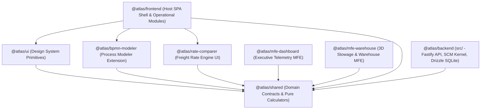

# Improvement Plan Traceability Matrix, Dependency Graph & Bounded Contexts (`P0` – `P2`)

- **Status:** `Active`
- **Owner:** Platform Architecture & Governance
- **Last Reviewed:** 2026-11-16
- **Persistence Standard:** 100% SQLite WAL + `@libsql/client` + Drizzle ORM ([ADR 0009](../adr/0009-sqlite-wal-mandatory-foreign-keys.md))

---

## 1. Execution Matrix (`P0.1` – `P2.5`)

| ID | Initiative | Priority | Status | Authoritative Implementation & CI Verification |
|---|---|---|---|---|
| **P0.1** | Stabilize `main` branch | Critical | ✅ Completed | [`.github/workflows/ci.yml`](../../.github/workflows/ci.yml), `concurrency.cancel-in-progress`, separated PR/Release/Pages/Security workflows |
| **P0.2** | Consolidate SQLite/libSQL | Critical | ✅ Completed | [`src/db/index.ts`](../../src/db/index.ts) (`createConfiguredSqliteClient`), [ADR 0009](../adr/0009-sqlite-wal-mandatory-foreign-keys.md), [`scripts/check-legacy-docs.mjs`](../../scripts/check-legacy-docs.mjs) |
| **P0.3** | Harden Drizzle migrations | Critical | ✅ Completed | [`tests/db-reproducibility-and-integrity.test.ts`](../../tests/db-reproducibility-and-integrity.test.ts) (empty DB creation, ordered apply, idempotency, FK integrity) |
| **P0.4** | Automate DDL drift detection | Critical | ✅ Completed | [`scripts/check-ddl-drift.mjs`](../../scripts/check-ddl-drift.mjs) (`pnpm run audit:ddl-drift` in CI) |
| **P0.5** | Verify backup & restoration | Critical | ✅ Completed | [`scripts/test-sqlite-backup-restore.mjs`](../../scripts/test-sqlite-backup-restore.mjs) (`VACUUM INTO`, `.meta.json` schema tag, SHA-256 parity) & [`docs/runbooks/DISASTER_RECOVERY.md`](../runbooks/DISASTER_RECOVERY.md) |
| **P0.6** | Enforce Org & Station isolation | Critical | ✅ Completed | [`src/middleware/station-context.ts`](../../src/middleware/station-context.ts), [`tests/station-context-middleware.test.ts`](../../tests/station-context-middleware.test.ts), [`tests/scm-cockpit-station-scoping.test.ts`](../../tests/scm-cockpit-station-scoping.test.ts) |
| **P0.7** | Validate secrets & log redaction | Critical | ✅ Completed | [`scripts/check-sensitive-leaks.cjs`](../../scripts/check-sensitive-leaks.cjs) (`SECRET_API_TOKEN`, `PROHIBITED_ENV_FILE`), Pino `redact` in [`src/config/logger.ts`](../../src/config/logger.ts) |
| **P1.1** | Clean repository root | High | ✅ Completed | Only 6 canonical docs in root; all docs organized in Diátaxis quadrants under `docs/` |
| **P1.2** | Establish documentation hierarchy | High | ✅ Completed | Canonical index in [`docs/README.md`](../README.md), [`scripts/check-markdown-links.mjs`](../../scripts/check-markdown-links.mjs) (`131/131` verified) |
| **P1.3** | Monorepo dependency graph | High | ✅ Completed | Documented in Section 2 below; zero circular dependencies across workspace packages |
| **P1.4** | Enforce architectural boundaries | High | ✅ Completed | `no-restricted-imports` in [`eslint.config.js`](../../eslint.config.js) isolating `src/scm/**` and `src/scm/engines/**` |
| **P1.5** | Classify bounded contexts | High | ✅ Completed | Documented in Section 3 below (`Core`, `Supporting`, `Generic`) |
| **P1.6** | Consolidate test strategy | High | ✅ Completed | Unit, SQLite/Drizzle integration, and Playwright E2E suites separated in `vitest.config.ts` & `playwright.config.ts` |
| **P1.7** | Simplify Docker | High | ✅ Completed | Multi-stage non-root Dockerfiles, embedded SQLite volume (`backend_data`), `observability` profile in [`docker-compose.prod.yml`](../../docker-compose.prod.yml) |
| **P2.1** | Centralize & validate env vars | Medium | ✅ Completed | [`src/config/env.ts`](../../src/config/env.ts) (`ENV_CONTRACT_CATALOG` + `validateEnv`) & [`tests/env-contract-validation.test.ts`](../../tests/env-contract-validation.test.ts) |
| **P2.2** | Consolidate observability | Medium | ✅ Completed | `@prometheus-io/client` in [`src/monitoring/metrics.ts`](../../src/monitoring/metrics.ts), OpenTelemetry tracing, Grafana Cloud (`cheerfulmole1135-prom`) & Assistant (`1917865`) |
| **P2.3** | Govern dependencies & supply chain | Medium | ✅ Completed | [`.github/workflows/dependency-review.yml`](../../.github/workflows/dependency-review.yml), [`.github/workflows/scorecard.yml`](../../.github/workflows/scorecard.yml), SLSA v1.0 provenance |
| **P2.4** | Establish performance budgets | Medium | ✅ Completed | Bundle/PWA gate in [`.github/workflows/pages-deploy.yml`](../../.github/workflows/pages-deploy.yml), ADR 0020 file size gate (`<1,000` lines), Section 4 below |
| **P2.5** | Automate documentation quality | Medium | ✅ Completed | `pnpm run audit:links` + `pnpm run audit:legacy-docs` executed on every push and PR in `ci.yml` |

---

## 2. Monorepo Package Dependency Graph & Responsibility Map (`P1.3`)

| Package / Layer | Path | Responsibility Classification | Allowed Internal Dependencies |
|---|---|---|---|
| `@atlas/shared` | `packages/shared` | **Domain & Contracts** (ISO 6346, FuelEU, USMCA, e-Firma, Risk Scorer) | None (Leaf package, 0 internal dependencies) |
| `src/scm/engines` | `src/scm/engines` | **Pure Domain Engines** (Tariffs, Customs, Green Compliance, Stowage) | `@atlas/shared` only (No Drizzle, No Fastify) |
| `src/scm/kernel` | `src/scm/kernel` | **Application & CQRS Projection Kernel** (Transactional Outbox, BFF) | `src/scm/engines`, `src/db`, `@atlas/shared` |
| `src/db` | `src/db` | **Infrastructure / Persistence** (SQLite WAL, Drizzle Schema, Seeds) | `@atlas/shared` |
| `src/routes` & `src/modules` | `src/routes`, `src/modules` | **Application / API Controllers** (Fastify HTTP, Station Context Guards) | `src/scm`, `src/db`, `src/middleware`, `@atlas/shared` |
| `@atlas/ui` | `packages/ui` | **Interface Primitives** (Shared accessible React components) | `@atlas/shared` |
| `@atlas/frontend` | `packages/frontend` | **Interface Host Application** (SPA Shell, Cockpit, 360 Workspace) | `@atlas/shared`, `@atlas/ui`, `@atlas/bpmn-modeler`, `@atlas/rate-comparer` |

---

## 3. Bounded Context Maturity Classification (`P1.5`)

| Bounded Context | Category | Implementation Status | Persistence Scope | Conceptual Owner |
|---|---|---|---|---|
| **Shipment Workspace 360 & Milestones** | **Core** | Production (`sh_demo_01` canonical flow) | `shipments`, `containers`, `shipment_events` | Operations & Visibility |
| **DCSA Ocean Booking & Cut-Off Radar** | **Core** | Production ([ADR 0012](../adr/0012-dcsa-booking-and-fmc-demurrage-resolution.md)) | `ocean_bookings`, `cutoffs` | Carrier Management |
| **Enterprise Organization & Station Scoping** | **Core** | Production ([ADR 0022](../adr/0022-enterprise-freight-forwarding-organization-schema-and-governance.md)) | `organizations`, `branch_offices`, `user_station_assignments` | Platform Governance |
| **Canonical Trading Partner Registry (`addresses`)** | **Core** | Production (`CAR`, `CB`, `AG`, `FWD`, `TRM`, `WH`) | `addresses`, `address_identifiers` | Master Data Governance |
| **FMC Part 541 Demurrage & Detention Disputes** | **Supporting** | Production ([ADR 0012](../adr/0012-dcsa-booking-and-fmc-demurrage-resolution.md)) | `demurrage_alerts`, `disputes` | Trade Compliance & Finance |
| **Customs Clearance, SAT e-Firma & USMCA** | **Supporting** | Production ([ADR 0011](../adr/0011-webcrypto-sat-efirma-and-mletr-blockchain.md)) | `customs_declarations`, `documents` | Customs Brokerage |
| **FuelEU Maritime, EU ETS & Carbon Insetting** | **Supporting** | Production ([ADR 0017](../adr/0017-fueleu-maritime-ets-carbon-insetting.md)) | `carbon_insetting_ledger`, `emissions` | ESG & Sustainability |
| **B2B EDI (EDIFACT), DCSA eBL & IATA ONE Record** | **Supporting** | Production ([ADR 0016](../adr/0016-b2b-edi-dcsa-ebl-iata-one-record.md)) | `edi_messages`, `ebl_endorsements` | B2B Integrations |
| **Authentication (WebCrypto Scrypt/JWT) & Audit** | **Generic** | Production ([ADR 0023](../adr/0023-native-web-crypto-session-migration.md)) | `users`, `sessions`, `audit_logs` | Security & Identity |
| **Observability, Prometheus & SQLite Backups** | **Generic** | Production (`@prometheus-io/client`, `VACUUM INTO`) | `/metrics`, `data/backups` | Platform SRE |

---

## 4. Quantitative Performance & Quality Budgets (`P2.4`)

| Metric | Target Budget | Enforcement Mechanism |
|---|---|---|
| **Initial SPA `<link rel="modulepreload">` Vendor Exclusions** | `0` heavy lazy vendors (`three-`, `bpmn-`, `jspdf-`, `recharts-`, `d3-`) | Enforced in `vite.config.ts` and verified in [`.github/workflows/pages-deploy.yml`](../../.github/workflows/pages-deploy.yml) |
| **PWA Icon Payload & Format** | Valid PNG (`89504e47`), `< 250 KB` per icon | Enforced in [`.github/workflows/pages-deploy.yml`](../../.github/workflows/pages-deploy.yml) |
| **Frontend Page Module Complexity (ADR 0020)** | Strictly `< 1,000` lines per page module (`packages/frontend/src/pages/*.tsx`) | Enforced via `node scripts/check-file-sizes.mjs` and `tests/check-file-sizes.test.ts` |
| **SQLite WAL Online Backup (`VACUUM INTO`)** | `< 2,000 ms` on development/test dataset, `0` FK violations | Enforced in CI via `pnpm run test:backup-restore` |
| **SQLite Busy Lock Timeout** | `5,000 ms` (`PRAGMA busy_timeout = 5000`) | Enforced in `src/db/index.ts` and alerted in `grafana/provisioning/alerting/rules.yml` |
