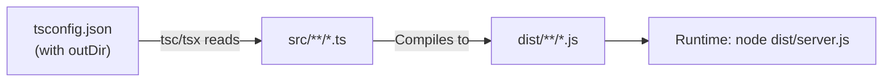
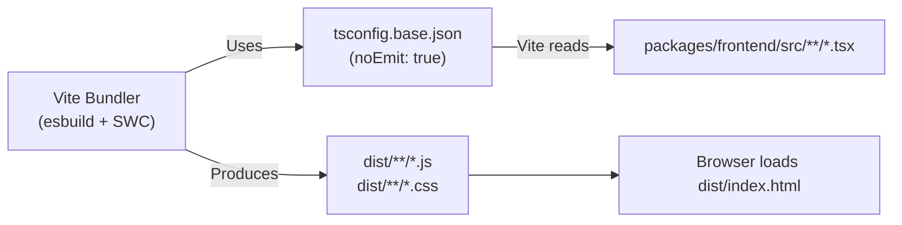

# TypeScript Configuration Guide

This guide explains the TypeScript configuration setup in Atlas Logistics monorepo and how each config is used.

## Overview

The project uses **two TypeScript config files** with different purposes:

```
├── tsconfig.json          ← Backend configuration
├── tsconfig.base.json     ← Base/Frontend configuration
└── packages/*/tsconfig.json (if present)
```

---

## `tsconfig.json` (Backend)

**Used By:** Backend server (`src/`, `drizzle/`, `tests/`)

**Location:** Repository root

**Contents:**
```json
{
  "compilerOptions": {
    "target": "ES2022",
    "module": "ESNext",
    "moduleResolution": "Bundler",
    "strict": true,
    "outDir": "./dist",
    "include": [
      "src/**/*",
      "tests/**/*",
      "drizzle.config.ts",
      "vite.config.ts",
      "vitest.config.ts"
    ]
  }
}
```

**Key Features:**
- ✅ `outDir: "./dist"` — Compiles backend to `dist/` directory
- ✅ `moduleResolution: "Bundler"` — Modern module resolution
- ✅ `target: "ES2022"` — Modern JavaScript output
- ✅ `strict: true` — All type-checking flags enabled

**When It's Used:**
- Running `pnpm run type-check:backend`
- Running `pnpm run build` (Turbo uses this for backend packages)
- Running backend in production (tsx reads type info)

**Example:**
```bash
pnpm run type-check:backend
# ✅ Uses tsconfig.json to type-check src/**/*.ts
```

---

## `tsconfig.base.json` (Base/Frontend)

**Used By:** Frontend (`packages/frontend/`, `packages/ui/`, `packages/shared/`)

**Location:** Repository root

**Contents:**
```json
{
  "compilerOptions": {
    "target": "ES2022",
    "module": "ESNext",
    "moduleResolution": "bundler",
    "strict": true,
    "noEmit": true,
    "lib": ["ES2022", "DOM", "DOM.Iterable"],
    "useDefineForClassFields": true,
    "allowImportingTsExtensions": true,
    "allowArbitraryExtensions": true,
    "resolveJsonModule": true,
    "isolatedModules": true,
    "noUnusedLocals": true,
    "noUnusedParameters": true,
    "noFallthroughCasesInSwitch": true
  }
}
```

**Key Features:**
- ✅ `noEmit: true` — **No compiled output** (Vite handles compilation)
- ✅ `allowImportingTsExtensions: true` — Allows `.ts` imports (for monorepo)
- ✅ `noUnusedLocals: true` — Warns about unused variables
- ✅ `isolatedModules: true` — Each file is compilable in isolation (Vite requirement)
- ❌ NO `outDir` — Frontend is compiled by Vite, not tsc

**When It's Used:**
- Running `pnpm run type-check` (frontend type-check)
- Running `pnpm --filter @atlas/frontend type-check`
- Running `pnpm --filter @atlas/ui type-check`
- Vite build process (references this config implicitly)

**Example:**
```bash
pnpm run type-check
# ✅ Uses tsconfig.base.json to type-check frontend packages
# ✅ No compiled output created
```

---

## Why Two Configs?

### Difference #1: `noEmit`

| Config | noEmit | Reason |
|--------|--------|--------|
| `tsconfig.json` | ❌ No (implicit: false) | Backend is compiled to `dist/` |
| `tsconfig.base.json` | ✅ Yes | Vite handles frontend compilation |

**Backend (tsconfig.json):**
```bash
tsc --noEmit false
# Creates: dist/server.ts → dist/server.js
```

**Frontend (tsconfig.base.json):**
```bash
tsc --noEmit true
# Creates: NOTHING (Vite compiles instead)
```

### Difference #2: Module Resolution

| Config | moduleResolution | outDir | Target Usage |
|--------|------------------|--------|--------------|
| `tsconfig.json` | Bundler | `./dist` | Node.js backend (runtime compilation with tsx) |
| `tsconfig.base.json` | bundler | None | Browsers (compiled by Vite) |

---

## File Inclusion/Exclusion

### `tsconfig.json` (Backend) — What Gets Checked

```json
"include": [
  "src/**/*",          // ✅ Backend source code
  "tests/**/*",        // ✅ Backend tests
  "drizzle.config.ts", // ✅ Database config
  "vite.config.ts",    // ✅ Vite config (for frontend assets)
  "vitest.config.ts"   // ✅ Test runner config
]
```

### `tsconfig.base.json` (Frontend) — What Gets Excluded

```json
{
  "ignores": [
    "**/dist/**",
    "**/node_modules/**",
    "**/coverage/**",
    ".turbo/**",
    "packages/**"  // ← In eslint.config.js
  ]
}
```

Frontend packages are checked individually with:
```bash
pnpm --filter @atlas/frontend type-check
pnpm --filter @atlas/ui type-check
pnpm --filter @atlas/shared type-check
```

---

## How the Build Process Uses Each Config

### Backend Build (TypeScript → JavaScript)



**Command:**
```bash
pnpm run build:backend
# 1. Reads tsconfig.json
# 2. Compiles src/**/*.ts → dist/**/*.js
# 3. Result: dist/server.js ready for production
```

### Frontend Build (Vite + TypeScript)



**Command:**
```bash
pnpm --filter @atlas/frontend build
# 1. Vite reads tsconfig.base.json
# 2. Transpiles + bundles packages/frontend/src/**/*.tsx
# 3. Result: packages/frontend/dist/ ready for nginx
```

---

## Type-Checking Command Reference

| Command | Config Used | Output | Purpose |
|---------|------------|--------|---------|
| `pnpm run type-check:backend` | tsconfig.json | None (check only) | Backend type-check |
| `pnpm run type-check` | tsconfig.base.json | None (check only) | Frontend type-check |
| `pnpm --filter @atlas/frontend type-check` | tsconfig.base.json | None | UI package type-check |
| `pnpm --filter @atlas/ui type-check` | tsconfig.base.json | None | Shared components |
| `pnpm run build` | Both (Turbo orchestrates) | dist/ + dist/ | Full monorepo build |

---

## Strict Mode Across Configs

Both configs enable `strict: true` (all of):

```json
{
  "compilerOptions": {
    "strict": true
  }
}
```

This enables:
- ✅ `noImplicitAny: true` — No `any` without explicit annotation
- ✅ `strictNullChecks: true` — `null` / `undefined` must be explicit
- ✅ `strictFunctionTypes: true` — Function parameter types must match exactly
- ✅ `strictBindCallApply: true` — `.bind()` / `.call()` type-checked
- ✅ `strictPropertyInitialization: true` — All properties must be initialized
- ✅ `noImplicitThis: true` — `this` must have explicit type
- ✅ `alwaysStrict: true` — "use strict" in all files

---

## Monorepo-Specific Settings

### `allowImportingTsExtensions` (Frontend Config)

Allows imports like:
```typescript
// ✅ Valid in packages/frontend/
import { someFunction } from "@atlas/ui/src/index.ts"  // .ts extension allowed
```

Necessary because Vite loads TypeScript files directly (no compilation step for imports).

### `isolatedModules` (Frontend Config)

Ensures each `.ts` file can be compiled in isolation without cross-file dependencies. Required by Vite and esbuild.

**Why it matters:**
```typescript
// ❌ Not allowed (violates isolatedModules):
export const x = 5;
export namespace NS { export type T = typeof x; }  // Type reference across file boundaries

// ✅ Allowed:
export type T = number;
```

---

## Troubleshooting

### Issue: "Cannot find module" Error in Backend

**Cause:** Backend uses `tsconfig.json`, which doesn't have Vite's import extensions.

**Fix:** Use proper module paths:
```typescript
// ❌ Wrong (works in frontend, fails in backend):
import { helper } from "@atlas/shared/src/index.ts"

// ✅ Correct (works everywhere):
import { helper } from "@atlas/shared"  // Uses package.json "main"
```

### Issue: Frontend Type-Check Fails

**Cause:** Frontend uses `tsconfig.base.json` (stricter), but `noEmit: true`.

**Fix:** Errors are type-check only, won't affect runtime:
```bash
pnpm --filter @atlas/frontend type-check
# ❌ ERROR: Property 'x' is missing in type 'Props'
# → Fix type annotations, don't ignore errors
```

### Issue: ESLint Says "Project not found" During Lint

**Cause:** ESLint config points to wrong `tsconfig.json`

**Fix in `eslint.config.js`:**
```javascript
languageOptions: {
  parserOptions: {
    project: ["./tsconfig.json"],  // Backend project
    tsconfigRootDir: import.meta.dirname,
  },
}
```

---

## Best Practices

### When Adding a New Backend Service

1. Keep using `tsconfig.json`
2. Add path to `include` if it's a new root directory:
   ```json
   {
     "include": ["src/**/*", "services/**/*"]  // Add here
   }
   ```

### When Adding a New Frontend Package

1. Use `tsconfig.base.json` as base
2. Can extend with `extends: "../../tsconfig.base.json"` in package-specific config
3. Always set `noEmit: true` for frontend packages

### When Setting `noUnusedLocals`

- ✅ **Frontend:** Has `noUnusedLocals: true` → Warnings enforced
- ❌ **Backend:** Does NOT have `noUnusedLocals` → Disabled by ESLint instead

If backend needs unused variable checks, use ESLint rule:
```javascript
"@typescript-eslint/no-unused-vars": "warn"
```

---

## Configuration Inheritance

```
tsconfig.base.json
  ├─ Used by: frontend, ui, shared packages
  └─ Inherited by: packages/*/tsconfig.json (if extends it)

tsconfig.json
  ├─ Used by: backend, root-level tools
  └─ NOT inherited by: packages/**/*.json
```

---

## Summary

| Aspect | Backend (tsconfig.json) | Frontend (tsconfig.base.json) |
|--------|------------------------|------------------------------|
| **Module Compilation** | ✅ Compiles to `dist/` | ❌ Vite compiles (noEmit: true) |
| **Runtime** | Node.js + tsx | Browser + Vite |
| **Type-Check Mode** | `tsc --noEmit false` | `tsc --noEmit true` |
| **Module Resolution** | Node.js (Bundler) | ES Modules (Bundler) |
| **Unused Vars** | ESLint rule | TypeScript (`noUnusedLocals`) |
| **Use `any` Type** | ESLint warns | TypeScript warns (strict mode) |

---

**Last Updated:** 2025-01-15  
**For Questions:** Check individual package's `tsconfig.json` or run `pnpm run type-check` to see which config is being used.

