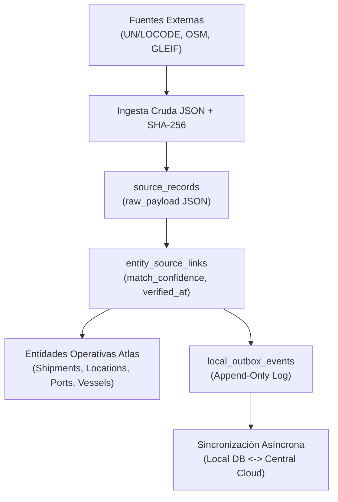

# Especificación Técnica: External Data Governance & Resilient Offline Synchronization

> **Cuadrante Diátaxis**: Referencia y Especificación Técnica (`docs/superpowers/specs/`)  
> **ADR Vinculante**: [ADR 0021: Gobierno Ágil de Datos Externos, Vinculación de Entidades y Metodología Offline Resiliente](../../adr/0021-external-data-governance-and-licensing.md)  
> **Estado**: Aprobado  

---

## 1. Alcance y Arquitectura Lean

El módulo de **External Data Governance** en Atlas Logistics se focaliza en resolver la necesidad operativa crítica: vincular contenedores, expedientes, terminales y buques con fuentes externas canónicas (UN/LOCODE, OpenStreetMap, GeoNames, GLEIF, IMO) a coste cero, con rendimiento en memoria y persistencia offline resiliente.

---

## 2. Esquema Relacional Lean (3 Tablas)

Ubicado en `src/db/schema/external_governance.ts`, respaldado por SQLite en modo WAL y claves foráneas activas (`PRAGMA foreign_keys = ON;`).

### 2.1 `data_sources`
Catálogo de autoridades y proveedores de datos externos:
- `id`: `text("id").primaryKey()`
- `code`: `text("code").notNull().unique()` (ej. `UNLOCODE`, `OPENSTREETMAP`, `GEONAMES`, `GLEIF`, `IMO_GISIS`)
- `name`: `text("name").notNull()`
- `type`: `text("type").notNull().default("OPEN_DATA")` (`OPEN_DATA`, `AUTHORITY`, `COMMERCIAL_API`, `REGULATORY`)
- `websiteUrl`: `text("website_url")`
- `termsUrl`: `text("terms_url")`
- `description`: `text("description")`
- `...commonAuditFields`

### 2.2 `source_records`
Registros crudos extraídos de fuentes externas (Zero BLOBs, JSON Mode):
- `id`: `text("id").primaryKey()`
- `sourceId`: `text("source_id").notNull().references(() => dataSources.id)`
- `externalId`: `text("external_id").notNull()` (ej. `ESBCN`, `NLRTM`, `node/123456`)
- `sourceUrl`: `text("source_url")`
- `rawPayload`: `text("raw_payload", { mode: "json" }).notNull()`
- `normalizedPayload`: `text("normalized_payload", { mode: "json" })`
- `sha256Hash`: `text("sha256_hash").notNull()`
- `retrievedAt`: `integer("retrieved_at", { mode: "timestamp" }).notNull()`
- `versionTag`: `text("version_tag")`
- `...commonAuditFields`
- Índice compuesto: `(source_id, external_id)`

### 2.3 `entity_source_links`
Cruce semántico directo entre el dato externo y la entidad operativa:
- `id`: `text("id").primaryKey()`
- `entityType`: `text("entity_type").notNull()` (`PORT`, `LOCATION`, `VESSEL`, `CARRIER`, `SHIPMENT`, `CONTAINER`)
- `entityId`: `text("entity_id").notNull()` (UUID o ID de negocio en Atlas Logistics)
- `sourceRecordId`: `text("source_record_id").notNull().references(() => sourceRecords.id)`
- `matchConfidence`: `real("match_confidence").notNull().default(1.0)` (0.0 a 1.0)
- `matchMethod`: `text("match_method").notNull().default("EXACT_CODE")` (`EXACT_CODE`, `FUZZY_NAME`, `GEO_PROXIMITY`, `MANUAL`)
- `verifiedAt`: `integer("verified_at", { mode: "timestamp" }).notNull()`
- `verifiedBy`: `text("verified_by")`
- `...commonAuditFields`
- Índice: `(entity_type, entity_id)`

---

## 3. Principios Operativos de Base de Datos y Offline

### 3.1 Event Sourcing y Outbox Append-Only
- Las mutaciones de vínculos y registros emiten eventos en `scmOutboxMessages`:
  - `external_data.record_ingested`: Registro de nuevo dato crudo.
  - `external_data.entity_linked`: Vinculación de un registro con una entidad de Atlas.
- La sincronización offline entre instancias locales y sistemas consolidados opera reproduciendo el log inmutable de eventos, eliminando colisiones de `UPDATE` sobre claves primarias.

### 3.2 Gestión Documental: Rutas Relativas y Garbage Collector
- La tabla `documents` almacena únicamente rutas relativas (`/api/documents/download/...`) y hashes SHA-256.
- El script `src/scripts/documents-garbage-collector.ts` audita periódicamente el directorio físico `DOCS_ROOT` contra la tabla SQLite y purga archivos no referenciados o marcados como `is_deleted = 1`.

### 3.3 Write-Through Cache en Memoria
- El motor de UN/LOCODE (`packages/shared/src/unlocode.ts`) implementa el método `upsertEntry(entry)`.
- Al persistir un nuevo puerto o ubicación en SQLite, se actualiza simultáneamente el árbol Trie y el caché LRU en la memoria de Fastify sin requerir reinicios.

### 3.4 Backup Transaccional Seguro (`VACUUM INTO`)
- El script de respaldo `src/scripts/backup-db.js` ejecuta `VACUUM INTO` sobre la conexión de SQLite para generar una instantánea limpia y consistente bajo el modo WAL.
